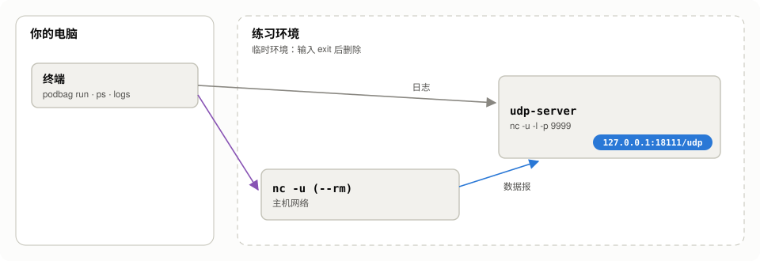

大多数服务器使用 TCP，但有些使用 UDP，例如 DNS 和许多游戏。UDP 不建立连接，只发送单条消息，这种消息叫数据报。在 `-p` 的末尾加上 `/udp`，就能发布 UDP 端口。在本模块中，你将运行一个小型 UDP 服务器，并向它发送一条消息。

**预计用时** 10 分钟。



## 开始模块

在 Podbag Desktop 中打开 **Training**，选择**发布 UDP 端口**。点击**刷新**后会出现新模块。也可以在终端中运行以下命令：

```sh
podbag lab start udp-ports
```

需要带有 Training 目录的 Podbag 版本（v0.3.2 之后）。出现 `training $` 提示符后继续。

## 拉取 busybox 镜像

```sh
podbag pull docker.io/library/busybox:1.37.0
```

Podbag 会检查镜像是否存在。

## 运行 UDP 服务器

`nc -u -l -p 9999` 在端口 `9999` 上等待 UDP 数据报，并打印收到的内容。`-p 127.0.0.1:18111:9999/udp` 把这个端口发布到你的电脑上。没有 `/udp`，端口就是 TCP。

```sh
podbag run -d --name udp-server -p 127.0.0.1:18111:9999/udp docker.io/library/busybox:1.37.0 nc -u -l -p 9999
```

下面的命令会使用这个端口。如果 `18111` 已被占用，Training 会显示使用其他端口的命令，请从 Training 复制。Podbag 会检查 `udp-server` 是否正在运行。

## 查看 UDP 端口

```sh
podbag ps
```

**PORTS** 列显示 `127.0.0.1:18111->9999/udp`。Podbag 会检查是否有这段文字。

## 发送数据报

客户端是另一个容器。`--network host` 让它进入引擎所在主机的网络。在那里，`127.0.0.1:18111` 就是发布的端口，和你电脑上的程序看到的一样。`nc -u -w 1` 发送一行内容，并在一秒后停止。

```sh
podbag run --rm --network host docker.io/library/busybox:1.37.0 sh -c 'echo "Hello over UDP" | nc -u -w 1 127.0.0.1 18111'
```

UDP 不会回复，所以这条命令没有输出。Podbag 会检查服务器是否仍在运行。

## 在日志中读取数据报

服务器打印了它收到的内容。日志中可以看到。

```sh
podbag logs udp-server
```

输出为 `Hello over UDP`。Podbag 会检查这一行。

在 macOS 上，发布的 UDP 端口也能像 TCP 端口一样，通过 Mac 的 `localhost` 访问。UDP 客户端的数据流在 90 秒没有流量后会结束。

## 清理并结束

删除服务器。它仍在运行，所以 `-f` 会先停止它。

```sh
podbag rm -f udp-server
exit
```

临时练习环境会被删除。Training 会显示该模块已完成。
