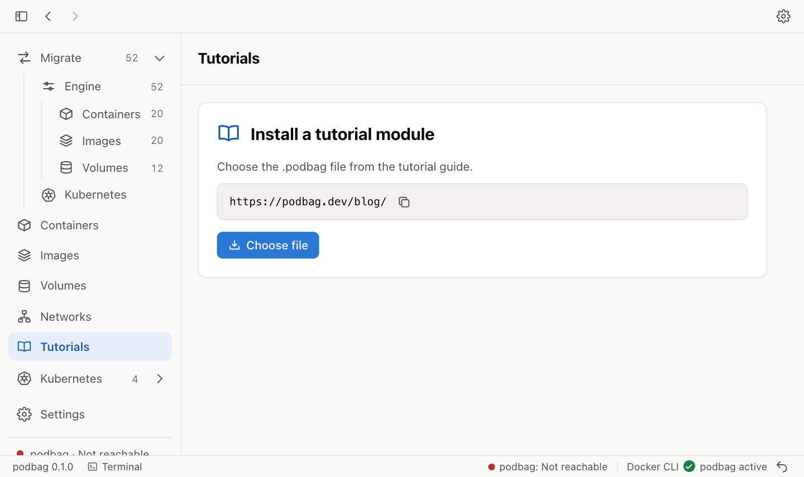
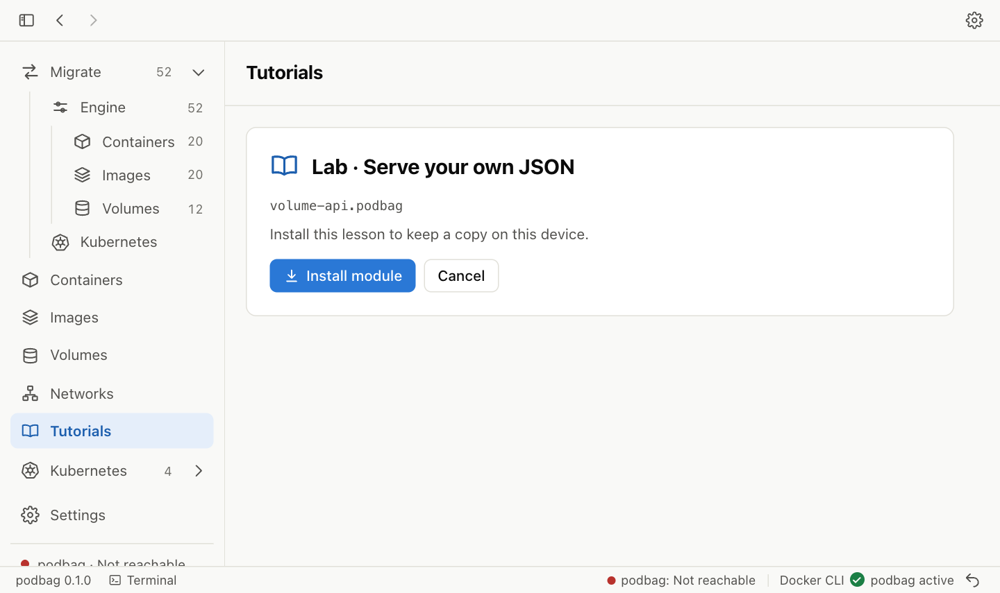
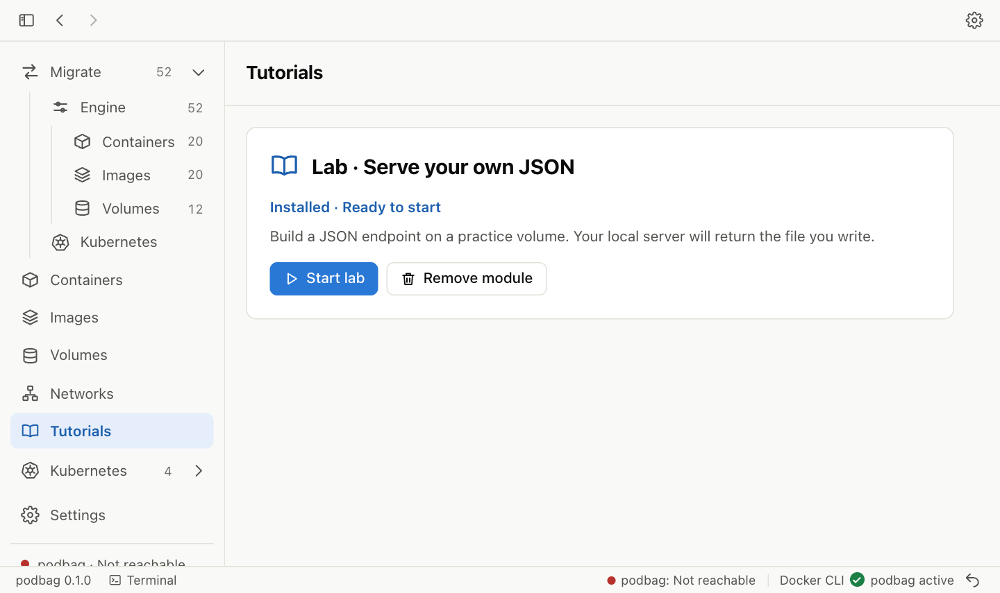
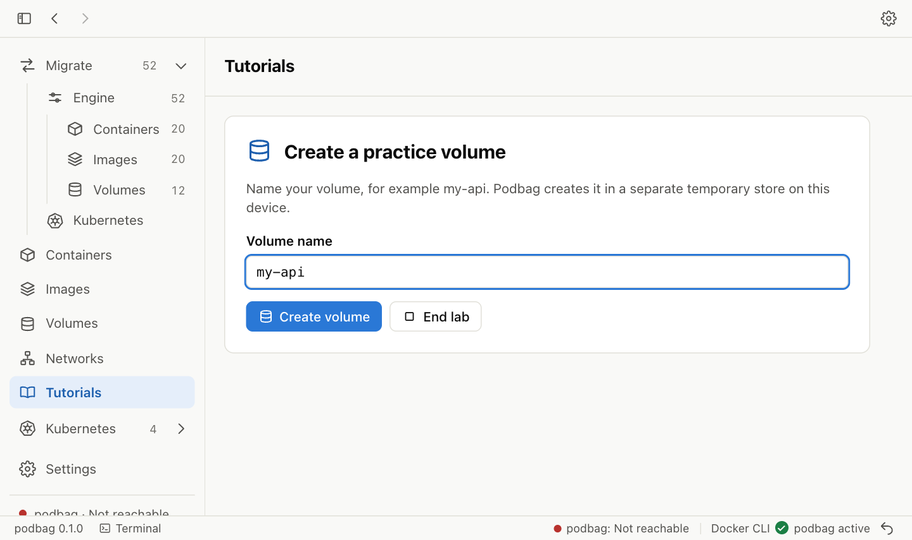
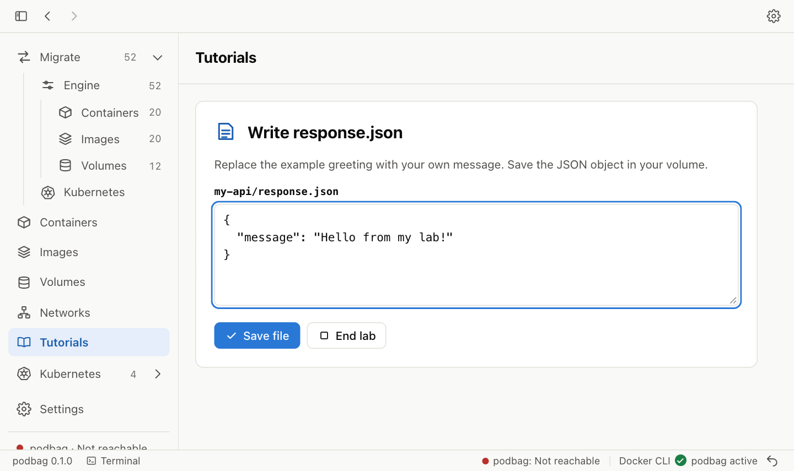
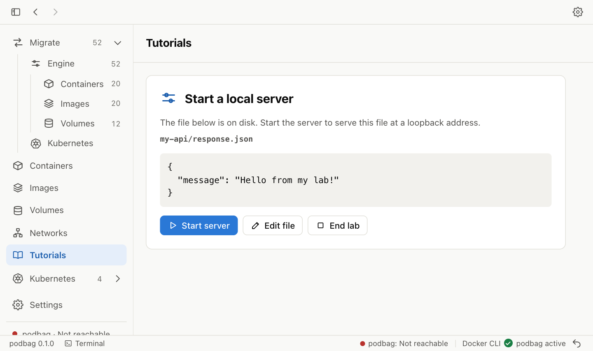
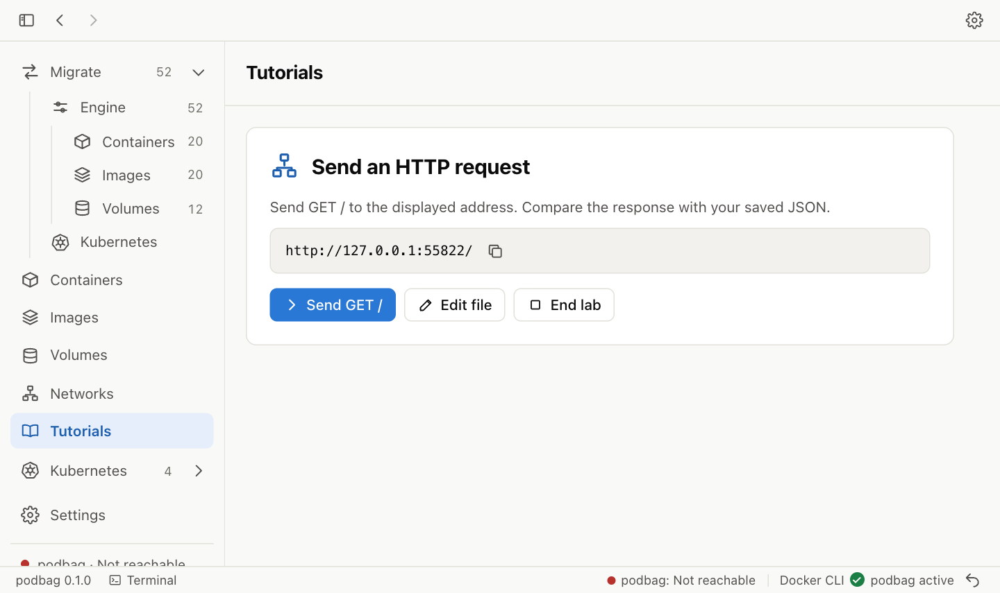
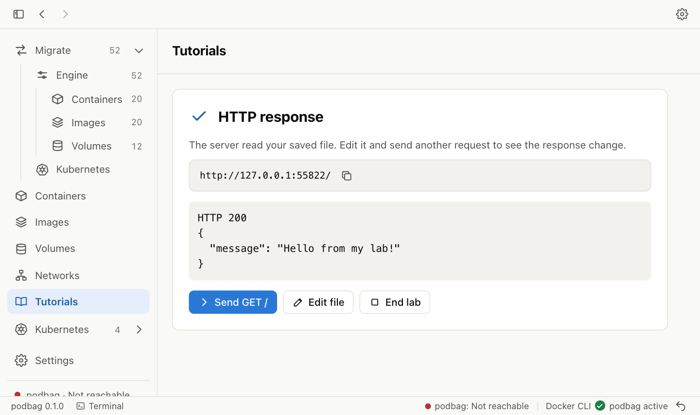
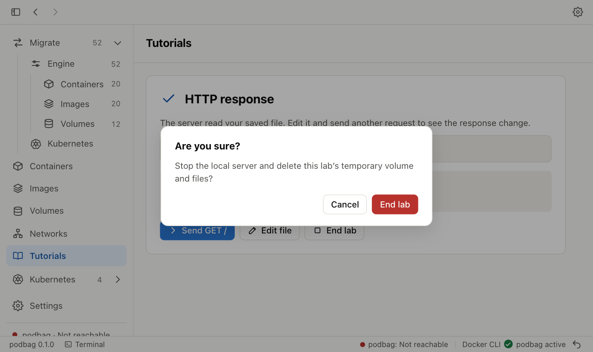

Use a build of Podbag Desktop with **Tutorials** in the sidebar. The lab uses a temporary store on your computer. You can run it without a container engine connection or an image download.

[Download the lab module](volume-api.podbag)

Save `volume-api.podbag` somewhere you can find it from the app.

## Open Tutorials

Select **Tutorials** in the left sidebar. The first visit opens the module installer.

## Choose the module

Click **Choose file** and open `volume-api.podbag` from your downloads. Check the lab title and file name before installing.

## Install and start the lab

Click **Install module**. When the module shows **Installed · Ready to start**, click **Start lab**. The app creates an empty workspace for this session.

## Create a volume

A volume stores files. Enter `my-api` in **Volume name** and click **Create volume**. The next screen shows `my-api/response.json`. If you used another name, the path starts with that name.

## Write your response

In the editor, replace the value of `message` with your own greeting. Here we use `Hello from my lab!`. Keep the double quotes and braces. Click **Save file** to write it into the volume.

## Start the server

Read back the saved JSON, then click **Start server**. The app opens an HTTP listener on an available port on `127.0.0.1`.

## Request the file

Click **Send GET /** to request the root path at the displayed address. You can also copy the URL into a browser on this computer. Each session can get a different port.

## Check the response and change it

Under `HTTP 200`, compare the message with what you typed. Click **Edit file**, change your greeting and save. Send another request to the same URL and look for the new value.

## End the lab

Click **End lab**, then confirm. This stops the listener and deletes the temporary volume and its files. The module and completion record stay installed. Start another lab to get a fresh workspace.

