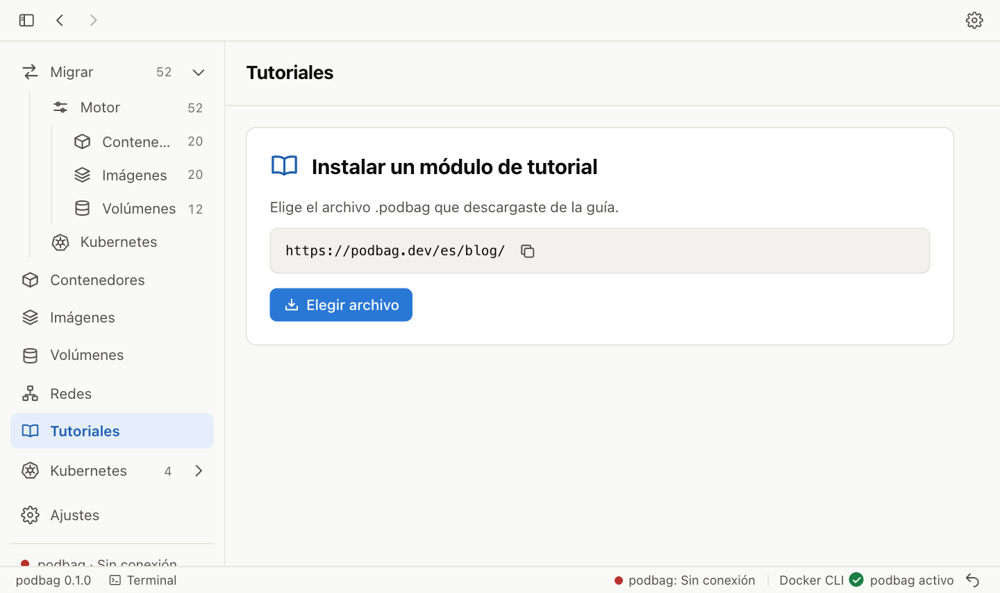
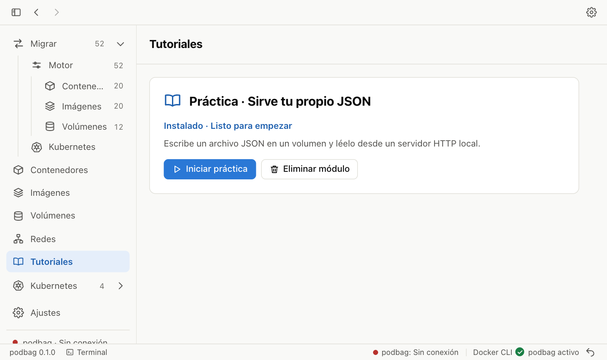
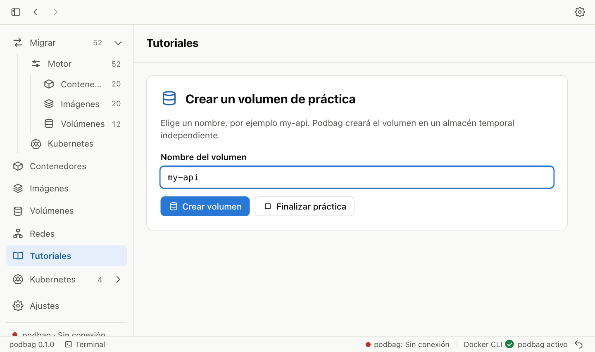
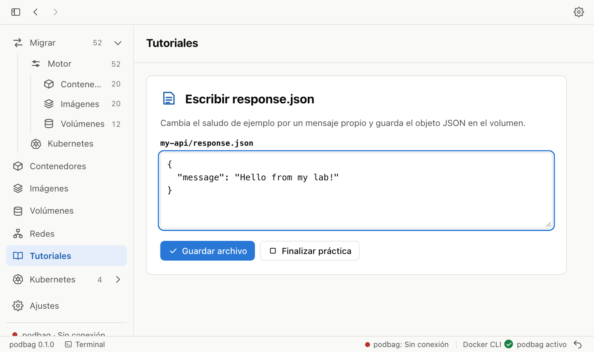
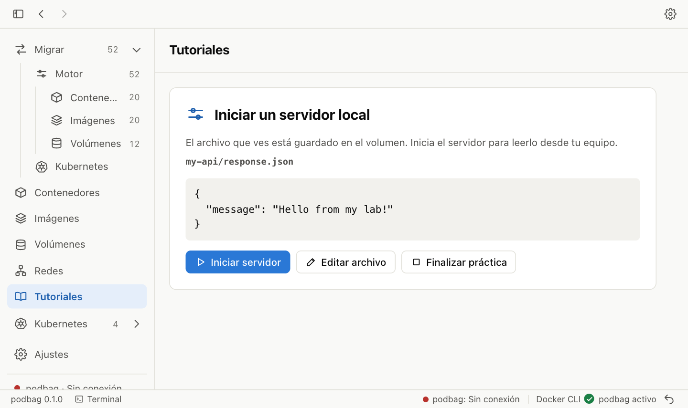
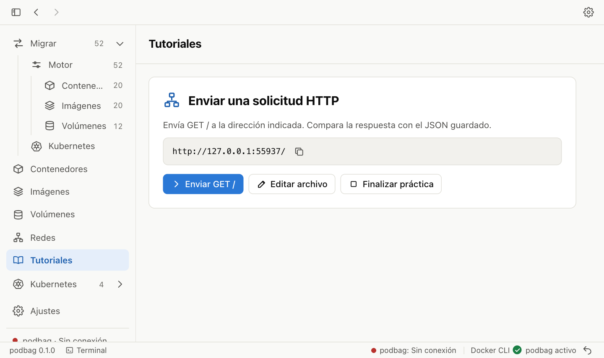
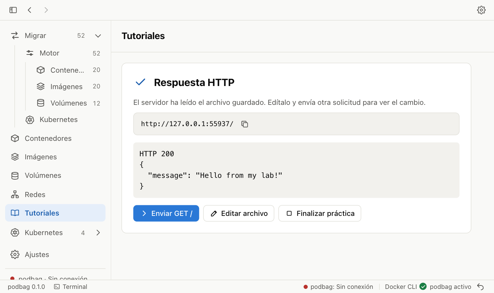
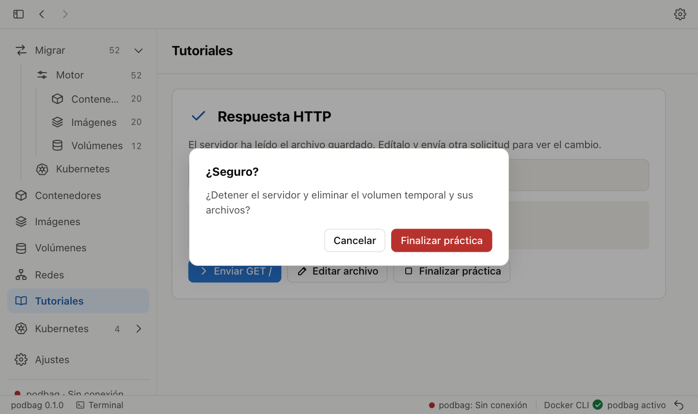

Usa una versión de Podbag Desktop con **Tutoriales** en la barra lateral. La práctica usa almacenamiento temporal local. Puedes hacerla sin descargar imágenes ni ejecutar contenedores.

[Descargar el módulo de práctica](volume-api.podbag)

Guarda `volume-api.podbag` y recuerda su ubicación.

## Abre Tutoriales

Selecciona **Tutoriales** en la barra lateral. La primera vez verás el instalador.

## Elige el módulo

Pulsa **Elegir archivo** y abre `volume-api.podbag`. Comprueba el título y el nombre antes de continuar.

## Instala e inicia la práctica

Pulsa **Instalar módulo**. Cuando aparezca como instalado, pulsa **Iniciar práctica** para abrir un espacio vacío.

## Crea un volumen

Escribe `my-api` como nombre y pulsa **Crear volumen**. El nombre aparecerá al principio de la ruta en la siguiente pantalla.

## Escribe la respuesta

Cambia el valor de `message` por tu saludo, por ejemplo `Hello from my lab!`. Conserva las comillas y las llaves. Pulsa **Guardar archivo**.

## Inicia el servidor

Revisa el JSON guardado y pulsa **Iniciar servidor**. La aplicación elige un puerto libre en `127.0.0.1`.

## Envía una solicitud

Pulsa **Enviar GET /** para leer la ruta raíz. También puedes copiar la URL en un navegador de este equipo. El puerto puede cambiar en cada sesión.

## Comprueba y modifica la respuesta

Busca tu mensaje debajo de `HTTP 200`. Pulsa **Editar archivo**, cambia el saludo y guárdalo. Envía otra solicitud a la misma URL para ver el cambio.

## Finaliza la práctica

Pulsa **Finalizar práctica** y confirma. El servidor se detiene y se eliminan el volumen temporal y sus archivos. Se conservan el módulo y el registro de finalización.

