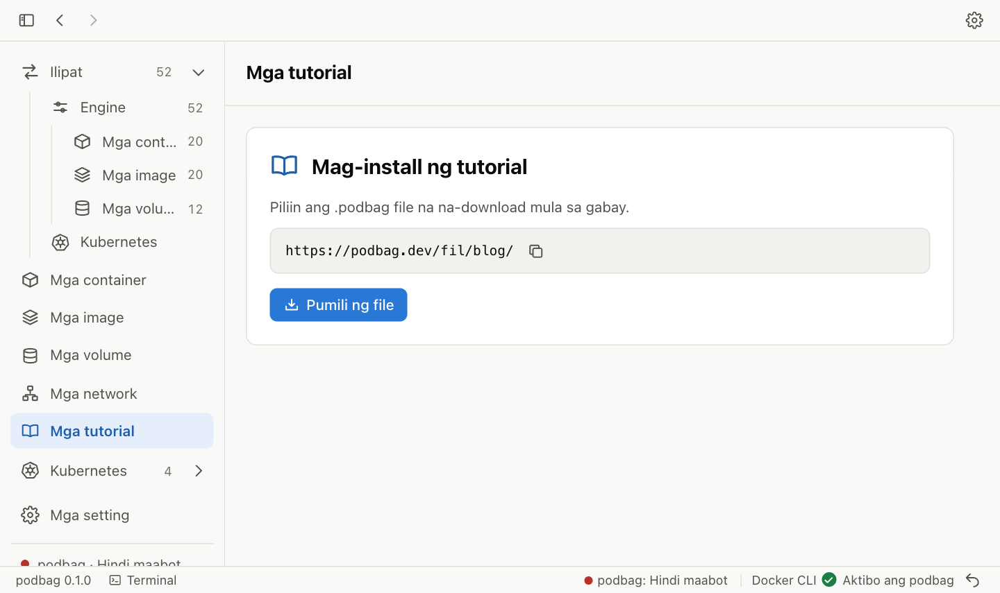
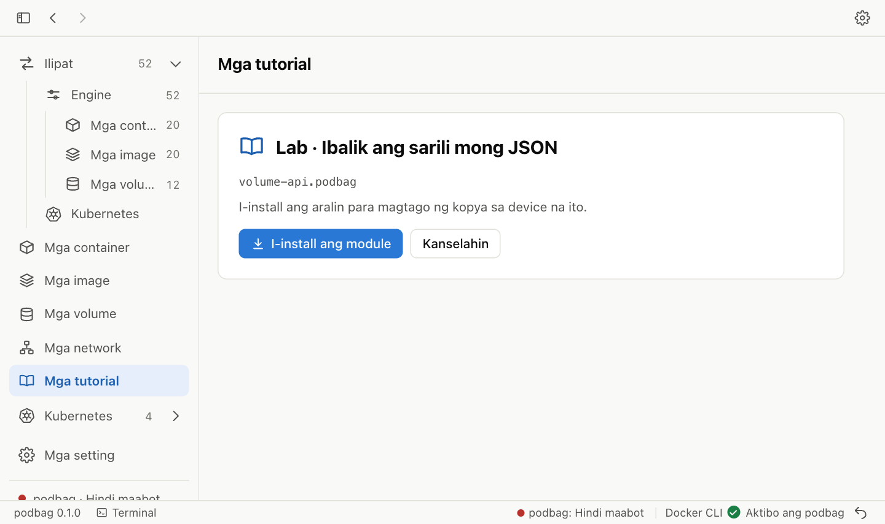
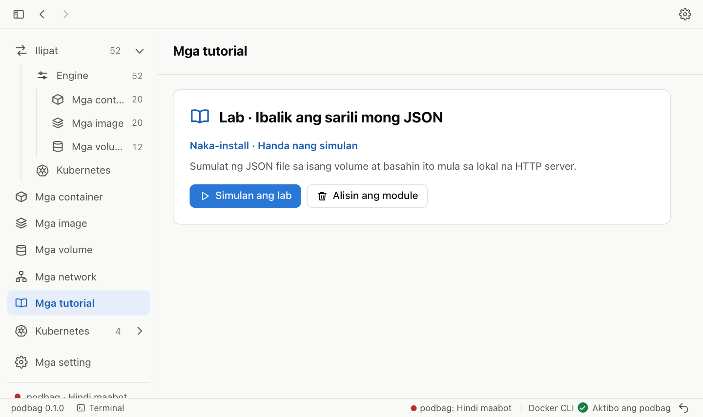
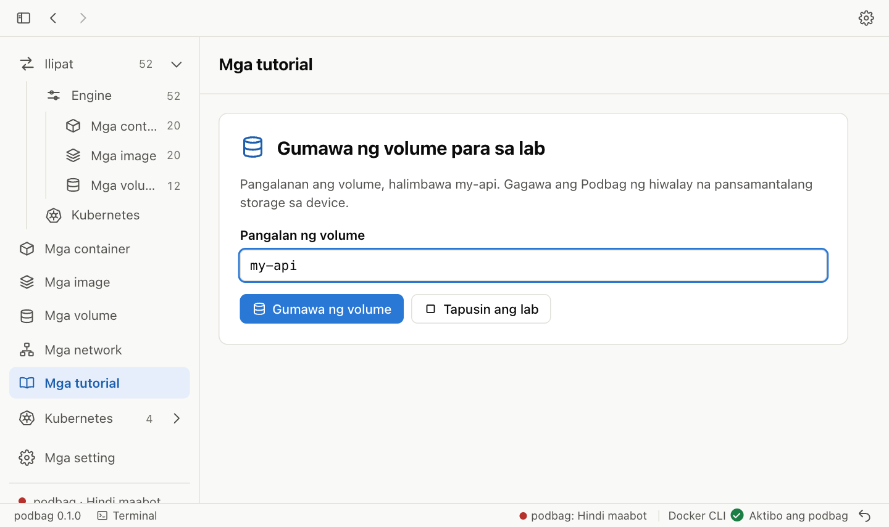
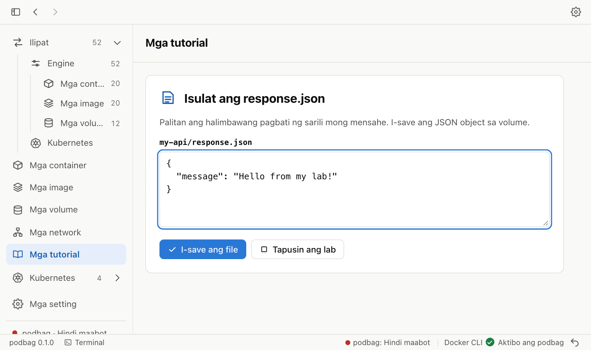
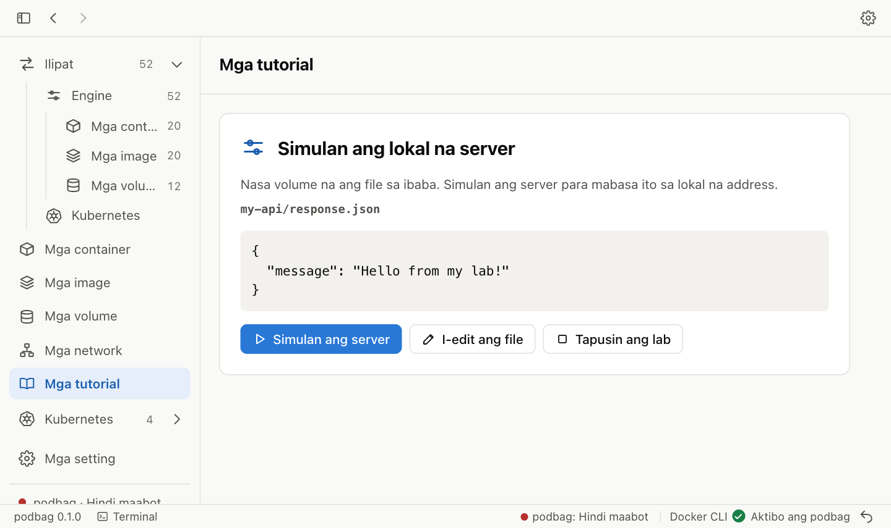
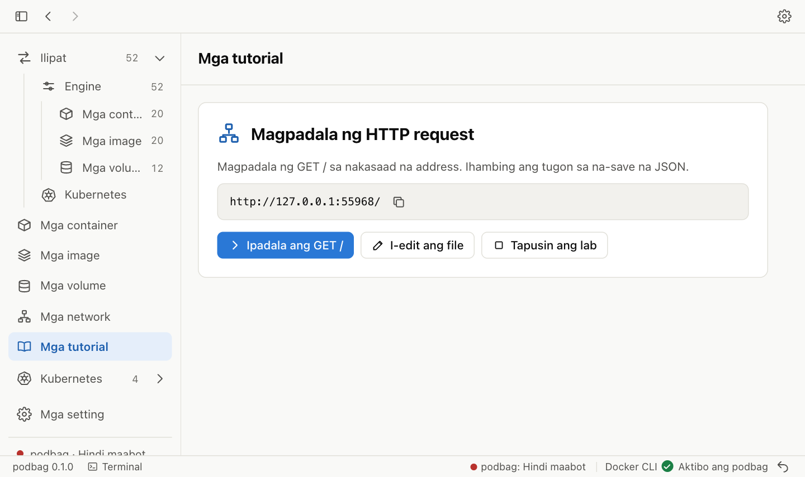
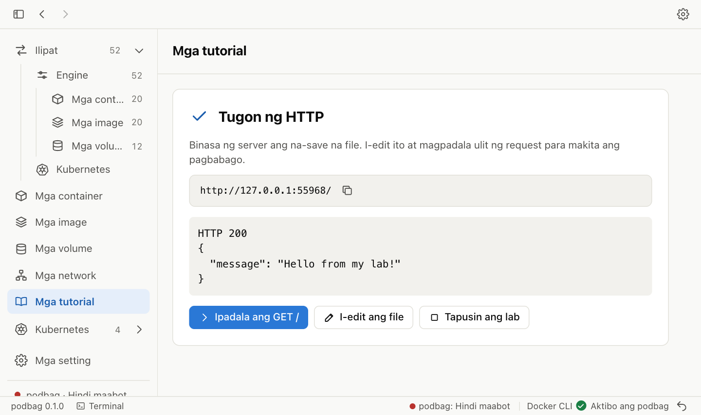
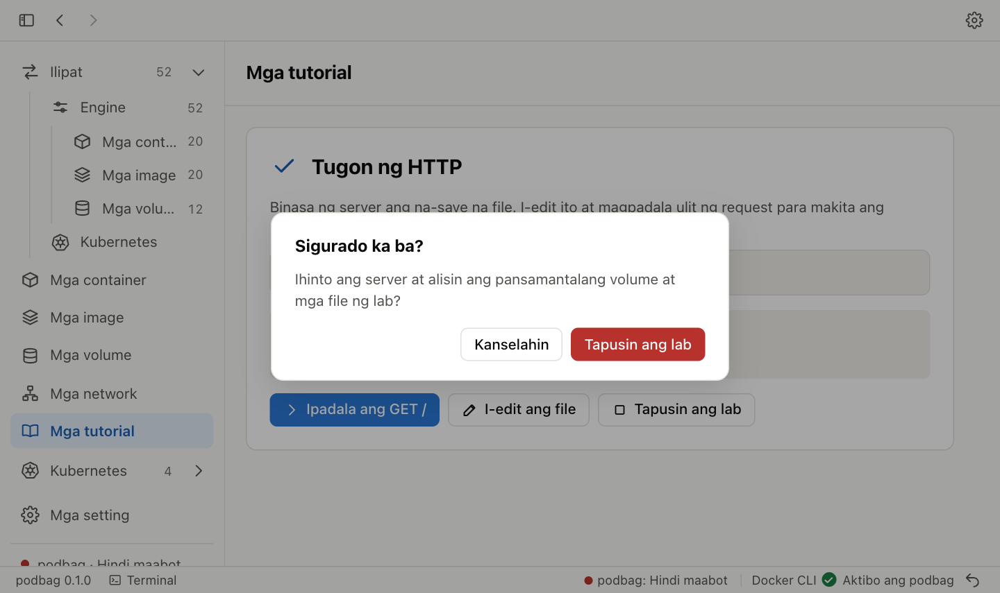

Gumamit ng Podbag Desktop na may **Mga tutorial** sa sidebar. Pansamantalang storage sa device ang gamit ng lab. Hindi kailangan ng container o image download.

[I-download ang module ng lab](volume-api.podbag)

I-save ang `volume-api.podbag` at tandaan ang folder nito.

## Buksan ang Mga tutorial

Piliin ang **Mga tutorial** sa kaliwang sidebar. Lalabas ang installer sa unang pagbisita.

## Piliin ang module

I-click ang **Pumili ng file** at buksan ang `volume-api.podbag`. Tingnan ang pamagat at pangalan ng file.

## I-install at simulan ang lab

I-click ang **I-install ang module**. Kapag naka-install na, i-click ang **Simulan ang lab** para magbukas ng bagong workspace.

## Gumawa ng volume

Ilagay ang `my-api` bilang pangalan at i-click ang **Gumawa ng volume**. Makikita ang pangalang ito sa path ng file sa susunod na screen.

## Isulat ang tugon

Palitan ang halaga ng `message` ng sarili mong pagbati, gaya ng `Hello from my lab!`. Panatilihin ang mga panipi at brace. I-click ang **I-save ang file**.

## Simulan ang server

Basahin ang na-save na JSON at i-click ang **Simulan ang server**. Pipili ang app ng libreng port sa `127.0.0.1`.

## Magpadala ng request

I-click ang **Ipadala ang GET /**. Maaari ring kopyahin ang URL sa browser ng device na ito. Maaaring mag-iba ang port sa bawat lab.

## Tingnan at baguhin ang tugon

Hanapin ang sarili mong mensahe sa ilalim ng `HTTP 200`. I-click ang **I-edit ang file**, palitan ang pagbati at i-save ito. Magpadala ulit sa parehong URL.

## Tapusin ang lab

I-click ang **Tapusin ang lab** at kumpirmahin. Hihinto ang server at aalisin ang pansamantalang volume at mga file. Mananatili ang module at ang tala ng pagkumpleto.

