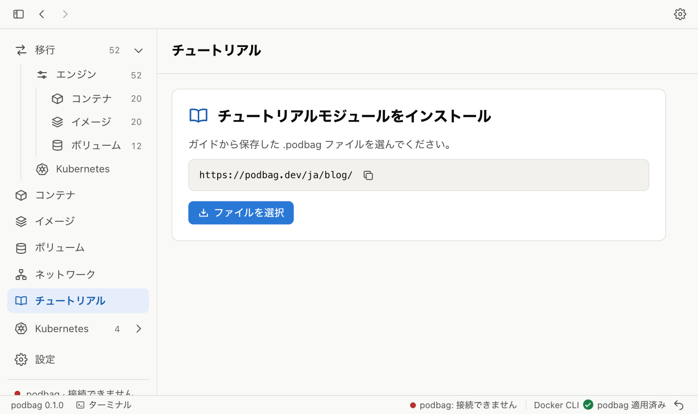
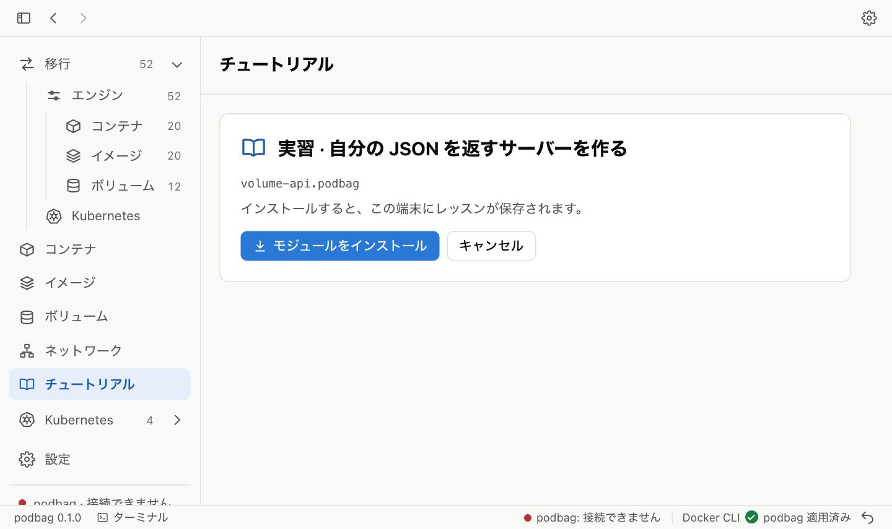
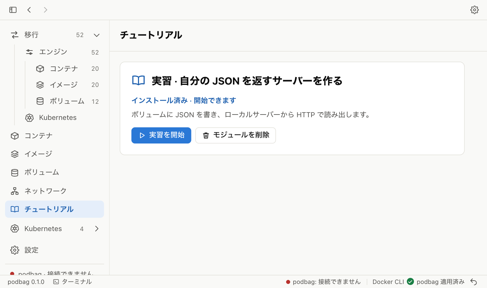
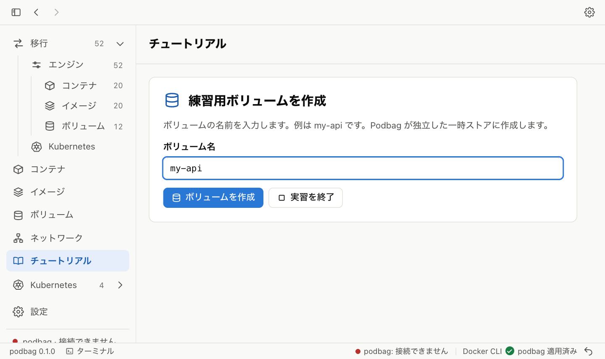
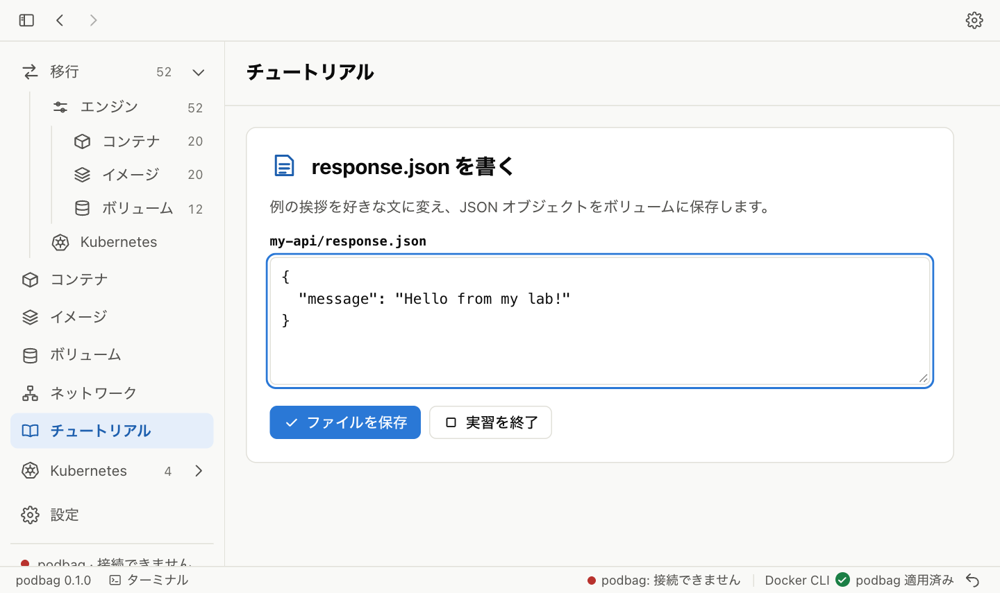
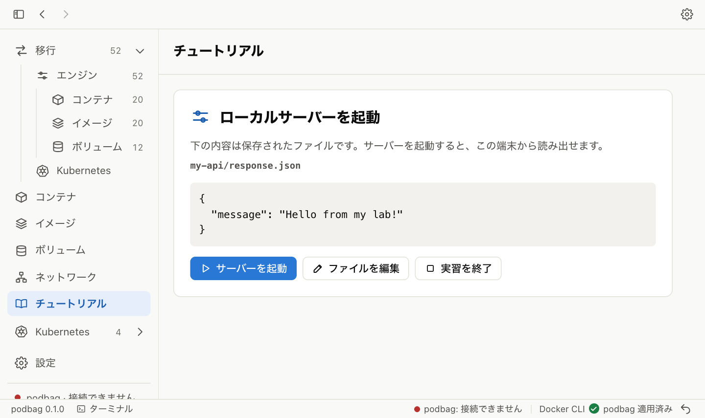
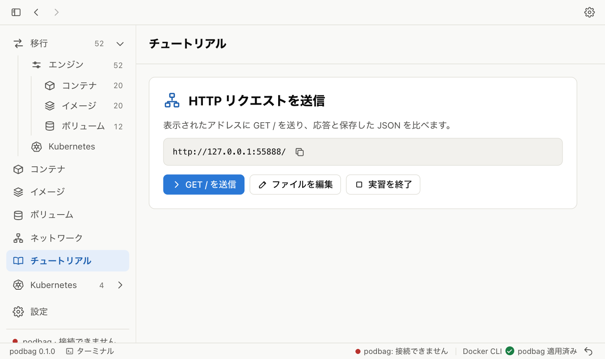
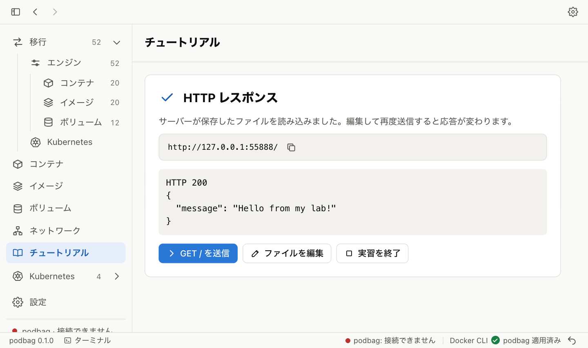
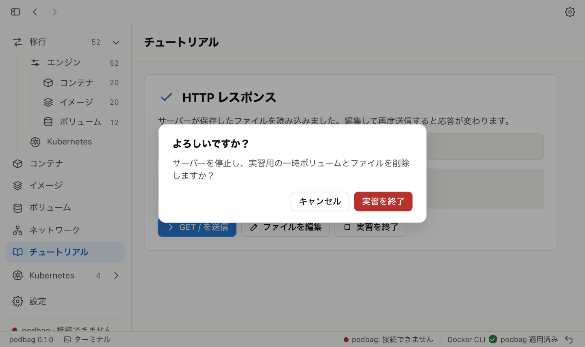

サイドバーに**チュートリアル**がある Podbag Desktop を用意します。実習は端末の一時ストアを使います。コンテナやイメージは不要です。

[実習モジュールをダウンロード](volume-api.podbag)

`volume-api.podbag` の保存先を確認します。

## チュートリアルを開く

左側の**チュートリアル**を選ぶと、初回はインストール画面が開きます。

## ファイルを選ぶ

**ファイルを選択**を押して、保存した `volume-api.podbag` を開きます。タイトルとファイル名を確認します。

## インストールして開始する

**モジュールをインストール**を押し、インストール済みになったら**実習を開始**を押します。空の作業領域が用意されます。

## ボリュームを作る

名前に `my-api` と入力し、**ボリュームを作成**を押します。次の画面のパスには自分で付けた名前が入ります。

## 応答ファイルを書く

`message` の値を自分の挨拶に変えます。例は `Hello from my lab!` です。引用符と波括弧を残し、**ファイルを保存**を押します。

## サーバーを起動する

保存内容を確認し、**サーバーを起動**を押します。アプリは `127.0.0.1` の空きポートで待ち受けます。

## リクエストを送る

**GET / を送信**を押します。この端末のブラウザーに URL をコピーしても確認できます。ポート番号は実習ごとに変わります。

## 応答を確認して変更する

`HTTP 200` の下に自分の挨拶があることを確認します。**ファイルを編集**で挨拶を変えて保存し、同じ URL にもう一度送信します。

## 実習を終了する

**実習を終了**を押し、確認画面でも終了を選びます。サーバーは停止し、一時ファイルとボリュームは削除されます。教材と完了記録は残ります。

