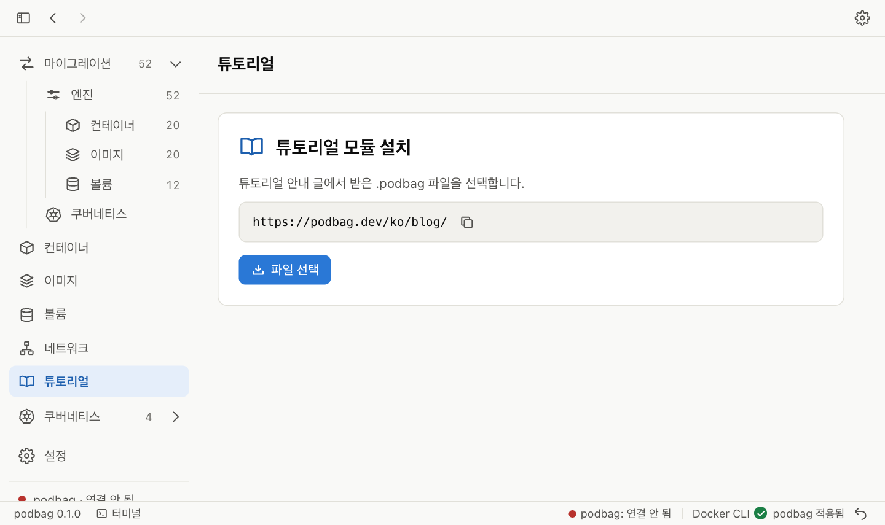
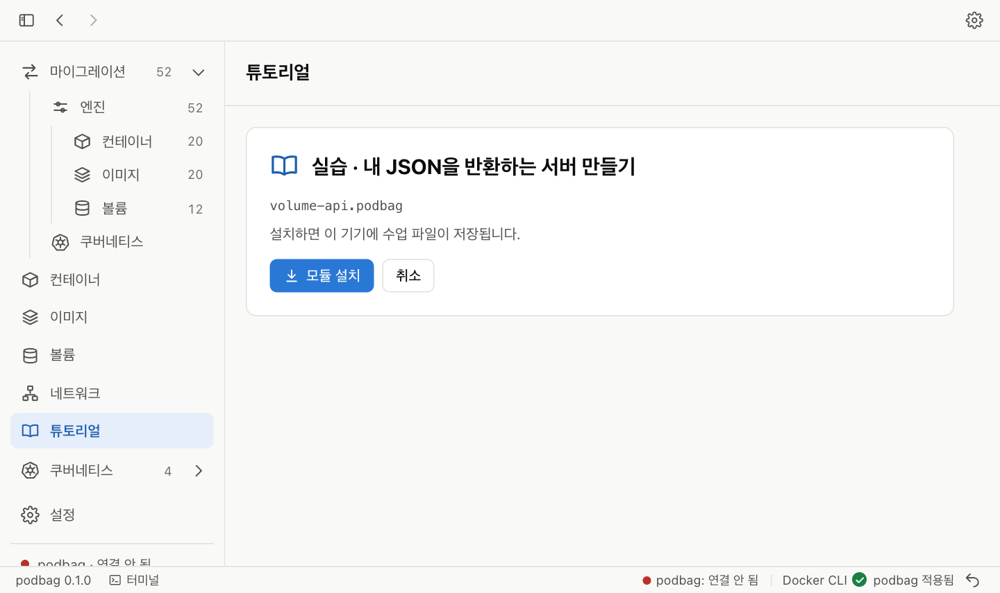
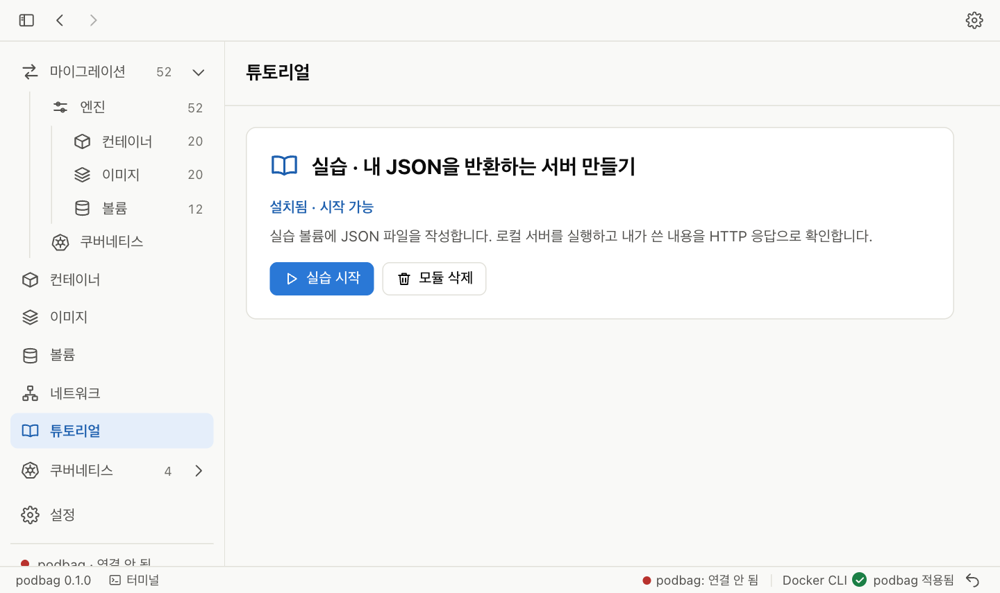
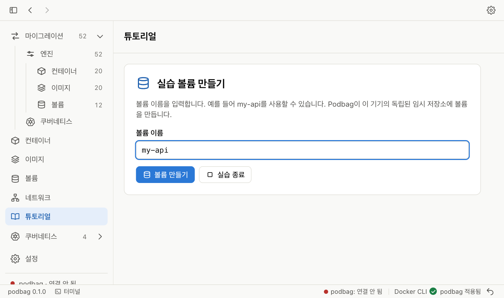
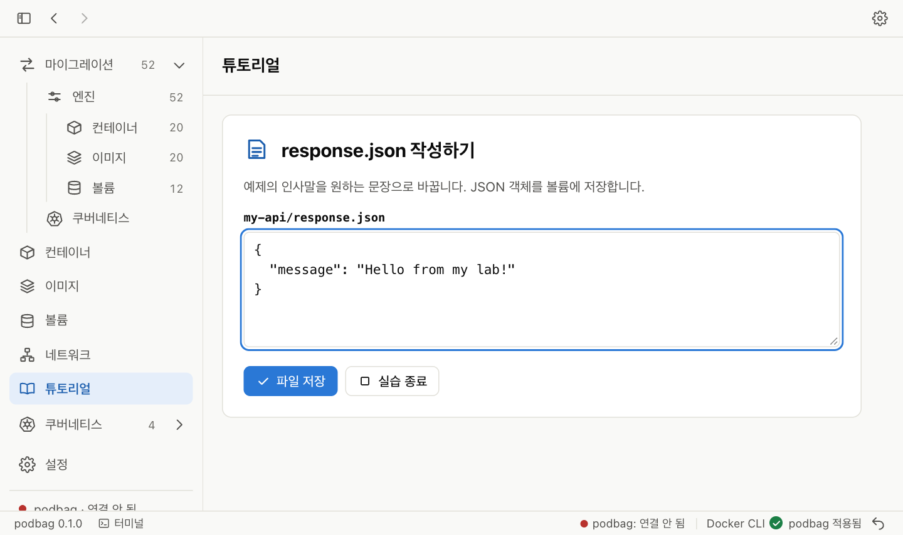
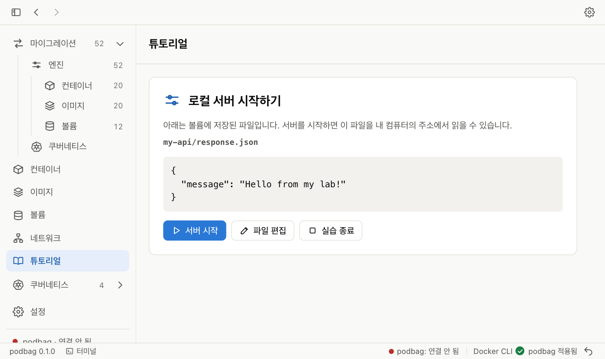
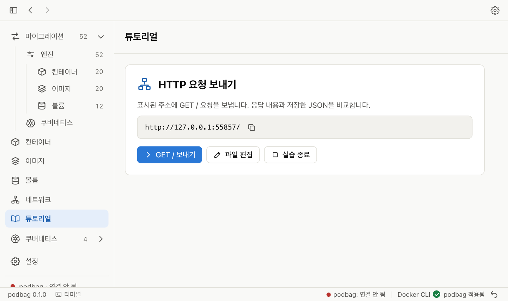
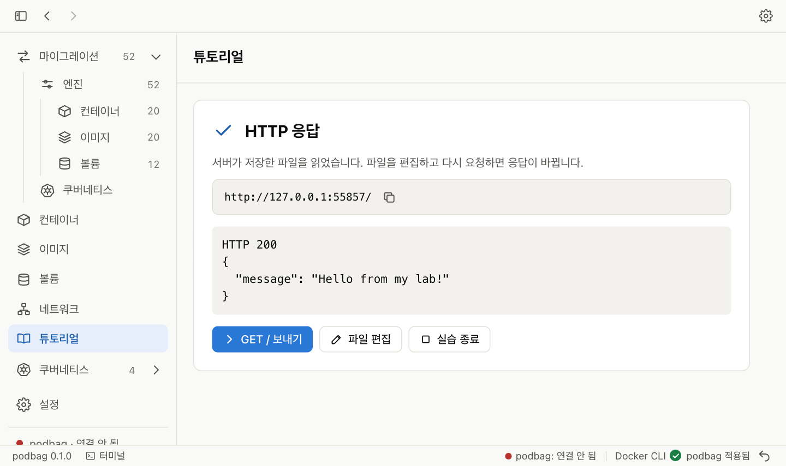
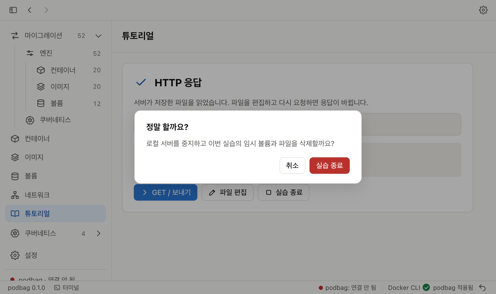

왼쪽 메뉴에 **튜토리얼**이 있는 Podbag Desktop을 준비합니다. 이 실습은 내 컴퓨터의 임시 저장소와 로컬 주소를 사용합니다. 실행 중인 컨테이너나 이미지 다운로드는 필요하지 않습니다.

[실습 모듈 다운로드](volume-api.podbag)

시작하기 전에 `volume-api.podbag`을 다운로드합니다. 파일을 저장한 폴더를 기억합니다.

## 튜토리얼 열기

Podbag Desktop의 왼쪽 메뉴에서 **튜토리얼**을 선택합니다. 처음 열면 **튜토리얼 모듈 설치** 화면이 나타납니다.

## 모듈 파일 선택하기

**파일 선택**을 누릅니다. 다운로드한 폴더에서 `volume-api.podbag`을 엽니다. 앱에 표시된 실습 제목과 파일 이름을 확인합니다.

## 설치하고 실습 시작하기

**모듈 설치**를 누릅니다. **설치됨 · 시작 가능**이 표시되면 **실습 시작**을 누릅니다. 이번 실습만 사용하는 빈 작업 공간이 열립니다.

## 실습용 볼륨 만들기

볼륨은 파일을 담는 저장 공간입니다. **볼륨 이름**에 `my-api`를 입력하고 **볼륨 만들기**를 누릅니다. 다음 화면에 `my-api/response.json`이 보이면 볼륨이 만들어진 것입니다. 다른 이름을 사용했다면 해당 이름이 표시됩니다.

## 응답 파일 직접 작성하기

편집기에서 `message`의 값을 자신의 문장으로 바꿉니다. 예제에서는 `Hello from my lab!`을 사용합니다. 문자열을 감싼 큰따옴표와 바깥쪽 중괄호를 유지합니다. **파일 저장**을 누르면 작성한 내용이 볼륨에 기록됩니다.

## 로컬 서버 시작하기

저장된 내용이 화면에 표시됩니다. 작성한 문장을 확인하고 **서버 시작**을 누릅니다. Podbag Desktop이 빈 포트를 골라 `127.0.0.1`에서 HTTP 서버를 엽니다.

## 내 서버에 요청 보내기

화면에 표시된 주소로 **GET / 보내기**를 누릅니다. `GET /`는 서버의 첫 경로에서 내용을 읽는 HTTP 요청입니다. 주소를 복사해 같은 컴퓨터의 브라우저에서도 요청할 수 있습니다. 포트 번호는 실습마다 달라질 수 있습니다.

## 응답 확인하고 바꿔 보기

`HTTP 200` 아래의 `message`가 내가 쓴 문장과 같은지 확인합니다. **파일 편집**에서 인사말을 바꾸고 저장합니다. 같은 주소에 다시 **GET / 보내기**를 눌러 새 값이 돌아오는지 확인합니다.

## 실습 종료하기

**실습 종료**를 누르고 확인 창에서 한 번 더 **실습 종료**를 누릅니다. 서버가 중지되고 임시 볼륨과 파일이 삭제됩니다. 설치한 모듈과 완료 기록은 남습니다. 다시 시작하면 빈 작업 공간이 열립니다.

