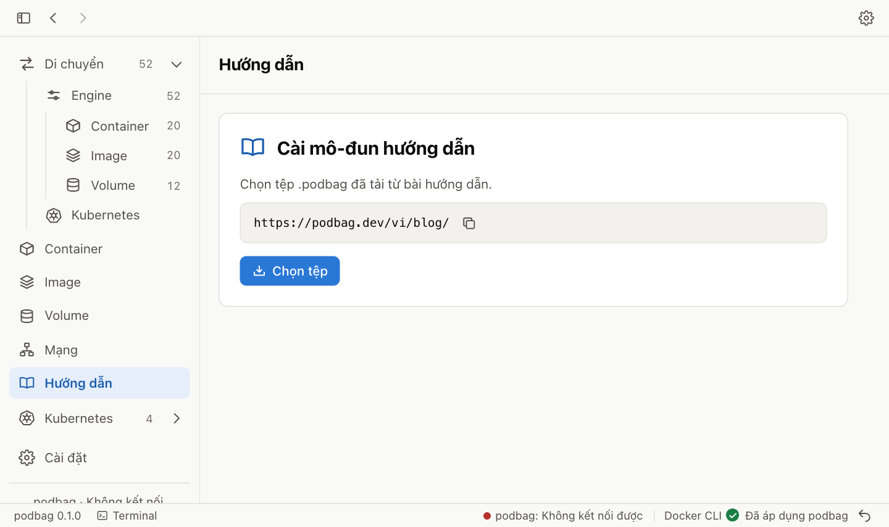
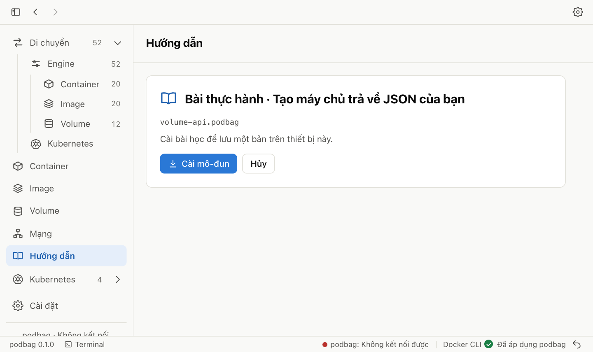
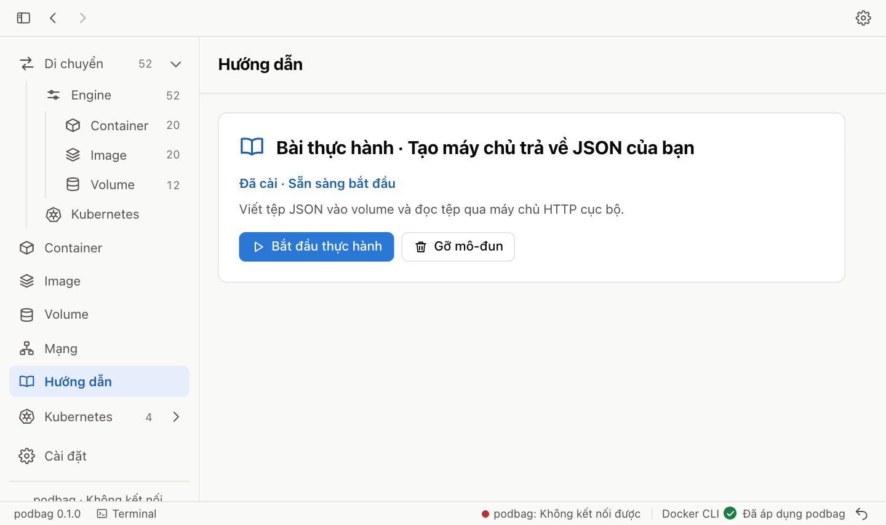
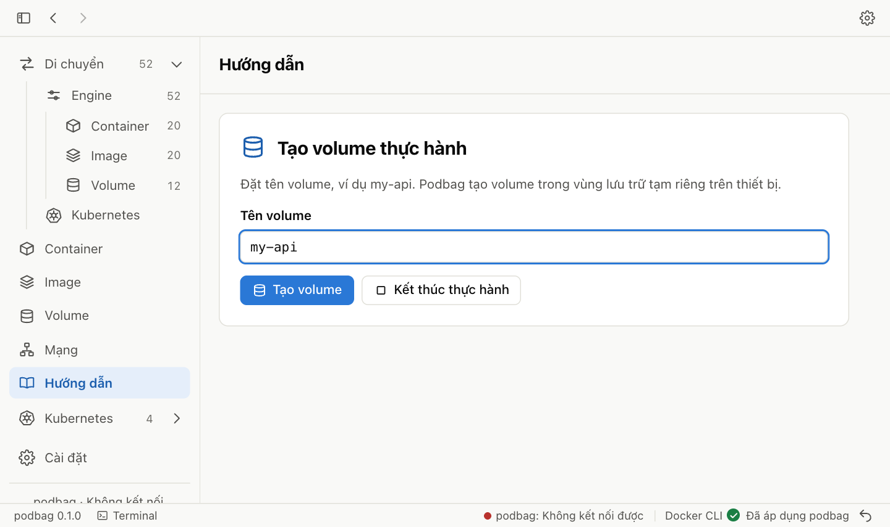
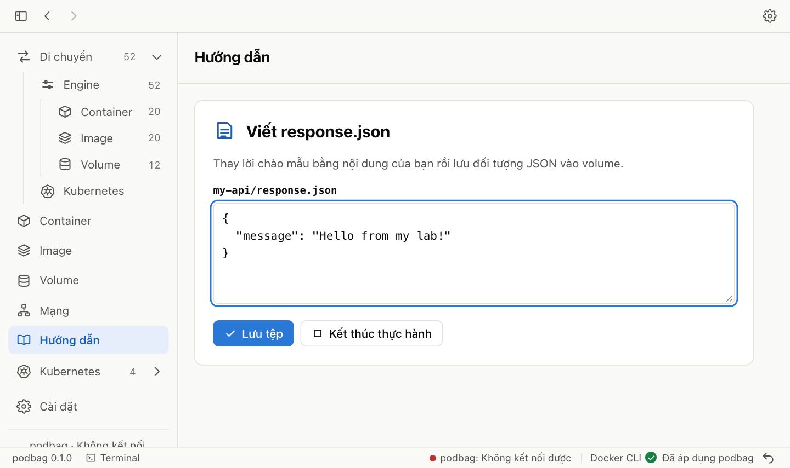
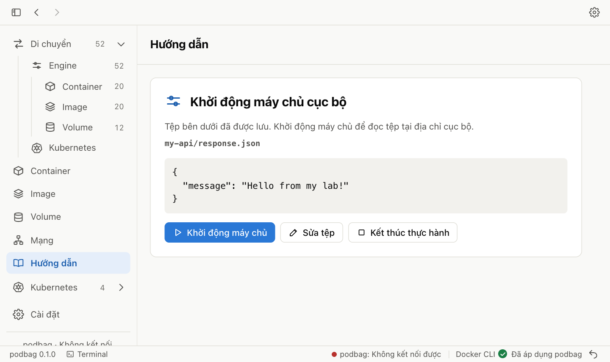
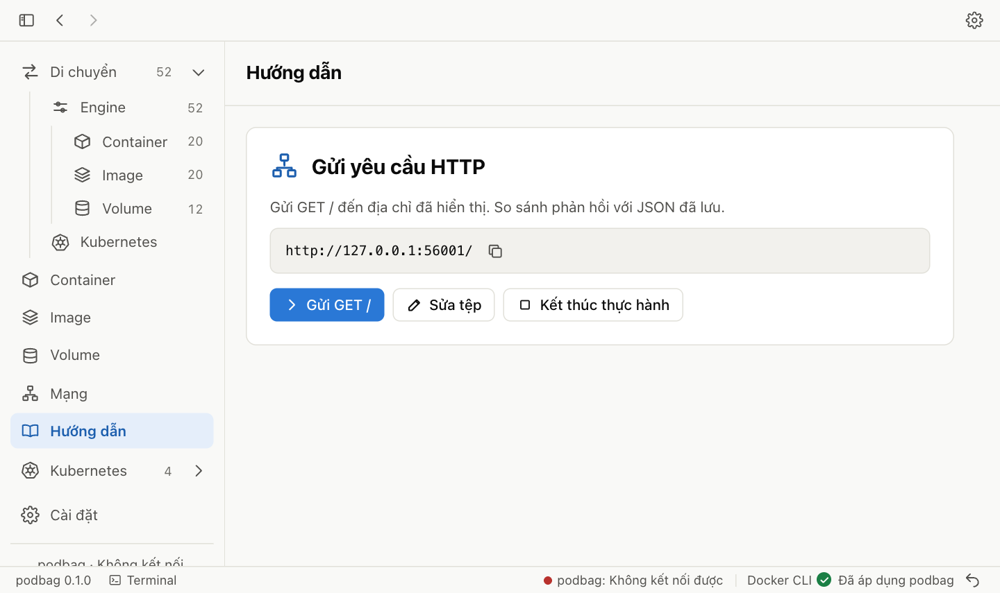
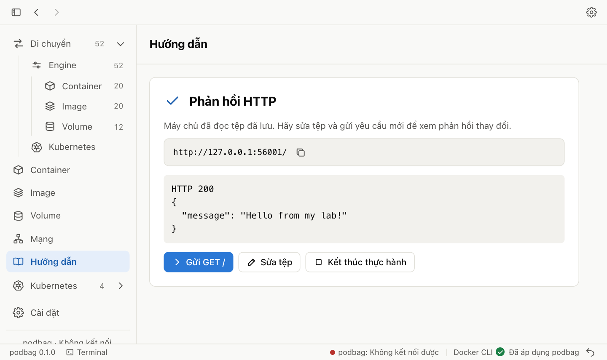
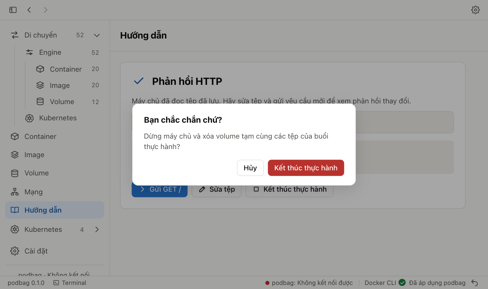

Dùng phiên bản Podbag Desktop có mục **Hướng dẫn** trên thanh bên. Bài thực hành dùng vùng lưu trữ tạm trên máy, không cần chạy container hoặc tải image.

[Tải mô-đun thực hành](volume-api.podbag)

Lưu `volume-api.podbag` và ghi nhớ vị trí.

## Mở mục Hướng dẫn

Chọn **Hướng dẫn** ở thanh bên trái. Lần đầu mở, bạn sẽ thấy màn hình cài mô-đun.

## Chọn mô-đun

Nhấn **Chọn tệp** và mở `volume-api.podbag` đã tải. Kiểm tra tiêu đề bài và tên tệp.

## Cài và bắt đầu

Nhấn **Cài mô-đun**. Khi đã cài xong, nhấn **Bắt đầu thực hành** để mở không gian trống.

## Tạo volume

Nhập `my-api` vào ô tên rồi nhấn **Tạo volume**. Đường dẫn tệp ở màn hình tiếp theo bắt đầu bằng tên này.

## Viết nội dung phản hồi

Thay giá trị của `message` bằng lời chào của bạn, chẳng hạn `Hello from my lab!`. Giữ nguyên dấu ngoặc kép và ngoặc nhọn. Nhấn **Lưu tệp**.

## Khởi động máy chủ

Kiểm tra JSON đã lưu rồi nhấn **Khởi động máy chủ**. Ứng dụng chọn một cổng trống trên `127.0.0.1`.

## Gửi yêu cầu

Nhấn **Gửi GET /** để đọc đường dẫn gốc. Bạn cũng có thể sao chép URL vào trình duyệt trên cùng máy. Số cổng có thể khác ở mỗi buổi thực hành.

## Kiểm tra và thay đổi phản hồi

Tìm lời chào của bạn bên dưới `HTTP 200`. Nhấn **Sửa tệp**, đổi lời chào rồi lưu. Gửi yêu cầu đến cùng URL để xem giá trị mới.

## Kết thúc thực hành

Nhấn **Kết thúc thực hành** rồi xác nhận. Máy chủ dừng, volume tạm và các tệp được xóa. Mô-đun và bản ghi hoàn thành vẫn được giữ lại.

