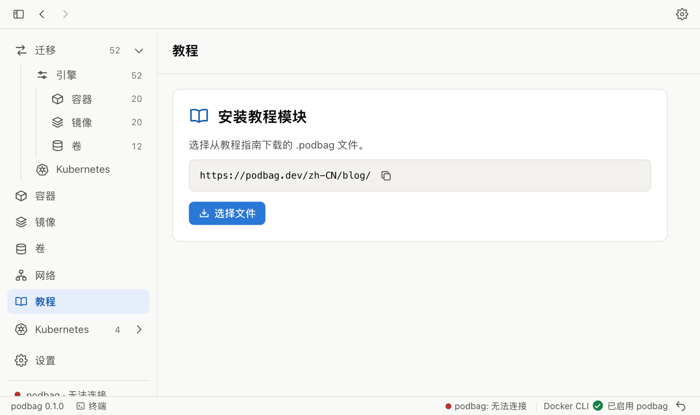
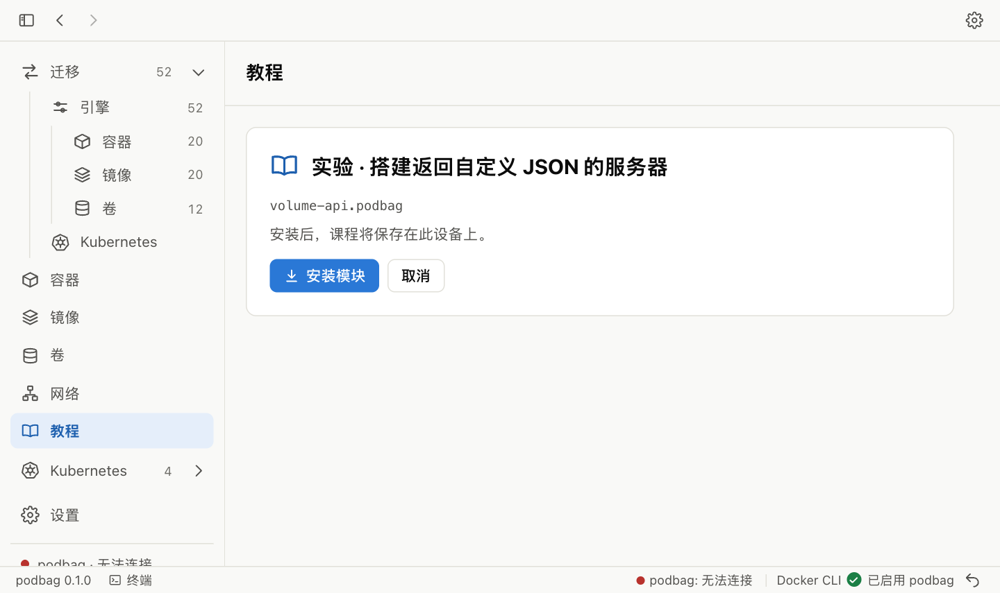
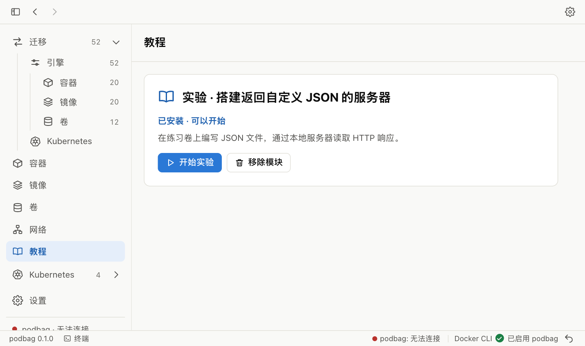
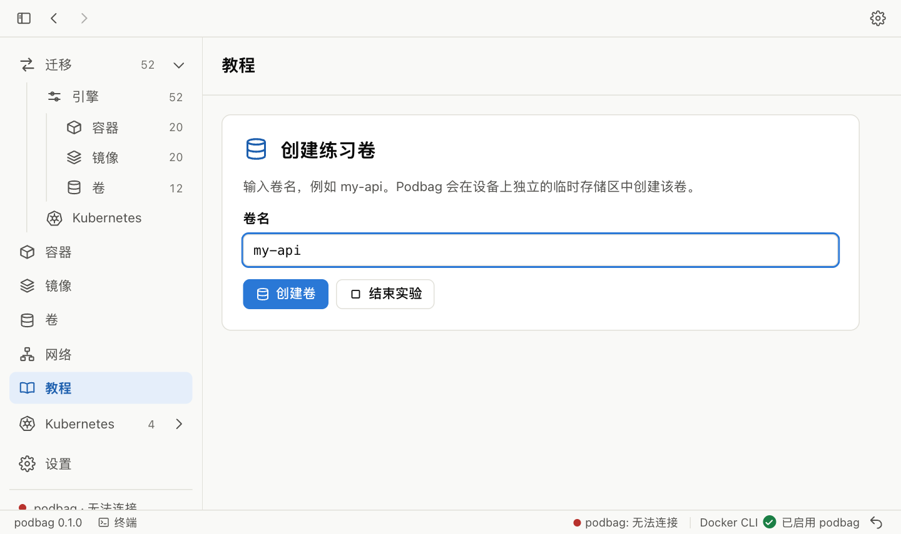
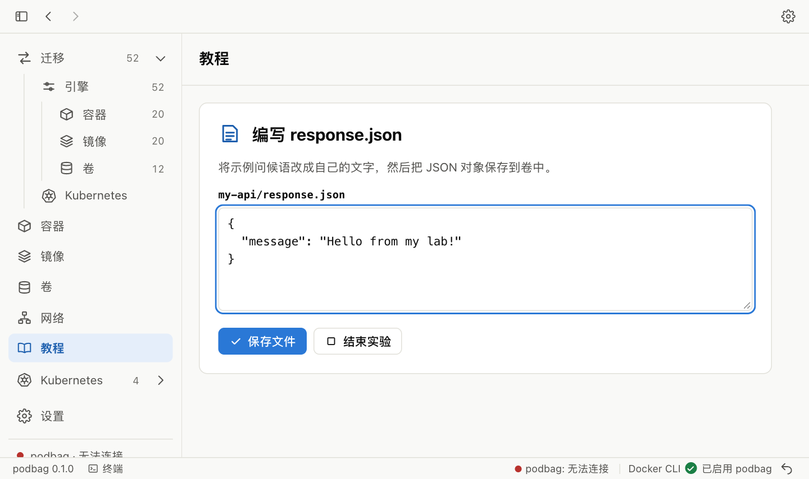
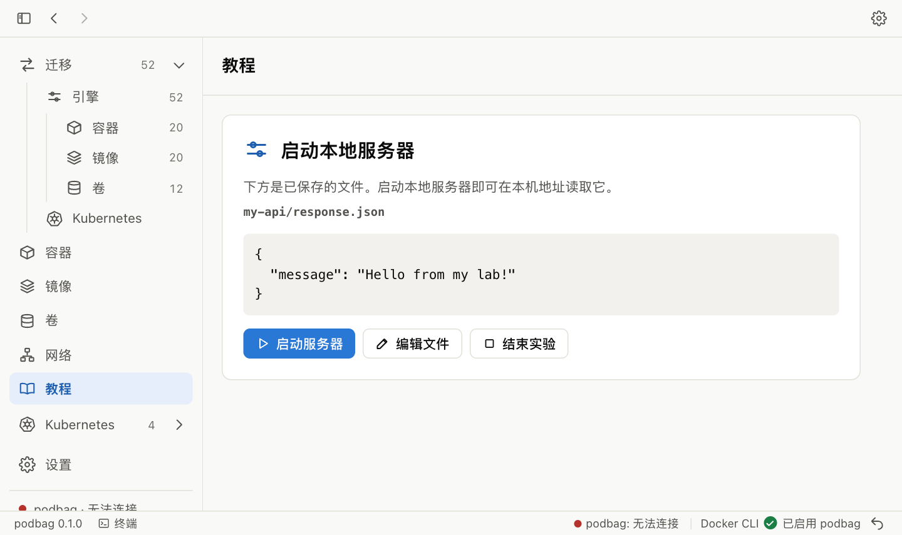
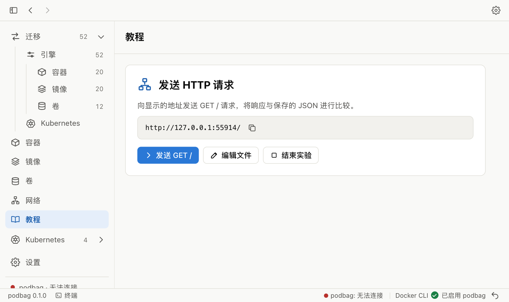
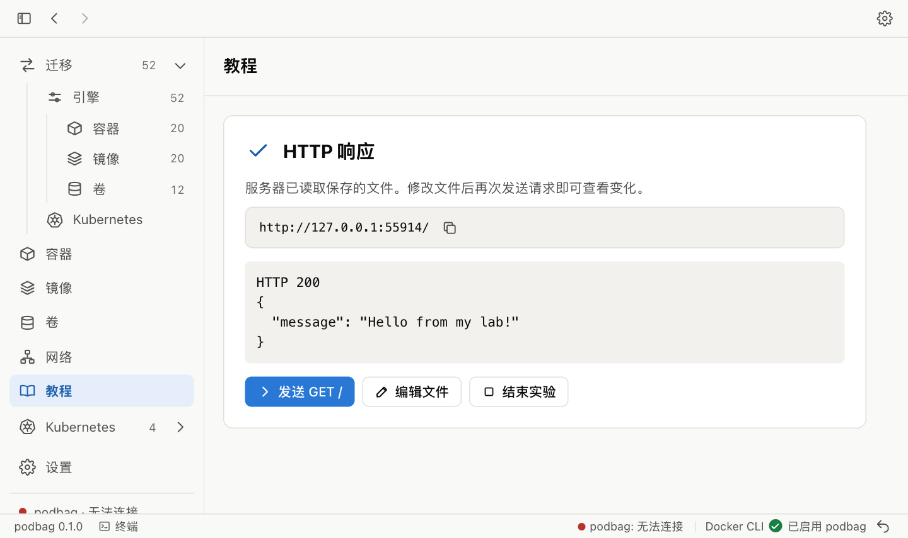
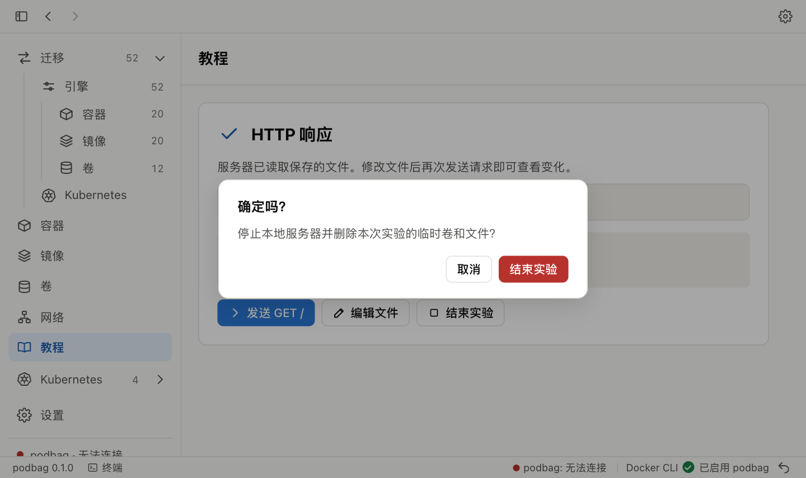

使用侧栏带有**教程**的 Podbag Desktop。本实验使用本机临时存储区，无需启动容器或下载镜像。

[下载实验模块](volume-api.podbag)

保存 `volume-api.podbag`，记下文件位置。

## 打开教程

点击左侧的**教程**。首次进入会看到安装页面。

## 选择模块文件

点击**选择文件**并打开下载的 `volume-api.podbag`。检查标题和文件名。

## 安装并开始

点击**安装模块**。出现已安装提示后，点击**开始实验**。应用会创建空的工作区。

## 创建卷

在卷名栏输入 `my-api`，点击**创建卷**。下一页的文件路径将以所选卷名开头。

## 编写响应

将 `message` 的值改为自己的问候语，例如 `Hello from my lab!`。保留双引号和花括号，然后点击**保存文件**。

## 启动服务器

确认保存的 JSON 后点击**启动服务器**。应用将在 `127.0.0.1` 上选择可用端口。

## 发送请求

点击**发送 GET /** 读取根路径。也可以把 URL 复制到本机浏览器。每次实验的端口可能不同。

## 查看并修改响应

确认 `HTTP 200` 下方显示你写的问候语。点击**编辑文件**修改内容并保存，再向同一地址发送请求，查看新值。

## 结束实验

点击**结束实验**并确认。服务器停止，临时卷和文件将被删除。模块和完成记录会保留。

