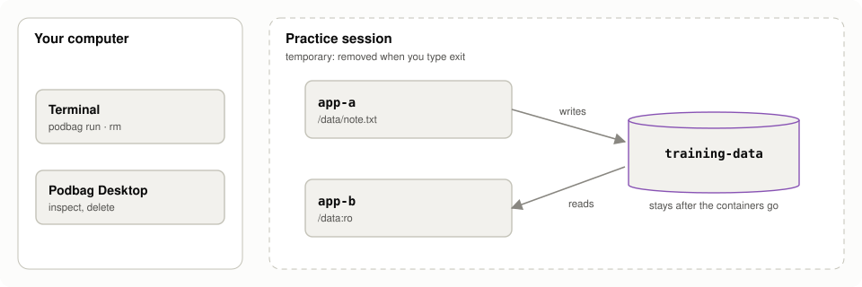
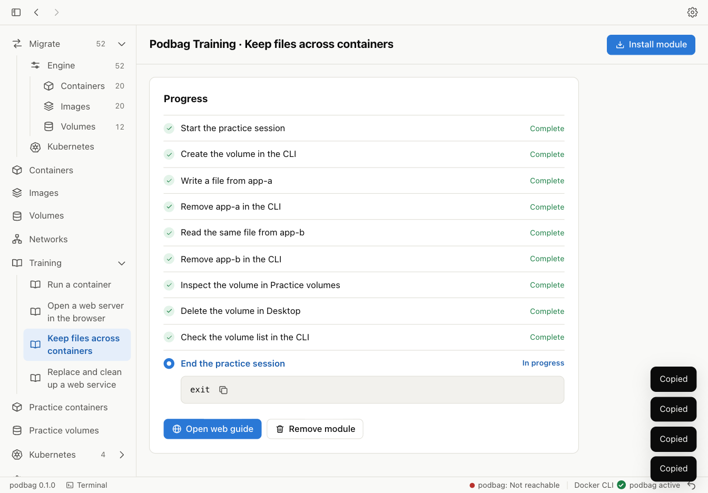

A volume stores files that can survive container removal. Watch the animation and then try the same sequence with `app-a` and `app-b`.

**Time** 15 minutes



## Beginner course

[Run your first container](../container-basics/) → [Open a web server in the browser](../web-basics/) → **Keep files across containers** → [Replace and clean up a web service](../web-service-lifecycle/)

[](volume-life.mp4)

## Install the module

[Download volume-persistence.podbag](volume-persistence.podbag). In Desktop, select **Install module** at the top of **Training**. Choose the downloaded file and confirm.

```sh
podbag lab install volume-persistence.podbag
```


## Start the practice session

Expand **Training** in the sidebar and select the module. Copy the start command into your terminal. Continue when it shows the `training $` prompt.

```sh
podbag lab start volume-persistence
```


To do the steps in the TUI instead of Podbag Desktop, add `--tui`.

```sh
podbag lab start volume-persistence --tui
```

In the TUI, press `:` to open the training shell for a command step, type `exit` to return to the TUI, and press `q` to end the session.

## Create the volume

Create the named volume `training-data` in the practice session.

```sh
podbag volume create training-data
```

- **In Podbag Desktop:** Select **Practice volumes → Create volume training-data**.
- **In the TUI:** Open **Volumes**, press `v`, type `training-data` and press `Enter`.


## Write a file from app-a

`-v training-data:/data` connects the volume to the container. The command writes `note.txt` and `app-a` exits.

```sh
podbag run --name app-a --network none -v training-data:/data docker.io/library/busybox:1.37.0 sh -c 'printf "%s\n" "hello from app-a" > /data/note.txt'
```


## Remove app-a

Remove the stopped container. The volume stays in the practice session.

```sh
podbag rm app-a
```

- **In Podbag Desktop:** Select **Practice containers → app-a → Remove** and confirm.
- **In the TUI:** Select `app-a` in **Containers**, press `d`, then `y`.


## Read the file from app-b

`app-b` mounts the same volume. The `:ro` suffix makes it read-only. The terminal displays `hello from app-a`.

```sh
podbag run --name app-b --network none -v training-data:/data:ro docker.io/library/busybox:1.37.0 cat /data/note.txt
```


## Remove app-b

Remove the second container to release the volume before you delete it.

```sh
podbag rm app-b
```

- **In Podbag Desktop:** Select **Practice containers → app-b → Remove** and confirm.
- **In the TUI:** Select `app-b` in **Containers**, press `d`, then `y`.


## Open the volume details

Select **Practice volumes → training-data**. The details show its name and mount point.

- **In Podbag Desktop:** Select **Practice volumes → training-data**.
- **In the TUI:** Select `training-data` in **Volumes** and press `Enter`.


## Delete the volume in Desktop

Select **Remove** and confirm that the dialog names `training-data`. The volume and its file are deleted.

- **In Podbag Desktop:** Select **Practice volumes → training-data → Remove** and confirm.
- **In the TUI:** Select `training-data` in **Volumes**, press `d`, then `y`.


## Check the volume list

Return to the same terminal. The volume list no longer contains `training-data`.

```sh
podbag volume ls
```


## Finish the practice session

Run the command shown in the final step. Training records completion after the practice environment has been removed.

```sh
exit
```




[Next module · Replace and clean up a web service](../web-service-lifecycle/)
