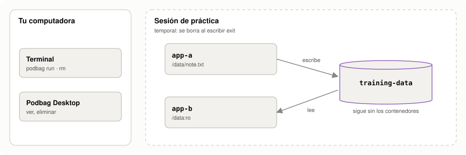
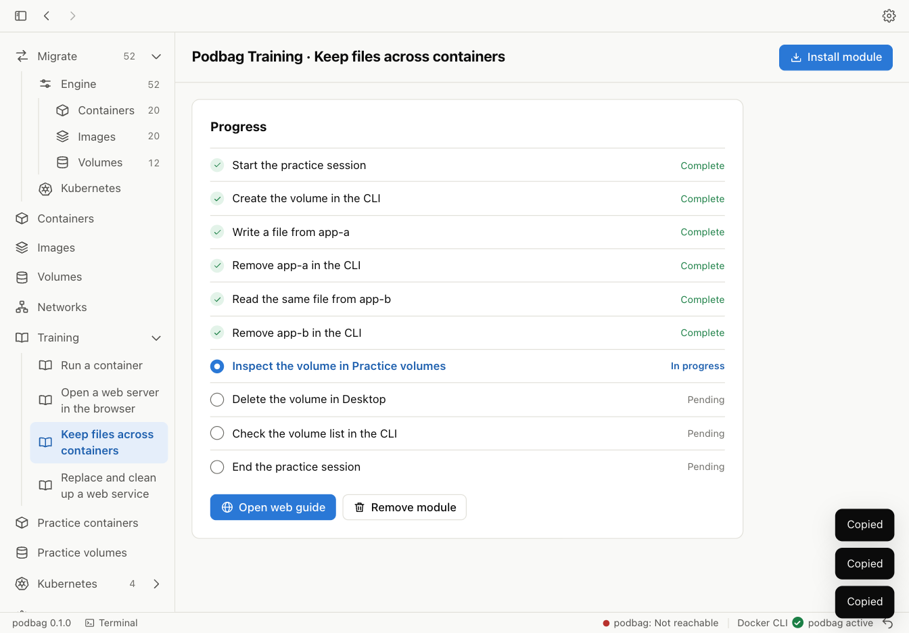

Un volumen guarda archivos que pueden seguir existiendo después de eliminar un contenedor. Mira la animación y luego prueba la misma secuencia con `app-a` y `app-b`.

**Tiempo** 15 minutos



## Curso de iniciación

[Ejecuta tu primer contenedor](../container-basics/) → [Abre un servidor web en el navegador](../web-basics/) → **Conserva archivos entre contenedores** → [Sustituye y limpia un servicio web](../web-service-lifecycle/)

[](volume-life.mp4)

## Instala el módulo

[Descargar volume-persistence.podbag](volume-persistence.podbag). En Desktop, selecciona **Instalar módulo** en la parte superior de **Training**. Elige el archivo descargado y confirma.

```sh
podbag lab install volume-persistence.podbag
```


## Inicia la sesión de práctica

Despliega **Training** en la barra lateral y selecciona el módulo. Copia el comando de inicio en tu terminal. Continúa cuando aparezca el prompt `training $`.

```sh
podbag lab start volume-persistence
```


Para hacer los pasos en la TUI en lugar de Podbag Desktop, añade `--tui`.

```sh
podbag lab start volume-persistence --tui
```

En la TUI, pulsa `:` para abrir la shell de Training cuando un paso pida un comando, escribe `exit` para volver a la TUI y pulsa `q` para terminar la sesión.

## Crea el volumen

Crea el volumen con nombre `training-data` en la sesión de práctica.

```sh
podbag volume create training-data
```

- **En Podbag Desktop:** Selecciona **Volúmenes de práctica → Crear el volumen training-data**.
- **En la TUI:** Abre **Volúmenes**, pulsa `v`, escribe `training-data` y pulsa `Enter`.


## Escribe un archivo desde app-a

`-v training-data:/data` conecta el volumen al contenedor. El comando escribe `note.txt` y `app-a` termina.

```sh
podbag run --name app-a --network none -v training-data:/data docker.io/library/busybox:1.37.0 sh -c 'printf "%s\n" "hello from app-a" > /data/note.txt'
```


## Elimina app-a

Elimina el contenedor detenido. El volumen sigue en la sesión de práctica.

```sh
podbag rm app-a
```

- **En Podbag Desktop:** Selecciona **Contenedores de práctica → app-a → Eliminar** y confirma.
- **En la TUI:** Selecciona `app-a` en **Contenedores**, pulsa `d` y luego `y`.


## Lee el archivo desde app-b

`app-b` monta el mismo volumen. El sufijo `:ro` lo hace de solo lectura. La terminal muestra `hello from app-a`.

```sh
podbag run --name app-b --network none -v training-data:/data:ro docker.io/library/busybox:1.37.0 cat /data/note.txt
```


## Elimina app-b

Elimina el segundo contenedor para liberar el volumen antes de borrarlo.

```sh
podbag rm app-b
```

- **En Podbag Desktop:** Selecciona **Contenedores de práctica → app-b → Eliminar** y confirma.
- **En la TUI:** Selecciona `app-b` en **Contenedores**, pulsa `d` y luego `y`.


## Abre los detalles del volumen

Selecciona **Volúmenes de práctica → training-data**. Los detalles muestran su nombre y su punto de montaje.

- **En Podbag Desktop:** Selecciona **Volúmenes de práctica → training-data**.
- **En la TUI:** Selecciona `training-data` en **Volúmenes** y pulsa `Enter`.




## Elimina el volumen en Desktop

Selecciona **Eliminar** y comprueba que el cuadro de diálogo nombra `training-data`. Confirma. Se borran el volumen y su archivo.

- **En Podbag Desktop:** Selecciona **Volúmenes de práctica → training-data → Eliminar** y confirma.
- **En la TUI:** Selecciona `training-data` en **Volúmenes**, pulsa `d` y luego `y`.


## Comprueba la lista de volúmenes

Vuelve a la misma terminal. La lista de volúmenes ya no contiene `training-data`.

```sh
podbag volume ls
```


## Termina la sesión de práctica

Ejecuta el comando del último paso. Training registra la finalización cuando se ha eliminado el entorno de práctica.

```sh
exit
```


[Siguiente módulo · Sustituye y limpia un servicio web](../web-service-lifecycle/)
