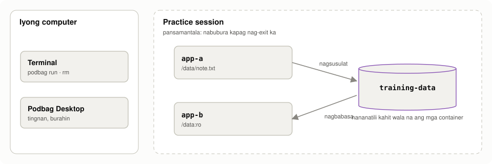
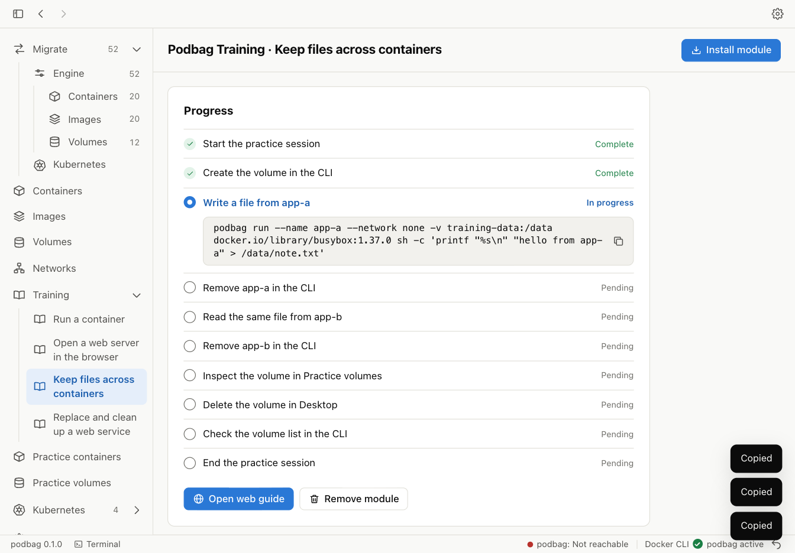
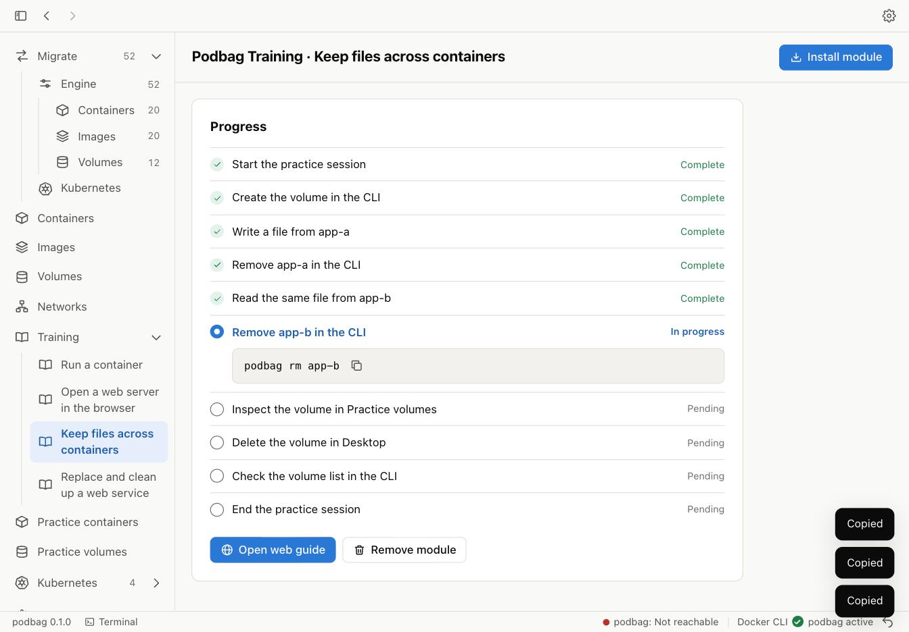

Nag-iimbak ang volume ng mga file na nananatili kahit maalis ang container. Panoorin ang animation. Pagkatapos, subukan ang parehong pagkakasunod gamit ang `app-a` at `app-b`.

**Oras** 15 minuto



## Kurso para sa baguhan

[Patakbuhin ang iyong unang container](../container-basics/) → [Buksan ang web server sa browser](../web-basics/) → **Panatilihin ang mga file sa pagitan ng mga container** → [Palitan at linisin ang web service](../web-service-lifecycle/)

[](volume-life.mp4)

## I-install ang module

[I-download ang volume-persistence.podbag](volume-persistence.podbag). Sa Desktop, piliin ang **I-install ang module** sa itaas ng **Training**. Piliin ang na-download na file at kumpirmahin.

```sh
podbag lab install volume-persistence.podbag
```


## Simulan ang practice session

Palawakin ang **Training** sa sidebar at piliin ang module. Kopyahin ang command sa pagsisimula sa terminal mo. Magpatuloy kapag lumabas ang prompt na `training $`.

```sh
podbag lab start volume-persistence
```


Para gawin ang mga hakbang sa TUI sa halip na sa Podbag Desktop, idagdag ang `--tui`.

```sh
podbag lab start volume-persistence --tui
```

Sa TUI, pindutin ang `:` para buksan ang training shell sa isang hakbang na command. I-type ang `exit` para bumalik sa TUI. Pindutin ang `q` para tapusin ang practice session.

## Gumawa ng volume

Gumawa ng named volume na `training-data` sa practice session.

```sh
podbag volume create training-data
```

- **Sa Podbag Desktop:** Piliin ang **Mga practice volume → Gumawa ng volume na training-data**.
- **Sa TUI:** Buksan ang **Mga volume**, pindutin ang `v`, i-type ang `training-data` at pindutin ang `Enter`.


## Magsulat ng file mula sa app-a

Ikinokonekta ng `-v training-data:/data` ang volume sa container. Isinusulat ng command ang `note.txt` at saka lalabas ang `app-a`.

```sh
podbag run --name app-a --network none -v training-data:/data docker.io/library/busybox:1.37.0 sh -c 'printf "%s\n" "hello from app-a" > /data/note.txt'
```



## Alisin ang app-a

Alisin ang nakahintong container. Mananatili ang volume sa practice session.

```sh
podbag rm app-a
```

- **Sa Podbag Desktop:** Piliin ang **Mga practice container → app-a → Alisin** at kumpirmahin.
- **Sa TUI:** Piliin ang `app-a` sa **Mga container**, pindutin ang `d`, saka ang `y`.


## Basahin ang file mula sa app-b

Ini-mount ng `app-b` ang parehong volume. Ginagawang read-only ng suffix na `:ro` ang volume. Ipinapakita ng terminal ang `hello from app-a`.

```sh
podbag run --name app-b --network none -v training-data:/data:ro docker.io/library/busybox:1.37.0 cat /data/note.txt
```


## Alisin ang app-b

Alisin ang pangalawang container para mapalaya ang volume bago mo ito burahin.

```sh
podbag rm app-b
```

- **Sa Podbag Desktop:** Piliin ang **Mga practice container → app-b → Alisin** at kumpirmahin.
- **Sa TUI:** Piliin ang `app-b` sa **Mga container**, pindutin ang `d`, saka ang `y`.



## Buksan ang detalye ng volume

Piliin ang **Mga practice volume → training-data**. Ipinapakita ng detalye ang pangalan at mount point nito.

- **Sa Podbag Desktop:** Piliin ang **Mga practice volume → training-data**.
- **Sa TUI:** Piliin ang `training-data` sa **Mga volume** at pindutin ang `Enter`.


## Burahin ang volume sa Desktop

Piliin ang **Alisin** at tiyaking `training-data` ang pangalan sa dialog. Mabubura ang volume at ang file nito.

- **Sa Podbag Desktop:** Piliin ang **Mga practice volume → training-data → Alisin** at kumpirmahin.
- **Sa TUI:** Piliin ang `training-data` sa **Mga volume**, pindutin ang `d`, saka ang `y`.


## Tingnan ang listahan ng volume

Bumalik sa parehong terminal. Wala na ang `training-data` sa listahan ng volume.

```sh
podbag volume ls
```


## Tapusin ang practice session

Patakbuhin ang command sa huling hakbang. Itatala ng Training ang pagkumpleto pagkatapos maalis ang practice environment.

```sh
exit
```


[Susunod na module · Palitan at linisin ang web service](../web-service-lifecycle/)
