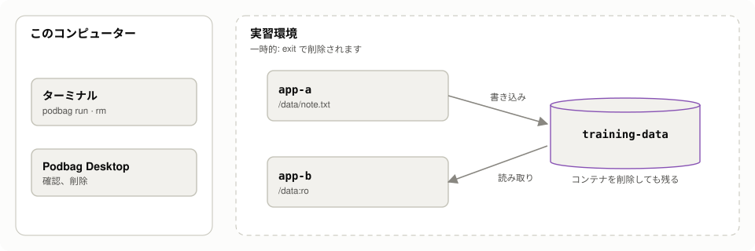
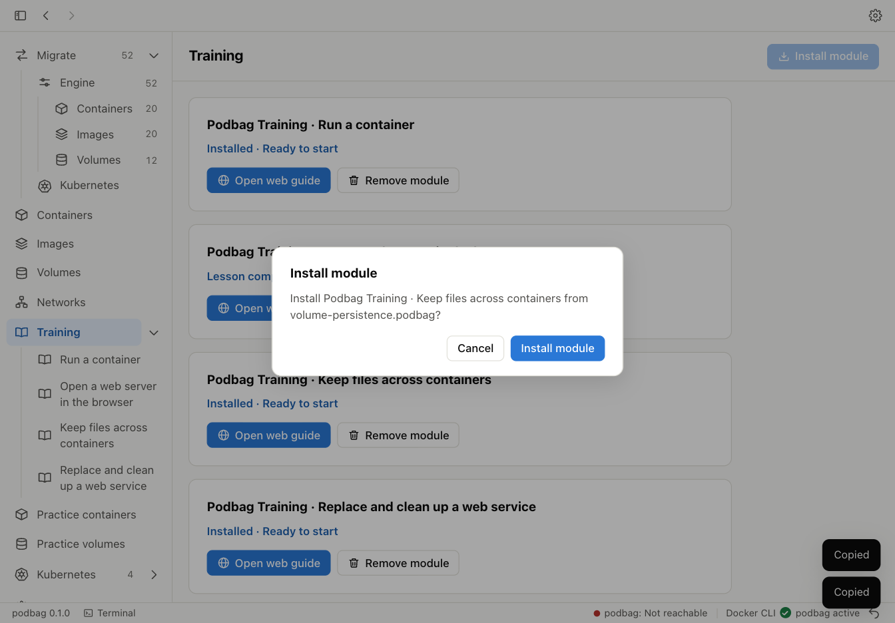
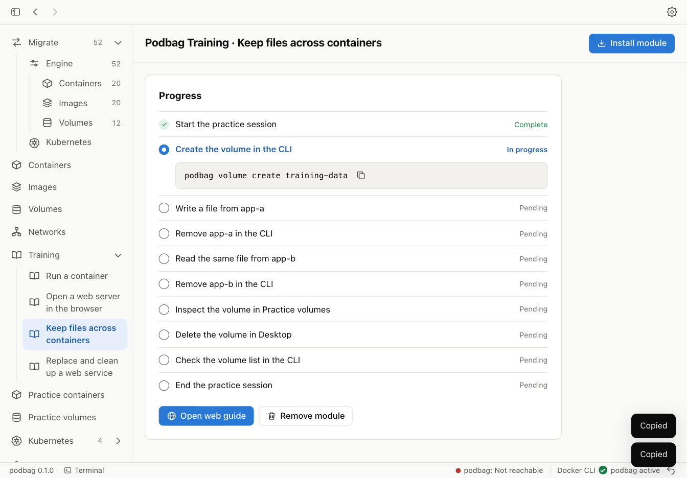
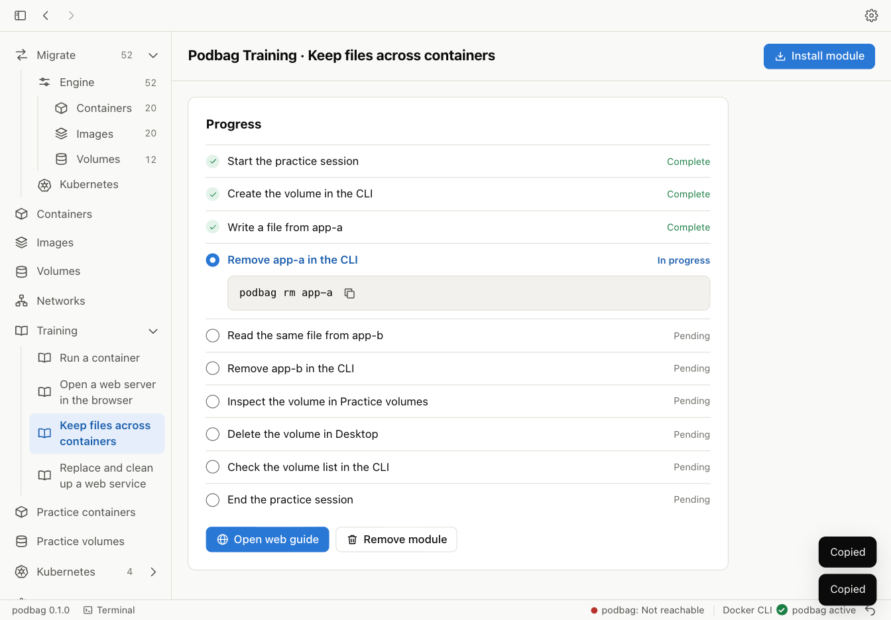
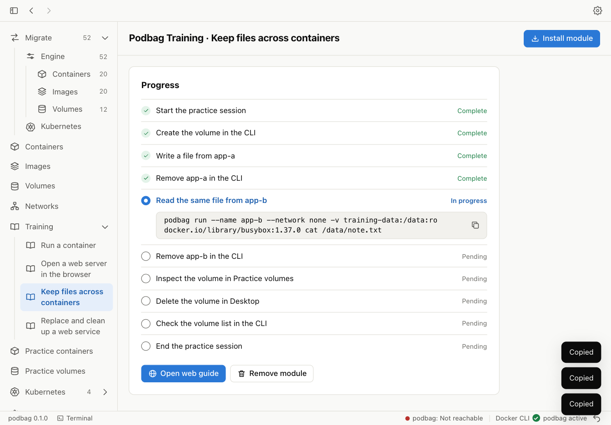
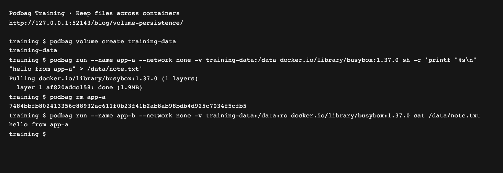
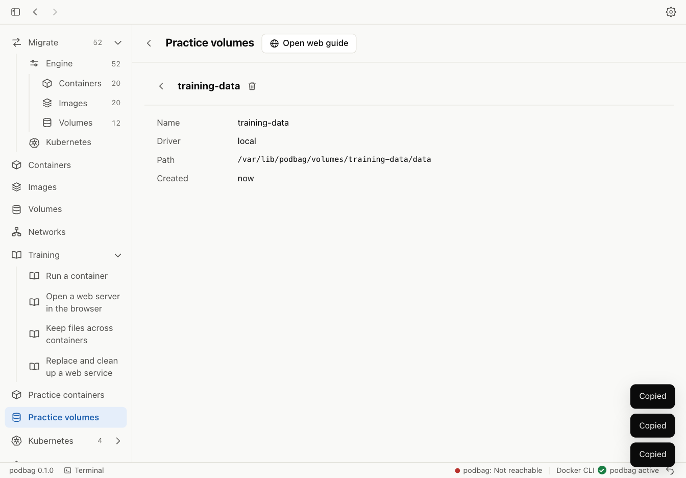

ボリュームは、コンテナを削除しても残るファイルを保存します。アニメーションを見てから、`app-a` と `app-b` で同じ流れを試します。

**所要時間** 15 分



## 初心者コース

[最初のコンテナを実行する](../container-basics/) → [ブラウザーで Web サーバーを開く](../web-basics/) → **コンテナが変わってもファイルを残す** → [Web サービスを入れ替えて片付ける](../web-service-lifecycle/)

[](volume-life.mp4)

## モジュールをインストールする

[volume-persistence.podbag をダウンロード](volume-persistence.podbag)します。Desktop で **Training** の上部にある**モジュールをインストール**を選びます。ダウンロードしたファイルを指定して確認します。

```sh
podbag lab install volume-persistence.podbag
```



## 実習を開始する

サイドバーの **Training** を展開し、モジュールを選びます。開始コマンドをコピーし、ターミナルで実行します。`training $` プロンプトが表示されたら続けます。

```sh
podbag lab start volume-persistence
```


## ボリュームを作成する

実習環境に、名前付きボリューム `training-data` を作成します。

```sh
podbag volume create training-data
```



## app-a からファイルを書く

`-v training-data:/data` はボリュームをコンテナにつなぎます。このコマンドは `note.txt` を書き、`app-a` は終了します。

```sh
podbag run --name app-a --network none -v training-data:/data docker.io/library/busybox:1.37.0 sh -c 'printf "%s\n" "hello from app-a" > /data/note.txt'
```


## app-a を削除する

停止したコンテナを削除します。ボリュームは実習環境に残ります。

```sh
podbag rm app-a
```



## app-b でファイルを読む

`app-b` は同じボリュームをマウントします。末尾の `:ro` で読み取り専用になります。ターミナルに `hello from app-a` と表示されます。

```sh
podbag run --name app-b --network none -v training-data:/data:ro docker.io/library/busybox:1.37.0 cat /data/note.txt
```





## app-b を削除する

ボリュームを削除する前に、2 つ目のコンテナを削除してボリュームを解放します。

```sh
podbag rm app-b
```


## ボリュームの詳細を開く

**実習ボリューム → training-data** を選びます。詳細に名前とマウントポイントが表示されます。




## Desktop でボリュームを削除する

**削除**を選び、確認画面に `training-data` と表示されていることを確かめます。ボリュームと中のファイルが削除されます。


## ボリュームの一覧を確認する

同じターミナルに戻ります。ボリュームの一覧に `training-data` はもうありません。

```sh
podbag volume ls
```


## 実習を終了する

最後の手順に表示されるコマンドを実行します。実習環境が削除された後、Training に完了が記録されます。

```sh
exit
```


[次のモジュール · Web サービスを入れ替えて片付ける](../web-service-lifecycle/)
