볼륨은 컨테이너를 삭제한 뒤에도 파일을 보존합니다. 애니메이션을 본 뒤 `app-a`와 `app-b`로 같은 순서를 따라갑니다.

**예상 시간** 15분

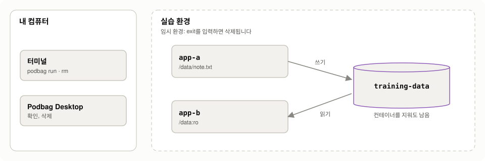

## 초보자 코스

[첫 컨테이너 실행하기](../container-basics/) → [브라우저에서 웹 서버 열기](../web-basics/) → **컨테이너를 바꿔도 파일 남기기** → [웹 서비스 교체하고 정리하기](../web-service-lifecycle/)

[](volume-life.mp4)

## 모듈 설치하기

[volume-persistence.podbag 다운로드](volume-persistence.podbag). Desktop의 **Training** 상단에서 **모듈 설치**를 누릅니다. 다운로드한 파일을 선택하고 확인합니다.

```sh
podbag lab install volume-persistence.podbag
```

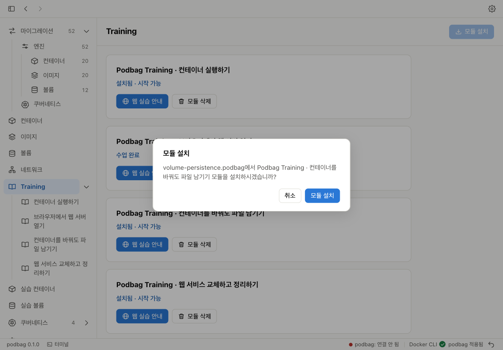

## 실습 시작하기

왼쪽 메뉴에서 **Training**을 펼치고 설치한 모듈을 선택합니다. 시작 명령을 복사해 사용 중인 터미널에서 실행합니다. `training $` 프롬프트가 나타나면 다음 단계로 이동합니다.

```sh
podbag lab start volume-persistence
```

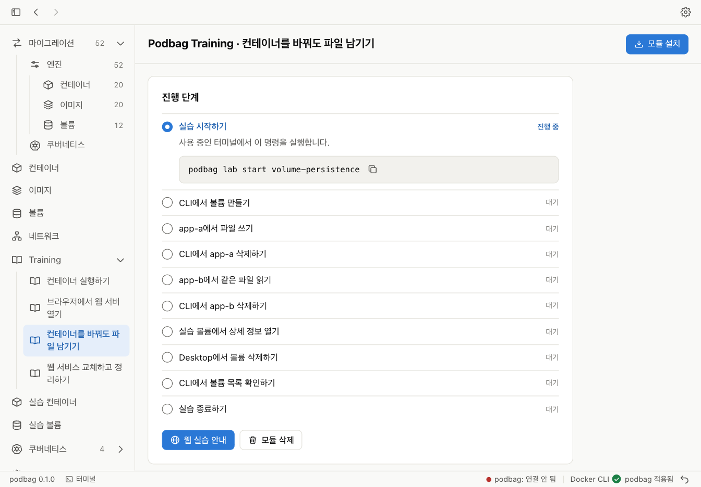

Podbag Desktop 대신 TUI에서 실습하려면 `--tui`를 붙입니다.

```sh
podbag lab start volume-persistence --tui
```

TUI에서는 `:` 키로 명령 단계용 Training 셸을 열고, `exit`를 입력해 TUI로 돌아오며, `q` 키로 실습을 끝냅니다.

## 볼륨 만들기

실습 환경에 `training-data`라는 이름으로 볼륨을 만듭니다.

```sh
podbag volume create training-data
```

- **Podbag Desktop에서:** **실습 볼륨 → 볼륨 training-data 만들기**를 누릅니다.
- **TUI에서:** **볼륨** 탭을 열고 `v` 키를 누른 뒤 `training-data` 입력 후 `Enter` 키를 누릅니다.

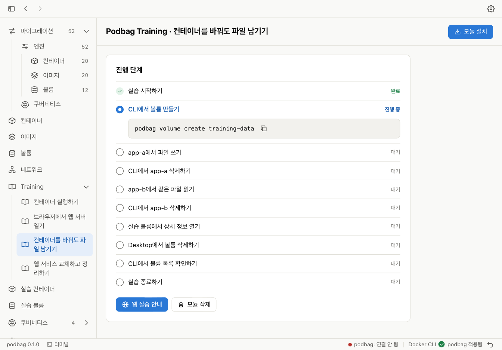

## app-a에서 파일 쓰기

`-v training-data:/data`는 볼륨을 컨테이너에 연결합니다. 명령을 실행하면 `note.txt`가 저장되고 `app-a`가 종료됩니다.

```sh
podbag run --name app-a --network none -v training-data:/data docker.io/library/busybox:1.37.0 sh -c 'printf "%s\n" "hello from app-a" > /data/note.txt'
```

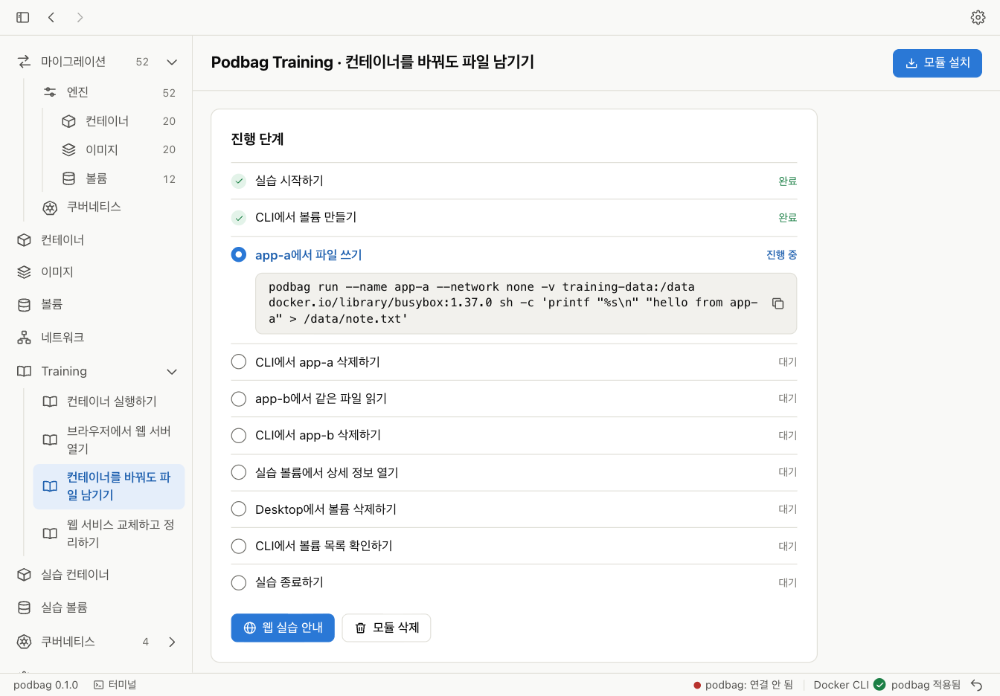

## app-a 삭제하기

종료된 컨테이너를 삭제합니다. 볼륨은 실습 환경에 남습니다.

```sh
podbag rm app-a
```

- **Podbag Desktop에서:** **실습 컨테이너 → app-a → 삭제**를 누르고 확인합니다.
- **TUI에서:** **컨테이너**에서 `app-a` 선택 후 `d` 키, `y` 키를 차례로 누릅니다.

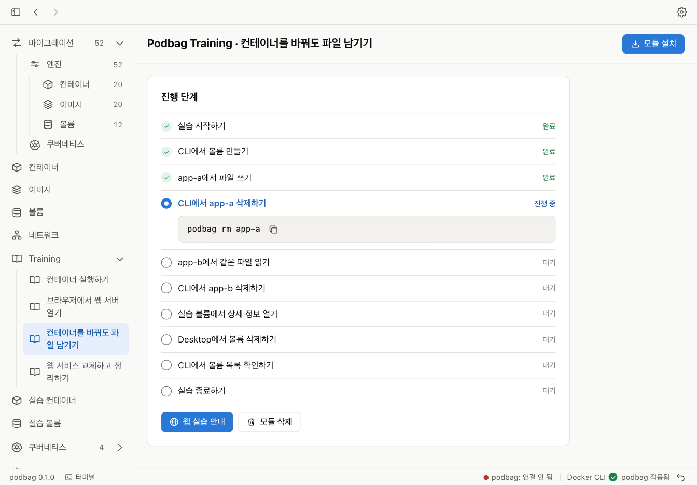

## app-b에서 같은 파일 읽기

`app-b`에 같은 볼륨을 연결합니다. `:ro`는 읽기 전용을 뜻합니다. 터미널에 `hello from app-a`가 표시됩니다.

```sh
podbag run --name app-b --network none -v training-data:/data:ro docker.io/library/busybox:1.37.0 cat /data/note.txt
```

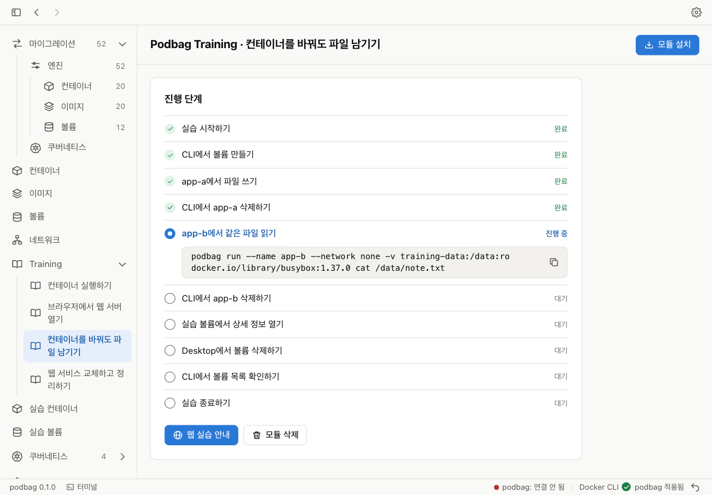


## app-b 삭제하기

두 번째 컨테이너를 삭제해 볼륨 연결을 해제합니다.

```sh
podbag rm app-b
```

- **Podbag Desktop에서:** **실습 컨테이너 → app-b → 삭제**를 누르고 확인합니다.
- **TUI에서:** **컨테이너**에서 `app-b` 선택 후 `d` 키, `y` 키를 차례로 누릅니다.

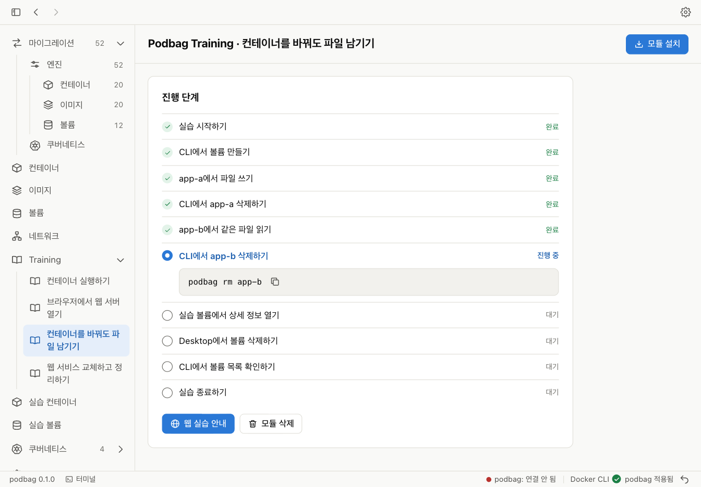

## 볼륨 상세 정보 열기

**실습 볼륨 → training-data**를 누릅니다. 상세 정보에서 볼륨 이름과 마운트 경로를 확인합니다.

- **Podbag Desktop에서:** **실습 볼륨 → training-data**를 누릅니다.
- **TUI에서:** **볼륨**에서 `training-data` 선택 후 `Enter` 키를 누릅니다.


## Desktop에서 볼륨 삭제하기

**삭제**를 누릅니다. 확인 창에 `training-data`가 표시되는지 확인하고 삭제합니다. 볼륨과 그 안의 파일이 삭제됩니다.

- **Podbag Desktop에서:** **실습 볼륨 → training-data → 삭제**를 누르고 확인합니다.
- **TUI에서:** **볼륨**에서 `training-data` 선택 후 `d` 키, `y` 키를 차례로 누릅니다.

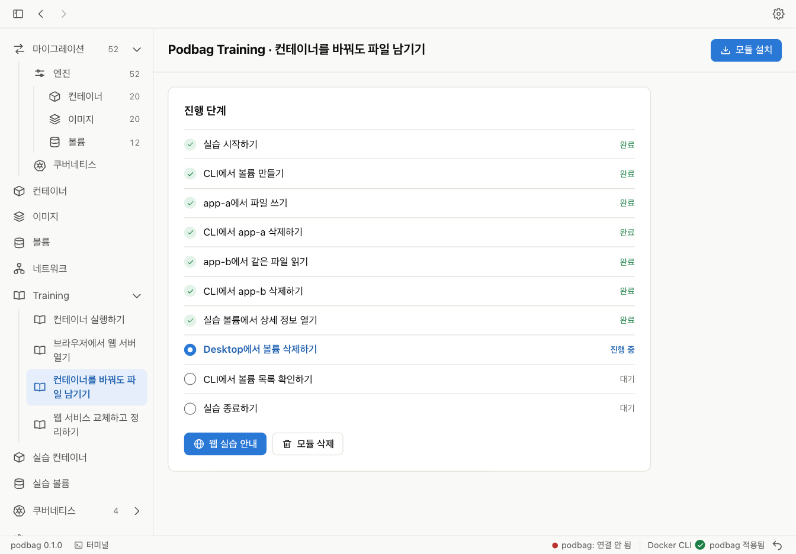


## 볼륨 목록 확인하기

같은 터미널에서 볼륨 목록을 확인합니다. `training-data`가 목록에서 사라집니다.

```sh
podbag volume ls
```

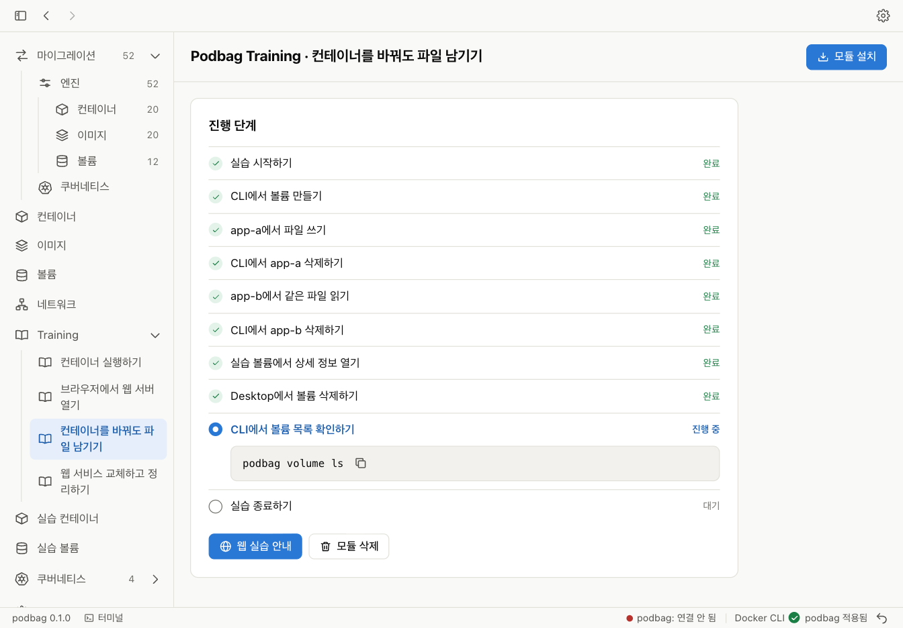

## 실습 종료하기

현재 단계에 종료 명령이 표시되면 입력합니다. 임시 실습 환경을 정리한 뒤 Training에 완료로 표시됩니다.

```sh
exit
```

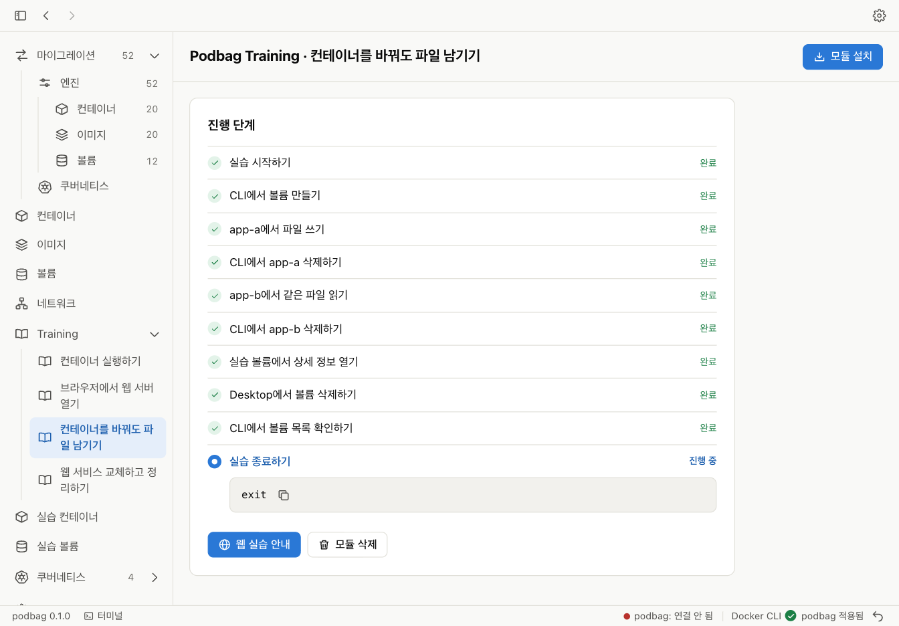

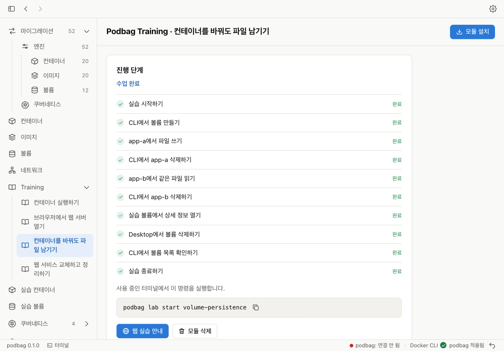

[다음 모듈 · 웹 서비스 교체하고 정리하기](../web-service-lifecycle/)
