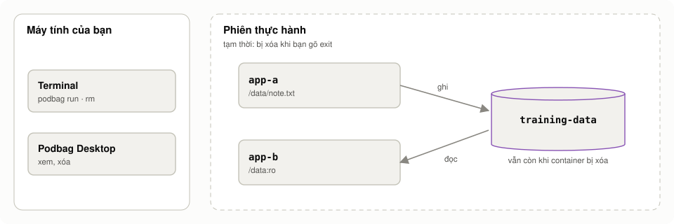
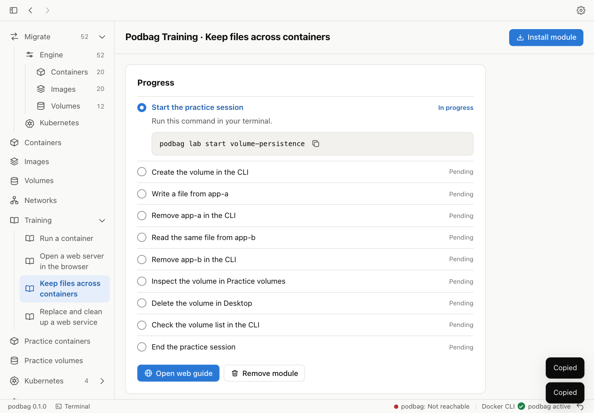
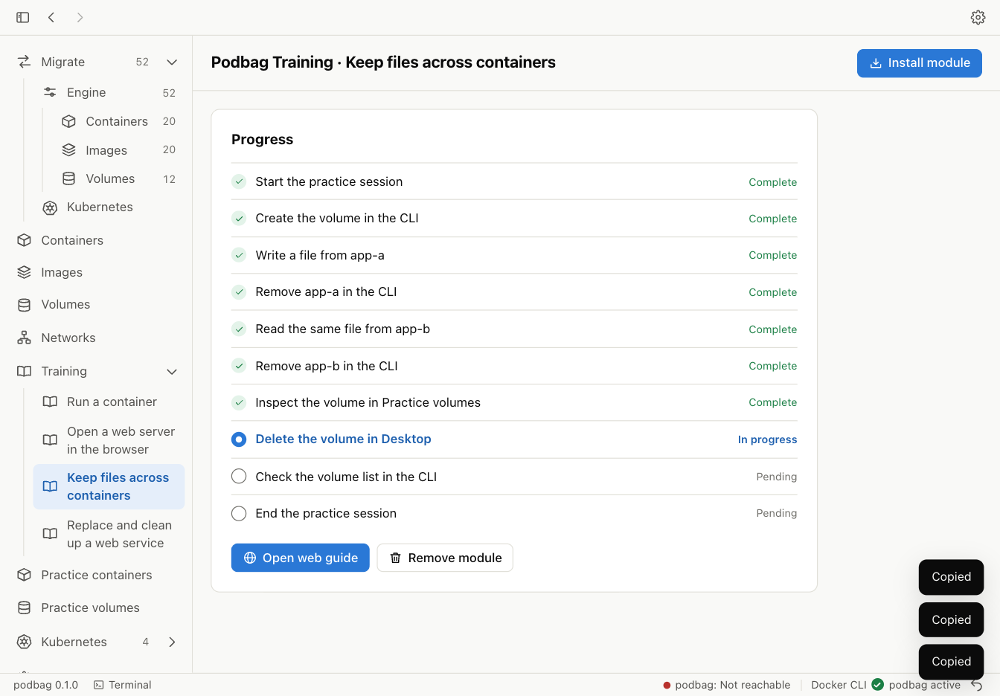
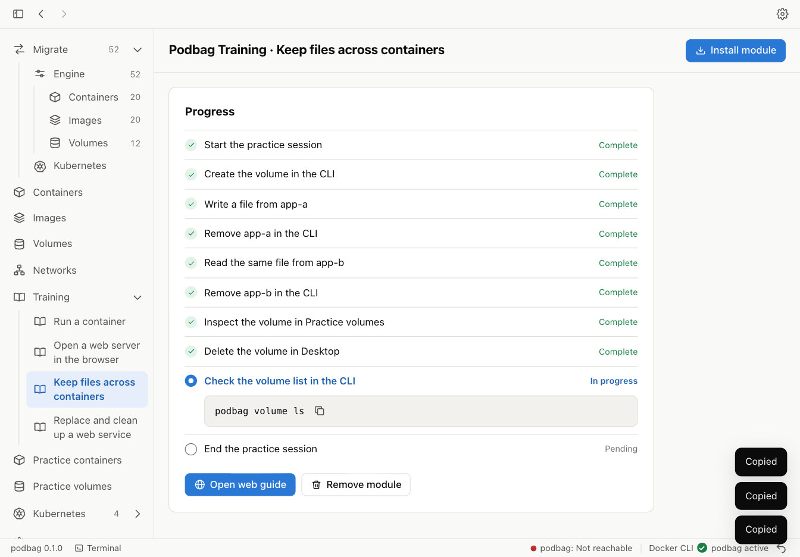

Volume lưu các tệp vẫn còn sau khi container bị xóa. Xem hình động, rồi thử cùng các bước đó với `app-a` và `app-b`.

**Thời gian** 15 phút



## Lộ trình cho người mới

[Chạy container đầu tiên](../container-basics/) → [Mở máy chủ web trong trình duyệt](../web-basics/) → **Giữ tệp khi thay container** → [Thay thế và dọn dẹp dịch vụ web](../web-service-lifecycle/)

[](volume-life.mp4)

## Cài mô-đun

[Tải volume-persistence.podbag](volume-persistence.podbag). Trong Desktop, chọn **Cài mô-đun** ở đầu mục **Training**. Chọn tệp đã tải và xác nhận.

```sh
podbag lab install volume-persistence.podbag
```


## Bắt đầu phiên thực hành

Mở rộng **Training** ở thanh bên và chọn mô-đun. Sao chép lệnh bắt đầu vào terminal của bạn. Tiếp tục khi thấy dấu nhắc `training $`.

```sh
podbag lab start volume-persistence
```



Để làm các bước trong TUI thay cho Podbag Desktop, hãy thêm `--tui`.

```sh
podbag lab start volume-persistence --tui
```

Trong TUI, nhấn `:` để mở shell Training cho bước chạy lệnh, gõ `exit` để quay lại TUI và nhấn `q` để kết thúc phiên.

## Tạo volume

Tạo volume có tên `training-data` trong phiên thực hành.

```sh
podbag volume create training-data
```

- **Trong Podbag Desktop:** Chọn **Volume thực hành → Tạo volume training-data**.
- **Trong TUI:** Mở **Volume**, nhấn `v`, gõ `training-data` rồi nhấn `Enter`.


## Ghi tệp từ app-a

`-v training-data:/data` gắn volume vào container. Lệnh này ghi `note.txt`, rồi `app-a` thoát.

```sh
podbag run --name app-a --network none -v training-data:/data docker.io/library/busybox:1.37.0 sh -c 'printf "%s\n" "hello from app-a" > /data/note.txt'
```


## Xóa app-a

Xóa container đã dừng. Volume vẫn còn trong phiên thực hành.

```sh
podbag rm app-a
```

- **Trong Podbag Desktop:** Chọn **Container thực hành → app-a → Xóa** và xác nhận.
- **Trong TUI:** Chọn `app-a` trong **Container**, nhấn `d`, rồi nhấn `y`.


## Đọc tệp từ app-b

`app-b` gắn cùng volume đó. Hậu tố `:ro` làm cho volume chỉ đọc. Terminal hiển thị `hello from app-a`.

```sh
podbag run --name app-b --network none -v training-data:/data:ro docker.io/library/busybox:1.37.0 cat /data/note.txt
```


## Xóa app-b

Xóa container thứ hai để giải phóng volume trước khi xóa volume.

```sh
podbag rm app-b
```

- **Trong Podbag Desktop:** Chọn **Container thực hành → app-b → Xóa** và xác nhận.
- **Trong TUI:** Chọn `app-b` trong **Container**, nhấn `d`, rồi nhấn `y`.


## Mở chi tiết volume

Chọn **Volume thực hành → training-data**. Phần chi tiết hiển thị tên và điểm gắn (mount point) của volume.

- **Trong Podbag Desktop:** Chọn **Volume thực hành → training-data**.
- **Trong TUI:** Chọn `training-data` trong **Volume** rồi nhấn `Enter`.


## Xóa volume trong Desktop

Chọn **Xóa** và kiểm tra rằng hộp thoại ghi tên `training-data`. Volume và tệp bên trong bị xóa.

- **Trong Podbag Desktop:** Chọn **Volume thực hành → training-data → Xóa** và xác nhận.
- **Trong TUI:** Chọn `training-data` trong **Volume**, nhấn `d`, rồi nhấn `y`.




## Kiểm tra danh sách volume

Quay lại cùng terminal. Danh sách volume không còn `training-data`.

```sh
podbag volume ls
```



## Kết thúc phiên thực hành

Chạy lệnh ở bước cuối cùng. Training ghi nhận hoàn thành sau khi môi trường thực hành đã được xóa.

```sh
exit
```


[Mô-đun tiếp theo · Thay thế và dọn dẹp dịch vụ web](../web-service-lifecycle/)
