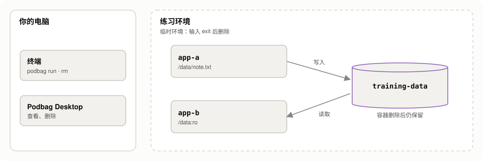
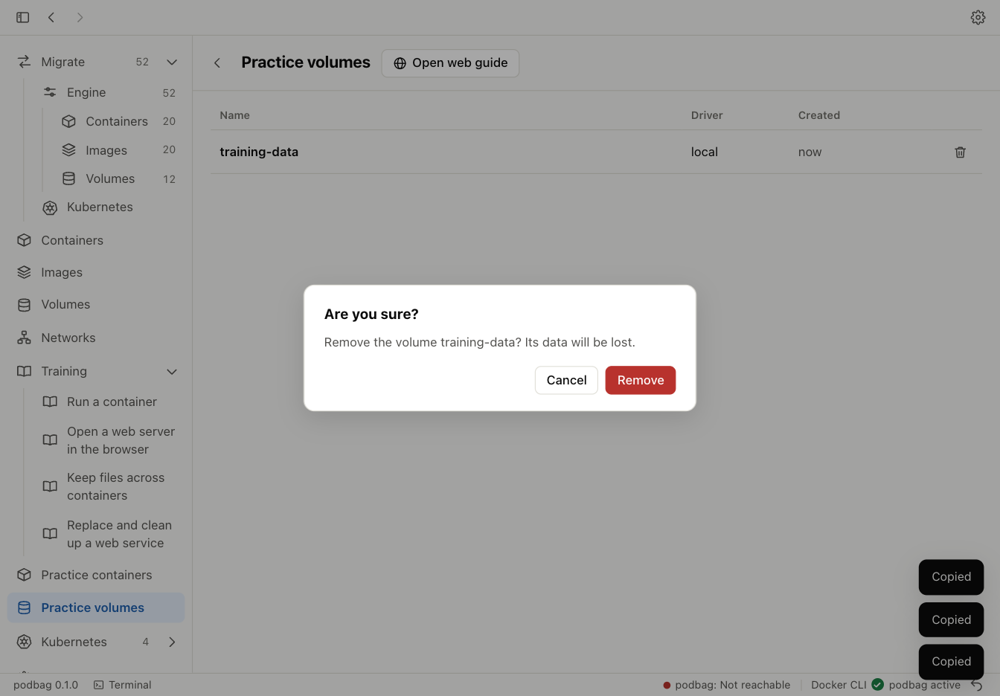
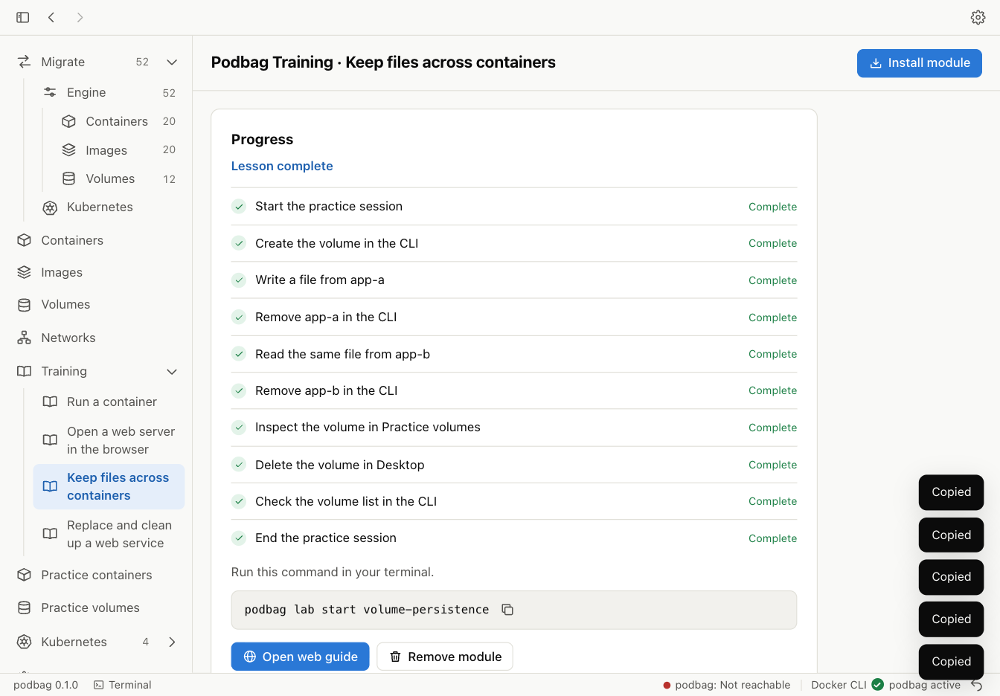

卷中保存的文件在删除容器后仍可保留。先观看动画，再用 `app-a` 和 `app-b` 按相同顺序操作一遍。

**预计用时** 15 分钟



## 入门课程

[运行第一个容器](../container-basics/) → [在浏览器中打开 Web 服务器](../web-basics/) → **在不同容器之间保留文件** → [替换并清理 Web 服务](../web-service-lifecycle/)

[](volume-life.mp4)

## 安装模块

[下载 volume-persistence.podbag](volume-persistence.podbag)。在 Desktop 中，点击 **Training** 顶部的**安装模块**。选择下载的文件并确认。

```sh
podbag lab install volume-persistence.podbag
```


## 开始实验

在侧栏中展开 **Training**，选择该模块。将启动命令复制到终端中运行。终端显示 `training $` 提示符后继续。

```sh
podbag lab start volume-persistence
```


## 创建卷

在练习环境中创建名为 `training-data` 的卷。

```sh
podbag volume create training-data
```


## 从 app-a 写入文件

`-v training-data:/data` 将卷连接到容器。这条命令写入 `note.txt`，然后 `app-a` 退出。

```sh
podbag run --name app-a --network none -v training-data:/data docker.io/library/busybox:1.37.0 sh -c 'printf "%s\n" "hello from app-a" > /data/note.txt'
```


## 删除 app-a

删除已停止的容器。卷仍保留在练习环境中。

```sh
podbag rm app-a
```


## 从 app-b 读取文件

`app-b` 挂载同一个卷。`:ro` 后缀让卷变为只读。终端显示 `hello from app-a`。

```sh
podbag run --name app-b --network none -v training-data:/data:ro docker.io/library/busybox:1.37.0 cat /data/note.txt
```


## 删除 app-b

删除第二个容器，释放卷，然后才能删除卷。

```sh
podbag rm app-b
```


## 打开卷详情

选择**实验卷 → training-data**。详情中显示卷名和挂载点。


## 在 Desktop 中删除卷

点击**删除**，确认对话框中显示的是 `training-data`。卷及其中的文件会被删除。




## 检查卷列表

回到同一个终端。卷列表中不再有 `training-data`。

```sh
podbag volume ls
```


## 结束实验

运行最后一步中显示的命令。练习环境删除后，Training 会记录完成。

```sh
exit
```




[下一个模块 · 替换并清理 Web 服务](../web-service-lifecycle/)
