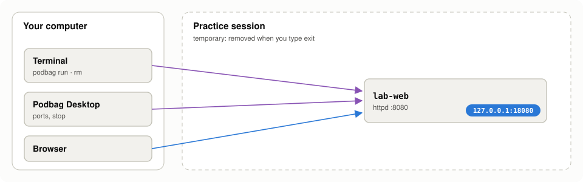
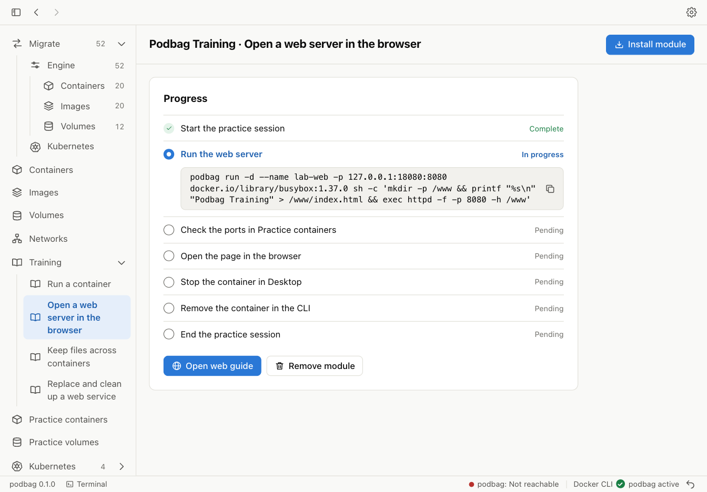
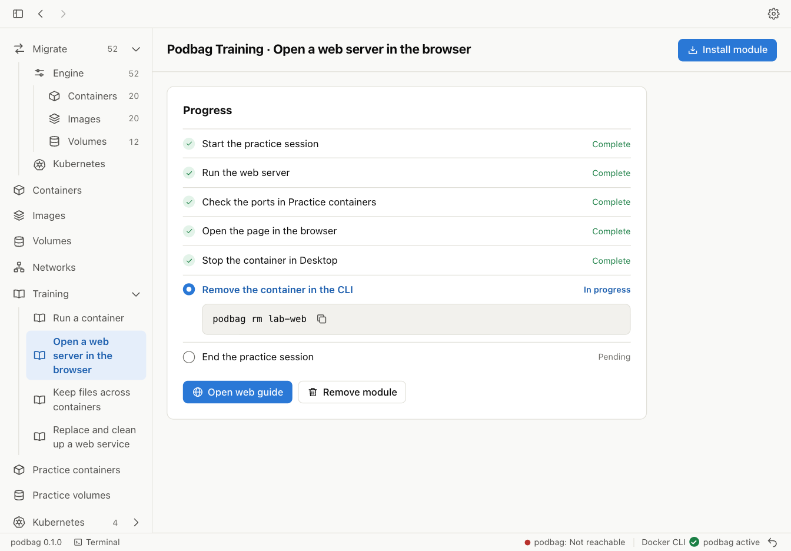

A web server listens on a port inside its container. Publishing a port gives your browser an address on your computer. In this module, the address is restricted to this computer.

**Time** 10 minutes



## Beginner course

[Run your first container](../container-basics/) → **Open a web server in the browser** → [Keep files across containers](../volume-persistence/) → [Replace and clean up a web service](../web-service-lifecycle/)

## Install the module

[Download web-basics.podbag](web-basics.podbag). In Desktop, select **Install module** at the top of **Training**. Choose the downloaded file and confirm.

```sh
podbag lab install web-basics.podbag
```


## Start the practice session

Expand **Training** in the sidebar and select the module. Copy the start command into your terminal. Continue when it shows the `training $` prompt.

```sh
podbag lab start web-basics
```


If the default port is already in use, use the port in Training. The command and browser address show the same port.

## Run the web server

Copy the command from the current step. It runs BusyBox and serves the file `/www/index.html`. The first run downloads the image.

```sh
podbag run -d --name lab-web -p 127.0.0.1:18080:8080 docker.io/library/busybox:1.37.0 sh -c 'mkdir -p /www && printf "%s\n" "Podbag Training" > /www/index.html && exec httpd -f -p 8080 -h /www'
```



## Check the port mapping in Desktop

Open **Practice containers → lab-web → View ports**. The default mapping is `127.0.0.1:18080 → 8080/tcp`. The first port belongs to your computer. The second belongs to the container.


## Open the page in the browser

Select **Open in browser**. The page shows **Podbag Training**. Desktop checks that the local address returns HTTP 200 and the expected text.


## Stop the server in Desktop

Return to **Practice containers**. Find `lab-web` and select **Stop** in its row.


## Remove the stopped container

Run the removal command in the same terminal. The next step appears when `lab-web` is gone.

```sh
podbag rm lab-web
```



## Finish the practice session

Run the command shown in the final step. Training records completion after the practice environment has been removed.

```sh
exit
```


[Next module · Keep files across containers](../volume-persistence/)
