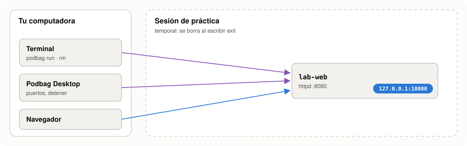
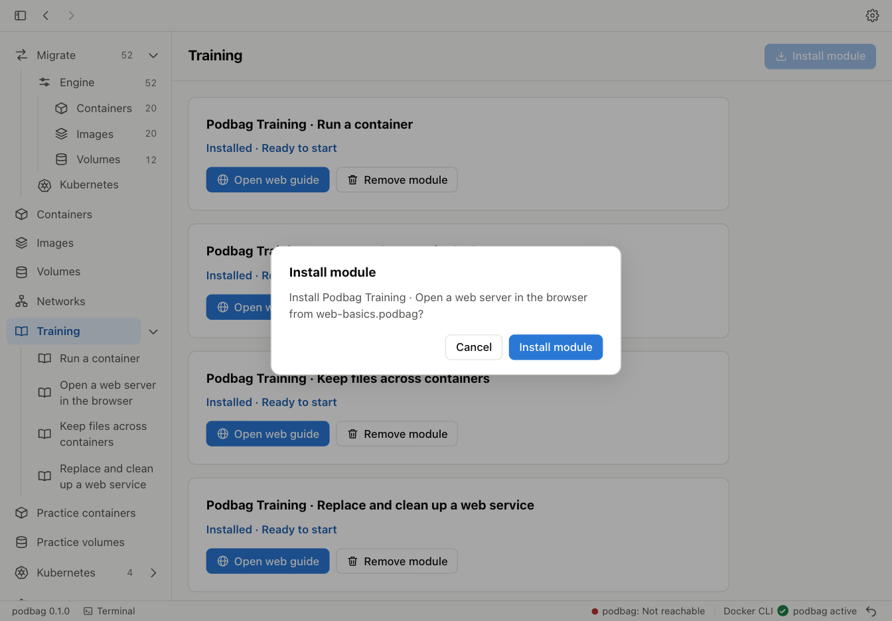
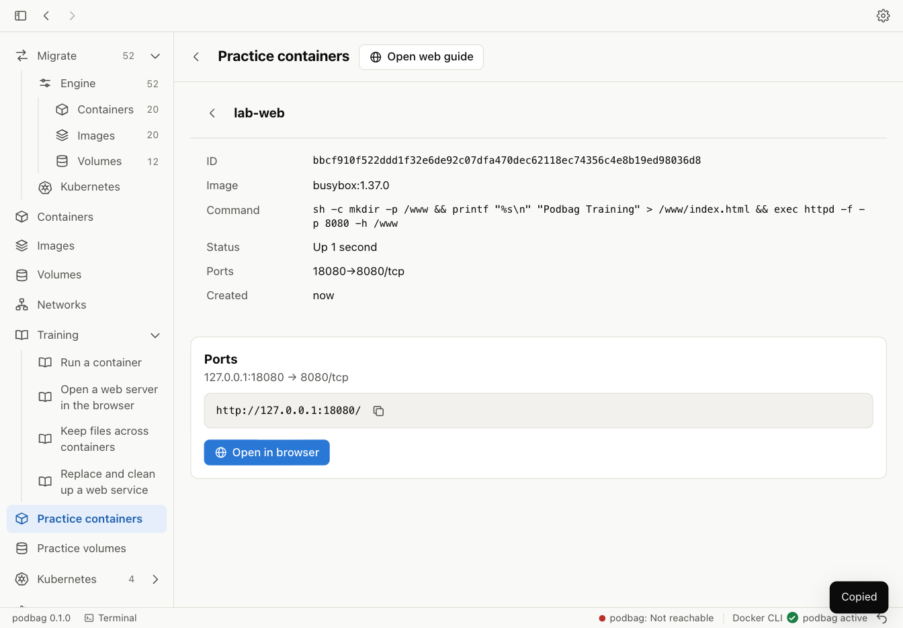

Un servidor web escucha en un puerto dentro de su contenedor. Al publicar un puerto, tu navegador obtiene una dirección en tu computadora. En este módulo, esa dirección solo funciona en esta computadora.

**Tiempo** 10 minutos



## Curso de iniciación

[Ejecuta tu primer contenedor](../container-basics/) → **Abre un servidor web en el navegador** → [Conserva archivos entre contenedores](../volume-persistence/) → [Sustituye y limpia un servicio web](../web-service-lifecycle/)

## Instala el módulo

[Descargar web-basics.podbag](web-basics.podbag). En Desktop, selecciona **Instalar módulo** en la parte superior de **Training**. Elige el archivo descargado y confirma.

```sh
podbag lab install web-basics.podbag
```



## Inicia la sesión de práctica

Despliega **Training** en la barra lateral y selecciona el módulo. Copia el comando de inicio en tu terminal. Continúa cuando aparezca el prompt `training $`.

```sh
podbag lab start web-basics
```


Para hacer los pasos en la TUI en lugar de Podbag Desktop, añade `--tui`.

```sh
podbag lab start web-basics --tui
```

En la TUI, pulsa `:` para abrir la shell de Training cuando un paso pida un comando, escribe `exit` para volver a la TUI y pulsa `q` para terminar la sesión.

Si el puerto predeterminado ya está en uso, usa el puerto que indica Training. El comando y la dirección del navegador muestran el mismo puerto.

## Ejecuta el servidor web

Copia el comando del paso actual. Ejecuta BusyBox y sirve el archivo `/www/index.html`. La primera vez se descarga la imagen.

```sh
podbag run -d --name lab-web -p 127.0.0.1:18080:8080 docker.io/library/busybox:1.37.0 sh -c 'mkdir -p /www && printf "%s\n" "Podbag Training" > /www/index.html && exec httpd -f -p 8080 -h /www'
```


## Comprueba la asignación de puertos en Desktop

Abre **Contenedores de práctica → lab-web → Ver puertos**. La asignación predeterminada es `127.0.0.1:18080 → 8080/tcp`. El primer puerto es de tu computadora. El segundo es del contenedor.

- **En Podbag Desktop:** Selecciona **Contenedores de práctica → lab-web → Ver puertos**.
- **En la TUI:** Selecciona `lab-web` en **Contenedores** y pulsa `Enter`.




## Abre la página en el navegador

Selecciona **Abrir en el navegador**. La página muestra **Podbag Training**. Desktop comprueba que la dirección local devuelve HTTP 200 y el texto esperado.

- **En Podbag Desktop:** Selecciona **Abrir en el navegador**.
- **En la TUI:** Abre `http://127.0.0.1:18080/` en un navegador. Cuando se vea la página, pulsa `o`.


## Detén el servidor en Desktop

Vuelve a **Contenedores de práctica**. Busca `lab-web` y selecciona **Detener** en su fila.

- **En Podbag Desktop:** Selecciona **Contenedores de práctica → lab-web → Detener**.
- **En la TUI:** Selecciona `lab-web` en **Contenedores** y pulsa `x`.


## Elimina el contenedor detenido

Ejecuta el comando de eliminación en la misma terminal. El siguiente paso aparece cuando `lab-web` ya no existe.

```sh
podbag rm lab-web
```

- **En Podbag Desktop:** Selecciona **Contenedores de práctica → lab-web → Eliminar** y confirma.
- **En la TUI:** Selecciona `lab-web` en **Contenedores**, pulsa `d` y luego `y`.


## Termina la sesión de práctica

Ejecuta el comando del último paso. Training registra la finalización cuando se ha eliminado el entorno de práctica.

```sh
exit
```


[Siguiente módulo · Conserva archivos entre contenedores](../volume-persistence/)
