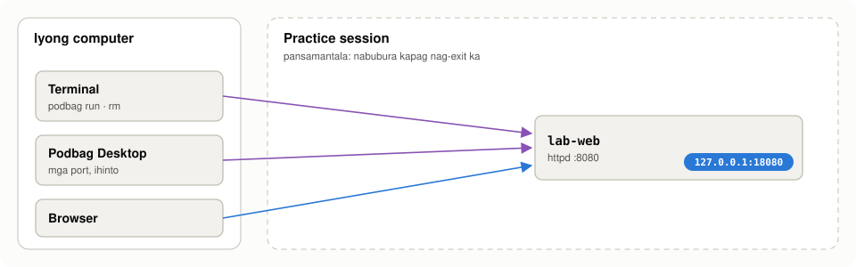
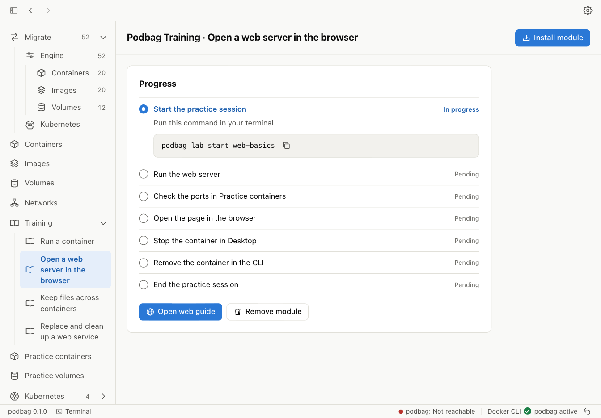
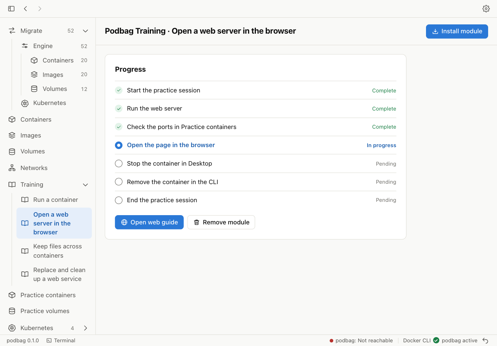
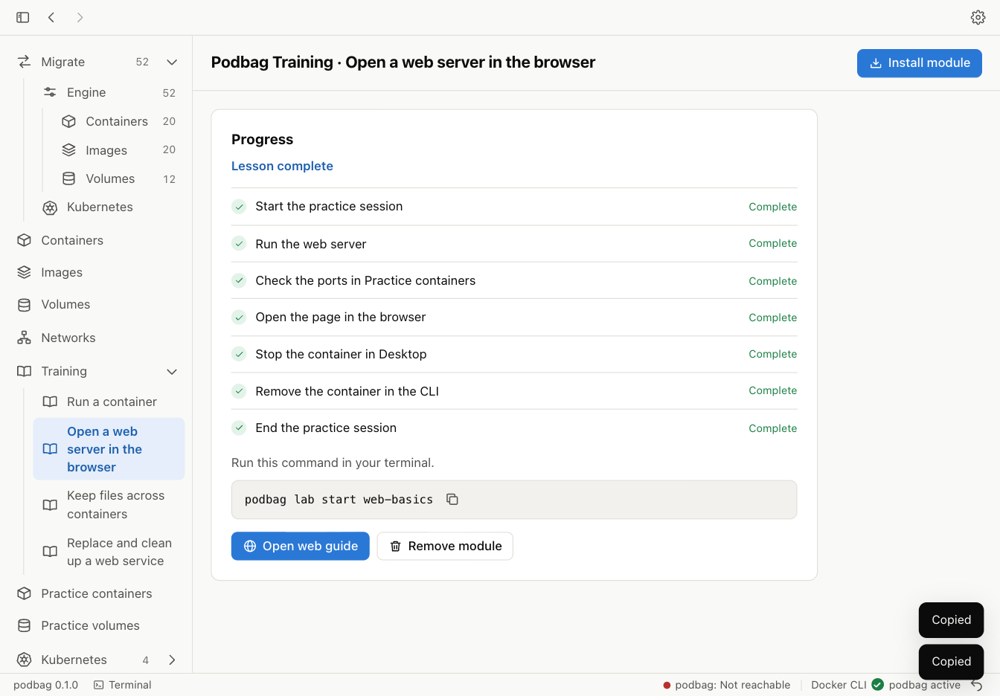

Nakikinig ang web server sa isang port sa loob ng container nito. Kapag ini-publish mo ang port, makakakuha ang browser mo ng address sa computer mo. Sa module na ito, magagamit lang ang address sa computer na ito.

**Oras** 10 minuto



## Kurso para sa baguhan

[Patakbuhin ang iyong unang container](../container-basics/) → **Buksan ang web server sa browser** → [Panatilihin ang mga file sa pagitan ng mga container](../volume-persistence/) → [Palitan at linisin ang web service](../web-service-lifecycle/)

## I-install ang module

[I-download ang web-basics.podbag](web-basics.podbag). Sa Desktop, piliin ang **I-install ang module** sa itaas ng **Training**. Piliin ang na-download na file at kumpirmahin.

```sh
podbag lab install web-basics.podbag
```


## Simulan ang practice session

Palawakin ang **Training** sa sidebar at piliin ang module. Kopyahin ang command sa pagsisimula sa terminal mo. Magpatuloy kapag lumabas ang prompt na `training $`.

```sh
podbag lab start web-basics
```



Kung gamit na ang default na port, gamitin ang port na nasa Training. Pareho ang port sa command at sa address ng browser.

## Patakbuhin ang web server

Kopyahin ang command ng kasalukuyang hakbang. Pinapatakbo nito ang BusyBox at inihahain ang file na `/www/index.html`. Dina-download ang image sa unang pagpapatakbo.

```sh
podbag run -d --name lab-web -p 127.0.0.1:18080:8080 docker.io/library/busybox:1.37.0 sh -c 'mkdir -p /www && printf "%s\n" "Podbag Training" > /www/index.html && exec httpd -f -p 8080 -h /www'
```


## Tingnan ang port mapping sa Desktop

Buksan ang **Mga practice container → lab-web → Tingnan ang mga port**. Ang default na mapping ay `127.0.0.1:18080 → 8080/tcp`. Sa computer mo ang unang port. Sa container ang pangalawa.


## Buksan ang page sa browser

Piliin ang **Buksan sa browser**. Ipinapakita ng page ang **Podbag Training**. Sinusuri ng Desktop na nagbabalik ang lokal na address ng HTTP 200 at ng inaasahang text.




## Ihinto ang server sa Desktop

Bumalik sa **Mga practice container**. Hanapin ang `lab-web` at piliin ang **Ihinto** sa hanay nito.


## Alisin ang nakahintong container

Patakbuhin ang command sa pag-alis sa parehong terminal. Lalabas ang susunod na hakbang kapag wala na ang `lab-web`.

```sh
podbag rm lab-web
```


## Tapusin ang practice session

Patakbuhin ang command sa huling hakbang. Itatala ng Training ang pagkumpleto pagkatapos maalis ang practice environment.

```sh
exit
```




[Susunod na module · Panatilihin ang mga file sa pagitan ng mga container](../volume-persistence/)
