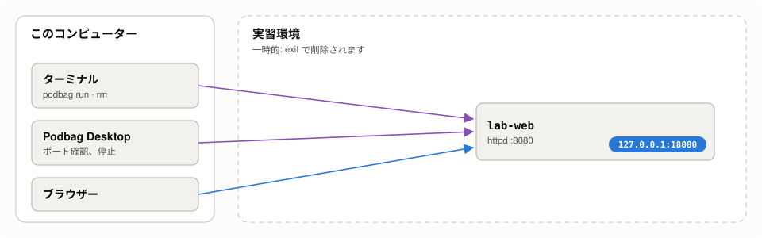

Web サーバーはコンテナ内のポートで待ち受けます。ポートを公開すると、ブラウザーはこのコンピューター上のアドレスで接続できます。このモジュールのアドレスは、このコンピューターからだけ開けます。

**所要時間** 10 分



## 初心者コース

[最初のコンテナを実行する](../container-basics/) → **ブラウザーで Web サーバーを開く** → [コンテナが変わってもファイルを残す](../volume-persistence/) → [Web サービスを入れ替えて片付ける](../web-service-lifecycle/)

## モジュールをインストールする

[web-basics.podbag をダウンロード](web-basics.podbag)します。Desktop で **Training** の上部にある**モジュールをインストール**を選びます。ダウンロードしたファイルを指定して確認します。

```sh
podbag lab install web-basics.podbag
```


## 実習を開始する

サイドバーの **Training** を展開し、モジュールを選びます。開始コマンドをコピーし、ターミナルで実行します。`training $` プロンプトが表示されたら続けます。

```sh
podbag lab start web-basics
```


既定のポートがすでに使われている場合は、Training に表示されるポートを使います。コマンドとブラウザーのアドレスには同じポートが表示されます。

## Web サーバーを実行する

現在の手順のコマンドをコピーします。このコマンドは BusyBox を実行し、ファイル `/www/index.html` を配信します。初回の実行ではイメージをダウンロードします。

```sh
podbag run -d --name lab-web -p 127.0.0.1:18080:8080 docker.io/library/busybox:1.37.0 sh -c 'mkdir -p /www && printf "%s\n" "Podbag Training" > /www/index.html && exec httpd -f -p 8080 -h /www'
```


## Desktop でポートの対応を確認する

**実習コンテナ → lab-web → ポートを表示**を開きます。既定の対応は `127.0.0.1:18080 → 8080/tcp` です。最初のポートはこのコンピューターのポートです。2 つ目のポートはコンテナのポートです。


## ブラウザーでページを開く

**ブラウザーで開く**を選びます。ページに **Podbag Training** と表示されます。Desktop は、ローカルのアドレスが HTTP 200 と期待どおりのテキストを返すことを確認します。


## Desktop でサーバーを停止する

**実習コンテナ**に戻ります。`lab-web` を探し、その行の**停止**を選びます。


## 停止したコンテナを削除する

同じターミナルで削除のコマンドを実行します。`lab-web` がなくなると、次の手順が表示されます。

```sh
podbag rm lab-web
```


## 実習を終了する

最後の手順に表示されるコマンドを実行します。実習環境が削除された後、Training に完了が記録されます。

```sh
exit
```


[次のモジュール · コンテナが変わってもファイルを残す](../volume-persistence/)
