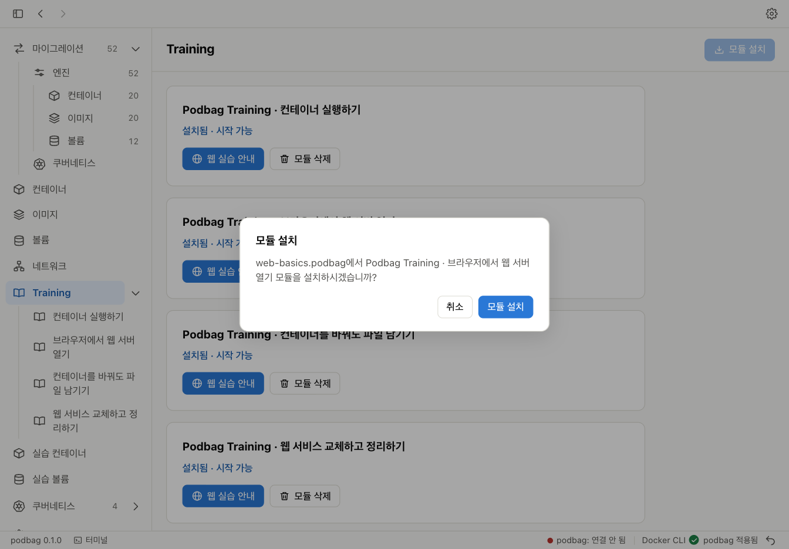
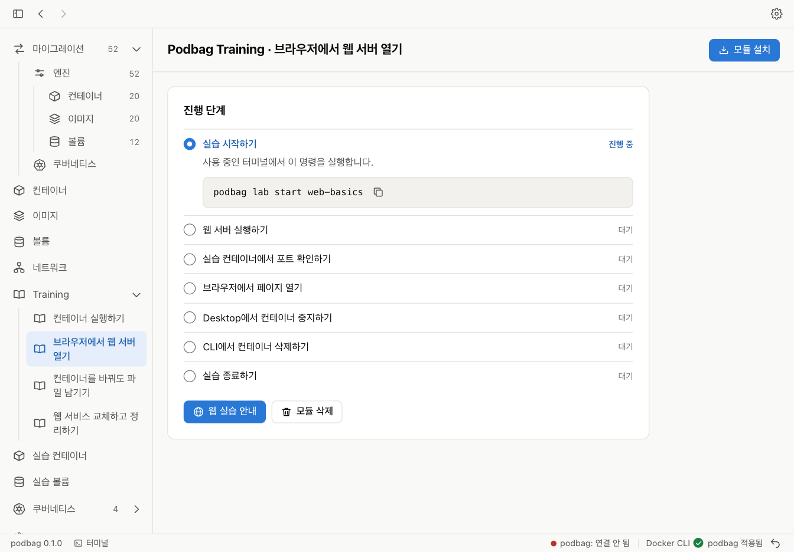
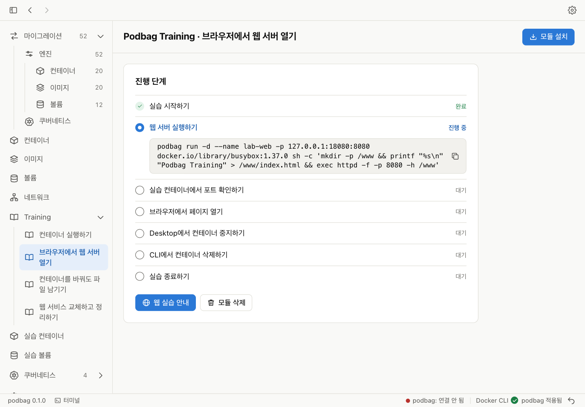
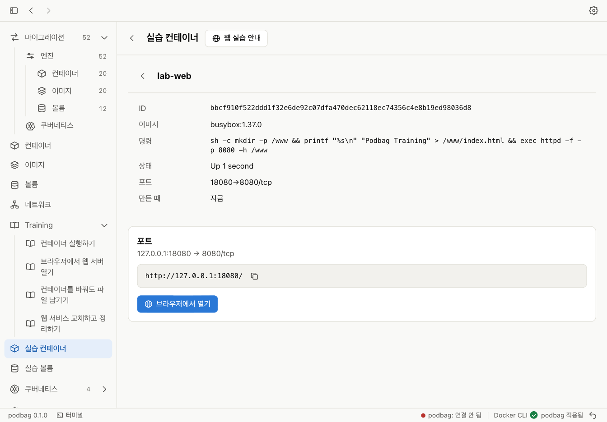
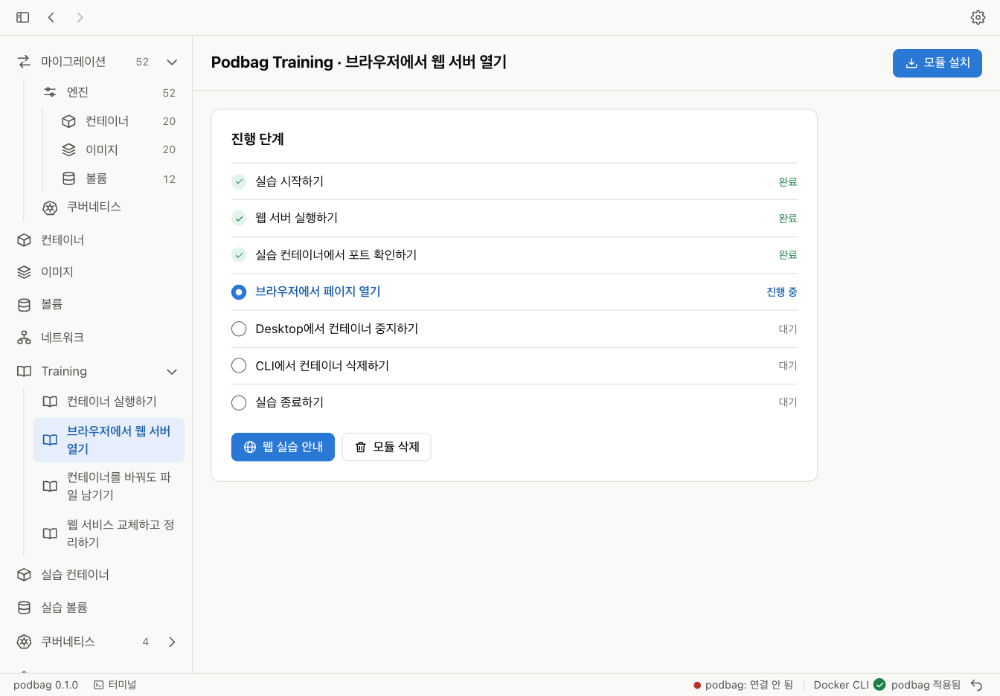
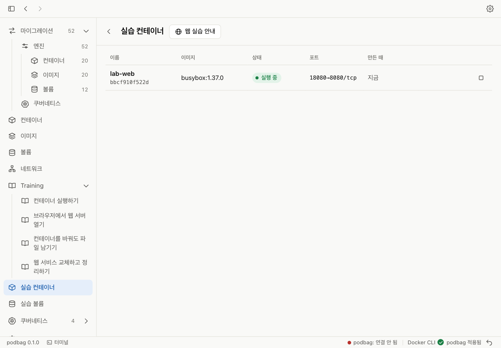
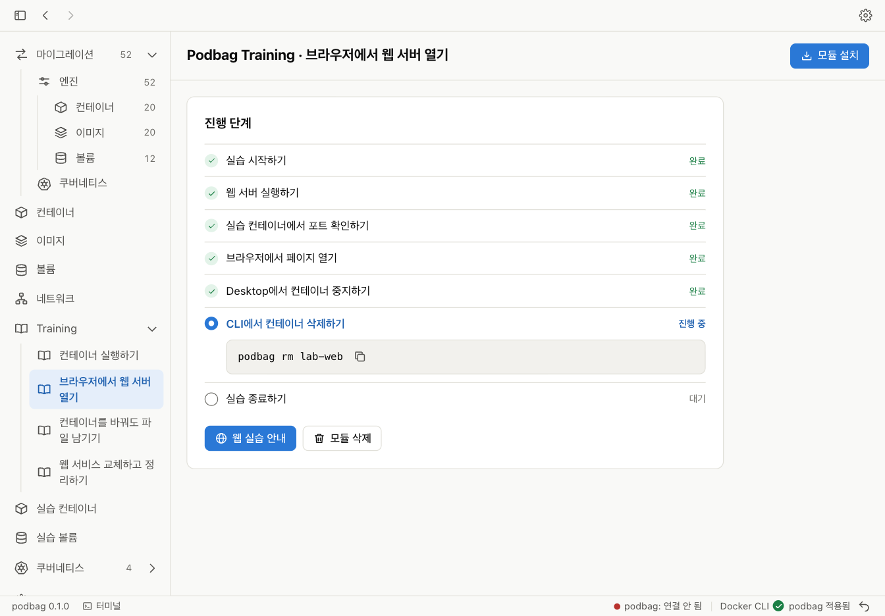
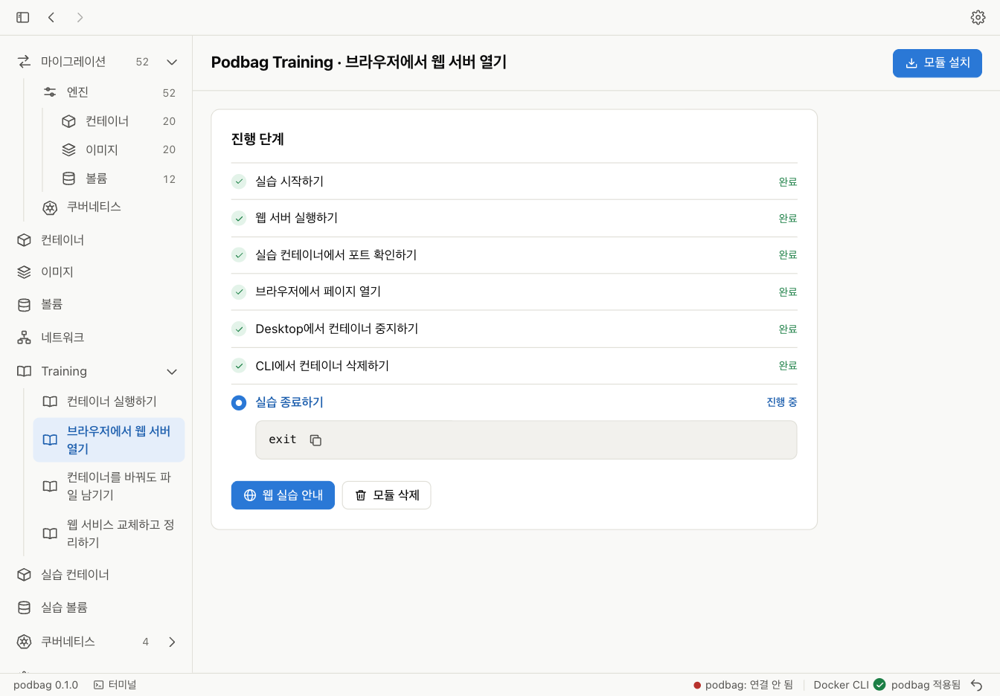
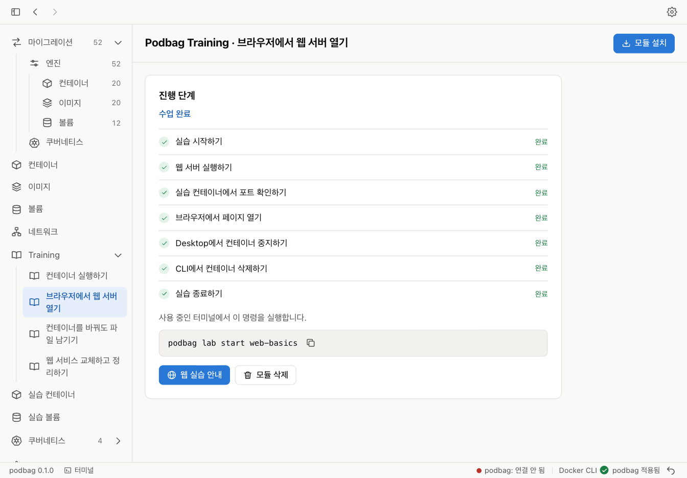

웹 서버는 컨테이너 안의 포트에서 요청을 받습니다. 포트를 연결하면 내 컴퓨터의 브라우저에서 접속할 수 있습니다. 이 실습의 주소는 내 컴퓨터에서만 열립니다.

**예상 시간** 10분

## 초보자 코스

[첫 컨테이너 실행하기](../container-basics/) → **브라우저에서 웹 서버 열기** → [컨테이너를 바꿔도 파일 남기기](../volume-persistence/) → [웹 서비스 교체하고 정리하기](../web-service-lifecycle/)

## 모듈 설치하기

[web-basics.podbag 다운로드](web-basics.podbag). Desktop의 **Training** 상단에서 **모듈 설치**를 누릅니다. 다운로드한 파일을 선택하고 확인합니다.

```sh
podbag lab install web-basics.podbag
```



## 실습 시작하기

왼쪽 메뉴에서 **Training**을 펼치고 설치한 모듈을 선택합니다. 시작 명령을 복사해 사용 중인 터미널에서 실행합니다. `training $` 프롬프트가 나타나면 다음 단계로 이동합니다.

```sh
podbag lab start web-basics
```



기본 포트가 사용 중이면 Training에 표시된 포트를 사용합니다. 실행 명령과 접속 주소에 같은 포트가 표시됩니다.

## 웹 서버 실행하기

현재 단계의 명령을 복사합니다. BusyBox가 `/www/index.html` 파일을 제공합니다. 처음 실행할 때 이미지를 내려받습니다.

```sh
podbag run -d --name lab-web -p 127.0.0.1:18080:8080 docker.io/library/busybox:1.37.0 sh -c 'mkdir -p /www && printf "%s\n" "Podbag Training" > /www/index.html && exec httpd -f -p 8080 -h /www'
```



## Desktop에서 포트 확인하기

**실습 컨테이너 → lab-web → 포트 보기**를 누릅니다. 기본 연결은 `127.0.0.1:18080 → 8080/tcp`입니다. 앞 숫자는 컴퓨터의 포트입니다. 뒤 숫자는 컨테이너의 포트입니다.




## 브라우저에서 페이지 열기

**브라우저에서 열기**를 누릅니다. 페이지에 **Podbag Training**이 표시됩니다. Desktop이 로컬 주소의 HTTP 200 응답과 본문을 확인합니다.




## Desktop에서 웹 서버 중지하기

**실습 컨테이너**로 돌아갑니다. `lab-web`의 행에서 **중지**를 누릅니다.




## 중지한 컨테이너 삭제하기

같은 터미널에서 삭제 명령을 실행합니다. `lab-web`이 목록에서 사라지면 다음 단계로 넘어갑니다.

```sh
podbag rm lab-web
```



## 실습 종료하기

현재 단계에 종료 명령이 표시되면 입력합니다. 임시 실습 환경을 정리한 뒤 Training에 완료로 표시됩니다.

```sh
exit
```





[다음 모듈 · 컨테이너를 바꿔도 파일 남기기](../volume-persistence/)
