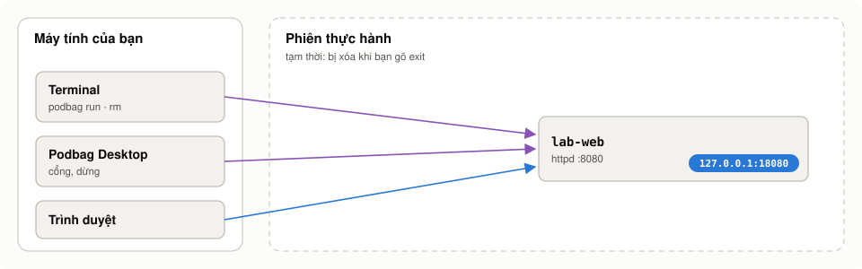
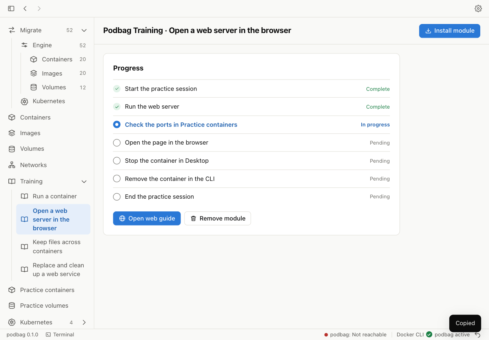
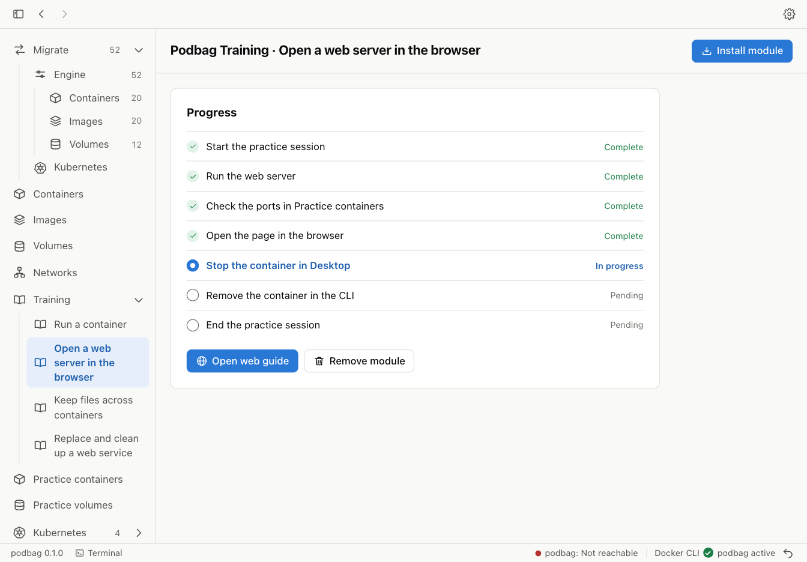
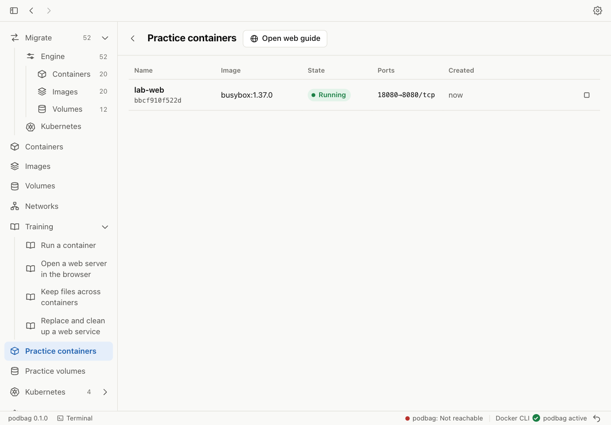
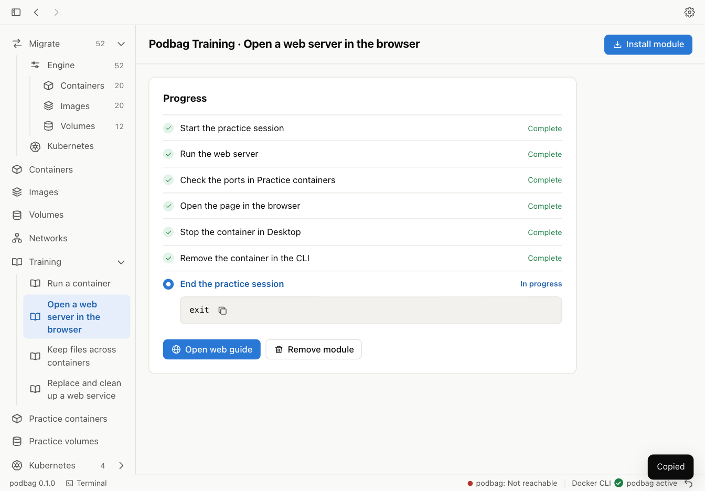

Máy chủ web nhận yêu cầu ở một cổng bên trong container. Khi công bố cổng, trình duyệt có một địa chỉ trên máy tính của bạn. Trong mô-đun này, địa chỉ đó chỉ mở được trên máy tính này.

**Thời gian** 10 phút



## Lộ trình cho người mới

[Chạy container đầu tiên](../container-basics/) → **Mở máy chủ web trong trình duyệt** → [Giữ tệp khi thay container](../volume-persistence/) → [Thay thế và dọn dẹp dịch vụ web](../web-service-lifecycle/)

## Cài mô-đun

[Tải web-basics.podbag](web-basics.podbag). Trong Desktop, chọn **Cài mô-đun** ở đầu mục **Training**. Chọn tệp đã tải và xác nhận.

```sh
podbag lab install web-basics.podbag
```


## Bắt đầu phiên thực hành

Mở rộng **Training** ở thanh bên và chọn mô-đun. Sao chép lệnh bắt đầu vào terminal của bạn. Tiếp tục khi thấy dấu nhắc `training $`.

```sh
podbag lab start web-basics
```


Nếu cổng mặc định đang được dùng, hãy dùng cổng hiển thị trong Training. Lệnh và địa chỉ trình duyệt hiển thị cùng một cổng.

## Chạy máy chủ web

Sao chép lệnh của bước hiện tại. Lệnh này chạy BusyBox và phục vụ tệp `/www/index.html`. Lần chạy đầu sẽ tải image về.

```sh
podbag run -d --name lab-web -p 127.0.0.1:18080:8080 docker.io/library/busybox:1.37.0 sh -c 'mkdir -p /www && printf "%s\n" "Podbag Training" > /www/index.html && exec httpd -f -p 8080 -h /www'
```


## Kiểm tra ánh xạ cổng trong Desktop

Mở **Container thực hành → lab-web → Xem cổng**. Ánh xạ mặc định là `127.0.0.1:18080 → 8080/tcp`. Cổng đầu tiên thuộc về máy tính của bạn. Cổng thứ hai thuộc về container.




## Mở trang trong trình duyệt

Chọn **Mở trong trình duyệt**. Trang hiển thị **Podbag Training**. Desktop kiểm tra rằng địa chỉ cục bộ trả về HTTP 200 và đúng nội dung mong đợi.


## Dừng máy chủ trong Desktop

Quay lại **Container thực hành**. Tìm `lab-web` và chọn **Dừng** ở hàng của nó.





## Xóa container đã dừng

Chạy lệnh xóa trong cùng terminal. Bước tiếp theo xuất hiện khi `lab-web` không còn nữa.

```sh
podbag rm lab-web
```


## Kết thúc phiên thực hành

Chạy lệnh ở bước cuối cùng. Training ghi nhận hoàn thành sau khi môi trường thực hành đã được xóa.

```sh
exit
```




[Mô-đun tiếp theo · Giữ tệp khi thay container](../volume-persistence/)
