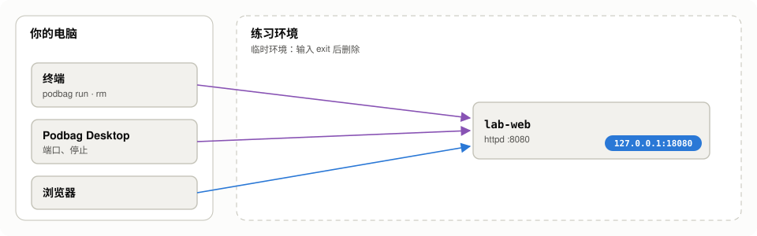

Web 服务器在容器内的端口上监听。发布端口后，浏览器可以通过你电脑上的地址访问它。在本模块中，这个地址只能在本机访问。

**预计用时** 10 分钟



## 入门课程

[运行第一个容器](../container-basics/) → **在浏览器中打开 Web 服务器** → [在不同容器之间保留文件](../volume-persistence/) → [替换并清理 Web 服务](../web-service-lifecycle/)

## 安装模块

[下载 web-basics.podbag](web-basics.podbag)。在 Desktop 中，点击 **Training** 顶部的**安装模块**。选择下载的文件并确认。

```sh
podbag lab install web-basics.podbag
```


## 开始实验

在侧栏中展开 **Training**，选择该模块。将启动命令复制到终端中运行。终端显示 `training $` 提示符后继续。

```sh
podbag lab start web-basics
```


如果默认端口已被占用，请使用 Training 中显示的端口。命令和浏览器地址会显示同一个端口。

## 运行 Web 服务器

复制当前步骤中的命令。它运行 BusyBox，并提供文件 `/www/index.html`。第一次运行时会下载镜像。

```sh
podbag run -d --name lab-web -p 127.0.0.1:18080:8080 docker.io/library/busybox:1.37.0 sh -c 'mkdir -p /www && printf "%s\n" "Podbag Training" > /www/index.html && exec httpd -f -p 8080 -h /www'
```


## 在 Desktop 中查看端口映射

打开**实验容器 → lab-web → 查看端口**。默认映射是 `127.0.0.1:18080 → 8080/tcp`。第一个端口属于你的电脑。第二个端口属于容器。


## 在浏览器中打开页面

点击**在浏览器中打开**。页面显示 **Podbag Training**。Desktop 会检查本地地址是否返回 HTTP 200 和预期的文字。


## 在 Desktop 中停止服务器

回到**实验容器**。找到 `lab-web`，点击该行的**停止**。


## 删除已停止的容器

在同一个终端中运行删除命令。`lab-web` 删除后，会出现下一步。

```sh
podbag rm lab-web
```


## 结束实验

运行最后一步中显示的命令。练习环境删除后，Training 会记录完成。

```sh
exit
```


[下一个模块 · 在不同容器之间保留文件](../volume-persistence/)
