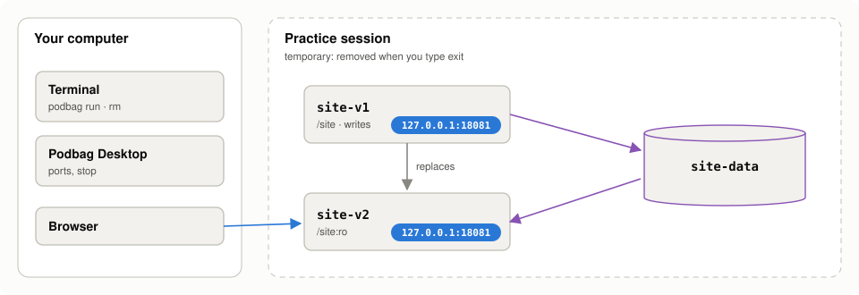
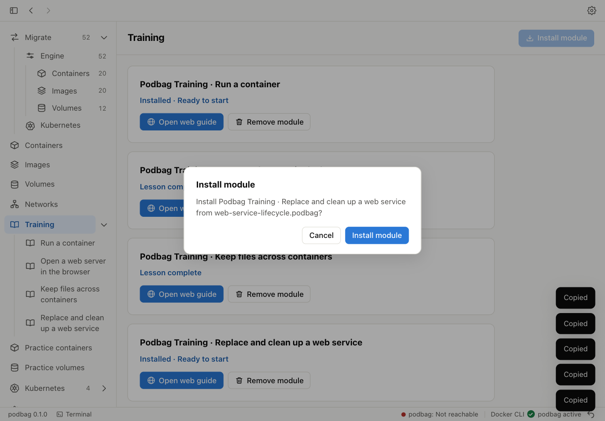
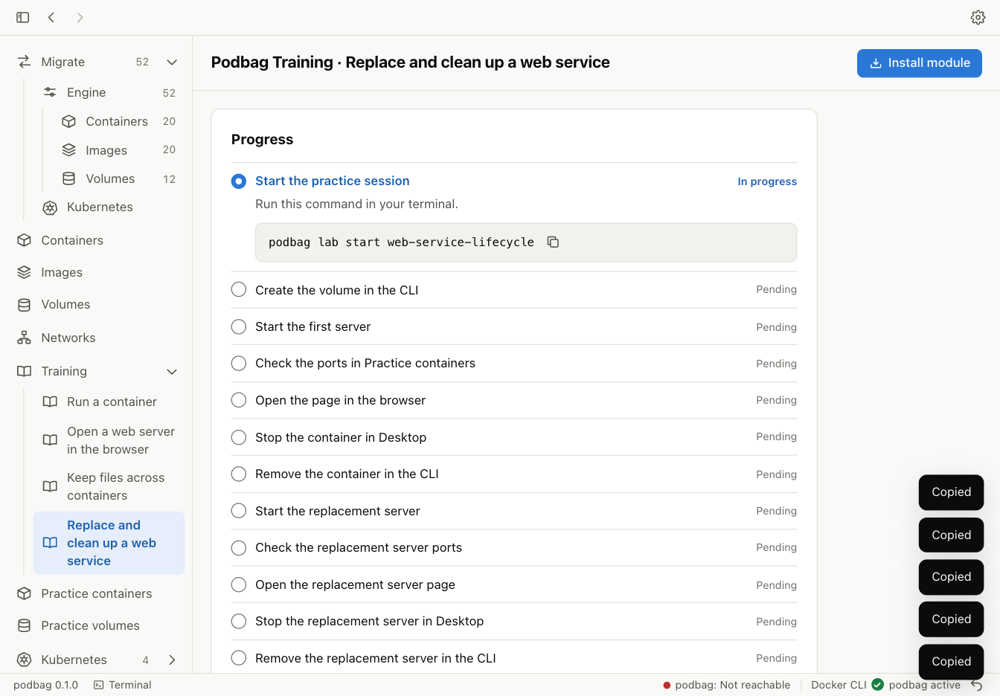
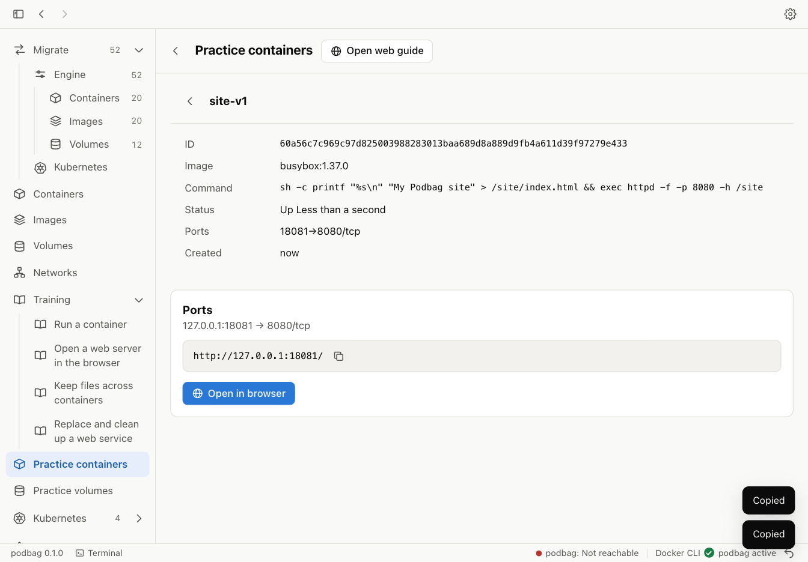
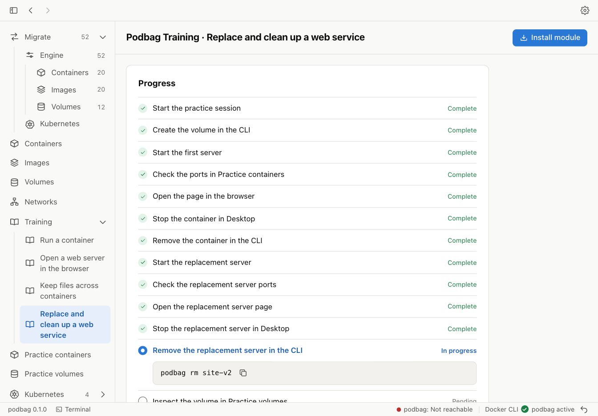
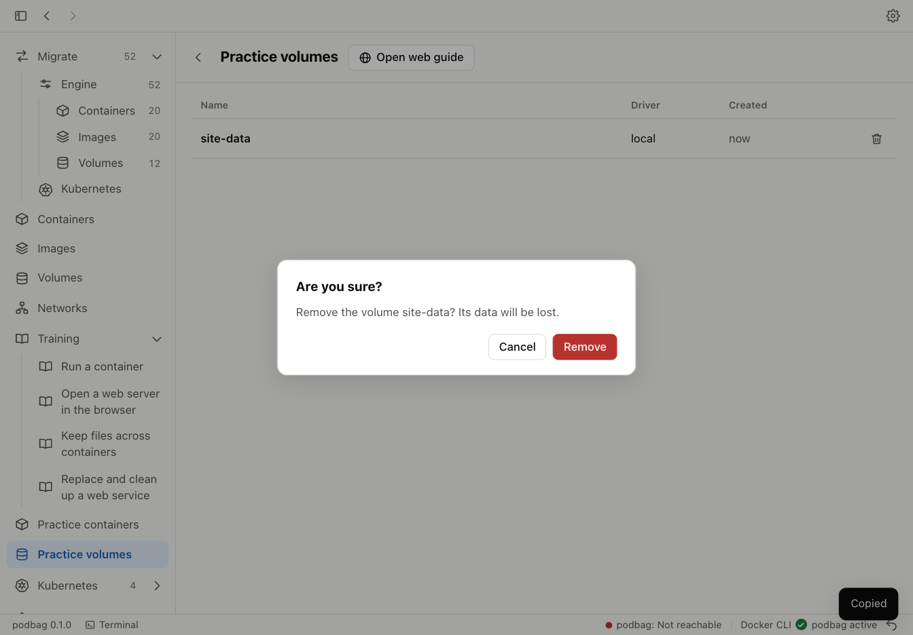

Replace a running web service while keeping its content. Use the same volume and local address before and after the replacement.

**Time** 15 minutes



## Beginner course

[Run your first container](../container-basics/) → [Open a web server in the browser](../web-basics/) → [Keep files across containers](../volume-persistence/) → **Replace and clean up a web service**

## Install the module

[Download web-service-lifecycle.podbag](web-service-lifecycle.podbag). In Desktop, select **Install module** at the top of **Training**. Choose the downloaded file and confirm.

```sh
podbag lab install web-service-lifecycle.podbag
```



## Start the practice session

Expand **Training** in the sidebar and select the module. Copy the start command into your terminal. Continue when it shows the `training $` prompt.

```sh
podbag lab start web-service-lifecycle
```



If the default port is already in use, use the port in Training. The command and browser address show the same port.

## Create the site volume

Create `site-data` to hold the web page.

```sh
podbag volume create site-data
```


## Start the first server

Start `site-v1`. It writes `index.html` to the volume and serves it on the published port. The default is `18081` on your computer.

```sh
podbag run -d --name site-v1 -p 127.0.0.1:18081:8080 -v site-data:/site docker.io/library/busybox:1.37.0 sh -c 'printf "%s\n" "My Podbag site" > /site/index.html && exec httpd -f -p 8080 -h /site'
```


## Check the first server ports

Select **Practice containers → site-v1 → View ports**. Check the address in the detail panel.




## Open the first server page

Select **Open in browser**. Confirm that the page displays **My Podbag site**.


## Stop the first server

Select **Practice containers → site-v1 → Stop**.


## Remove the first server

Run the removal command. The container disappears and `site-data` stays in the practice session.

```sh
podbag rm site-v1
```


## Start the replacement server

Start `site-v2` on the same port. Mount `site-data` read-only. The server uses the page already stored in the volume.

```sh
podbag run -d --name site-v2 -p 127.0.0.1:18081:8080 -v site-data:/site:ro docker.io/library/busybox:1.37.0 httpd -f -p 8080 -h /site
```


## Check the replacement server ports

Select **Practice containers → site-v2 → View ports**. Confirm the address matches the first server.


## Open the replacement server page

Select **Open in browser** again. The page still displays **My Podbag site**. Desktop checks the response with a new request.


## Stop the replacement server

Select **Practice containers → site-v2 → Stop**.


## Remove the replacement server

Remove the stopped container in the same terminal.

```sh
podbag rm site-v2
```



## Open the site volume details

Select **Practice volumes → site-data** to see the remaining volume.


## Delete the site volume

Select **Remove** and confirm the volume name.




## Check the container list

List all containers in the practice session. The list is empty.

```sh
podbag ps -a
```


## Check the volume list

List the practice volumes. The list is empty.

```sh
podbag volume ls
```


## Finish the practice session

Run the command shown in the final step. Training records completion after the practice environment has been removed.

```sh
exit
```


[Next Training module · Recover a web server with logs](../web-service-recovery/)
