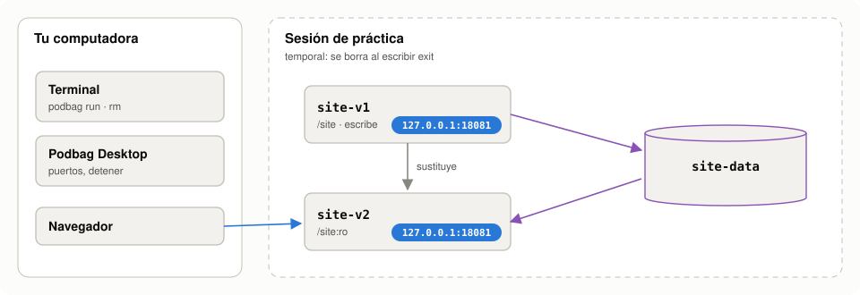
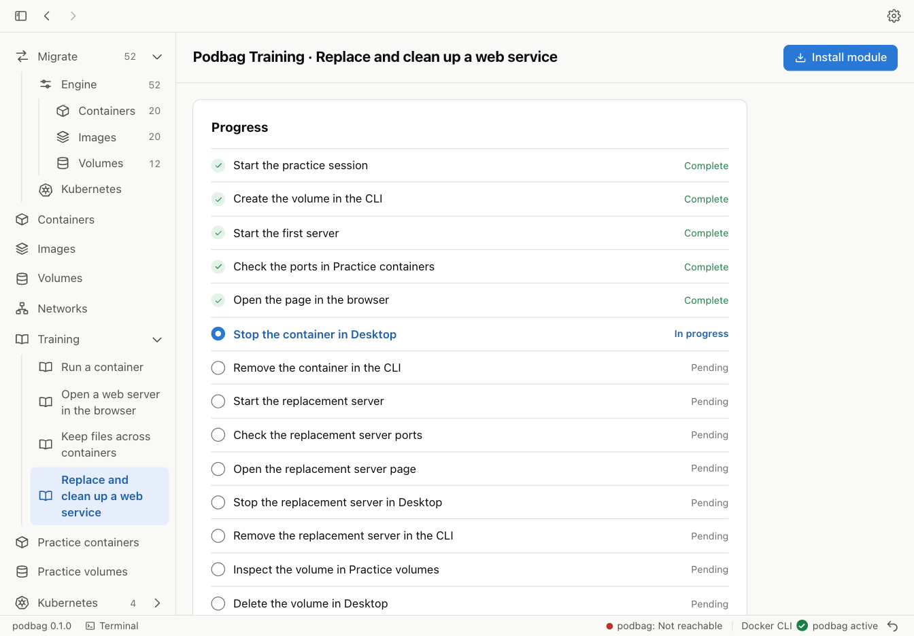
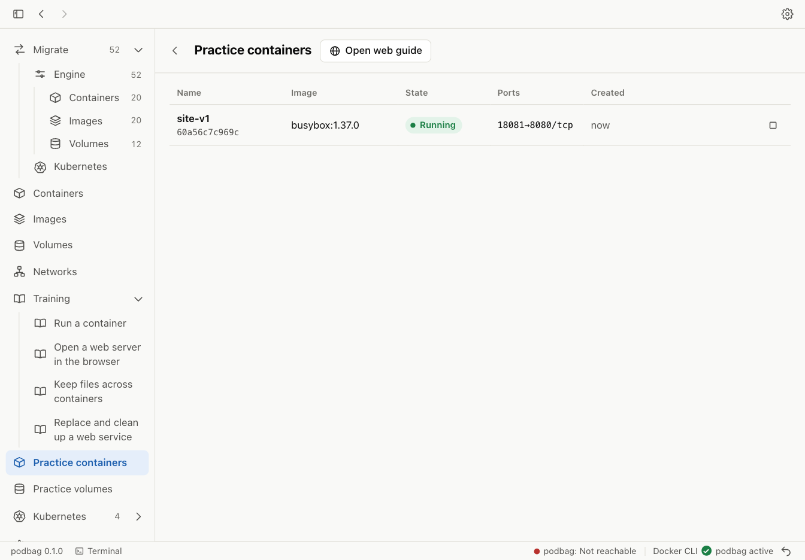
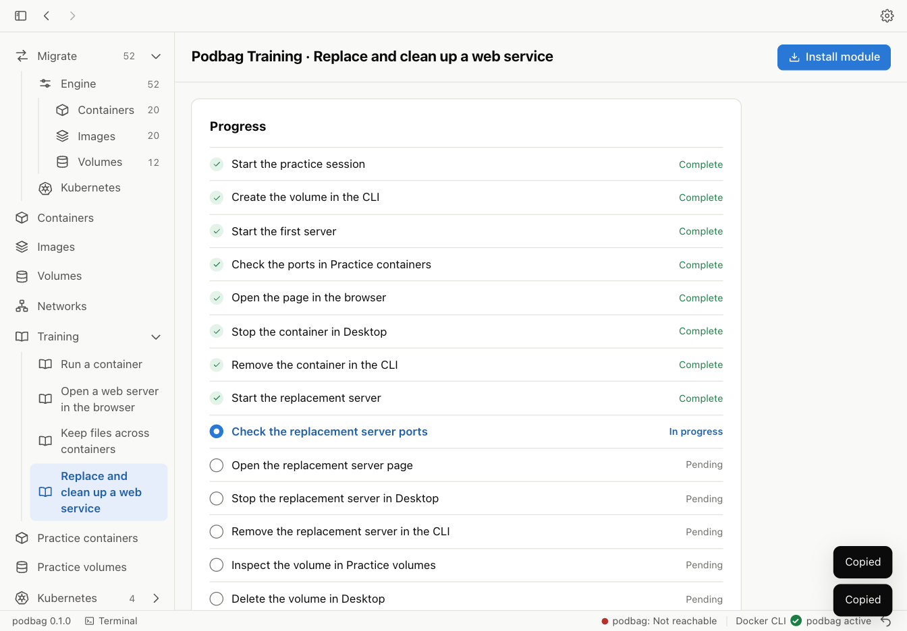
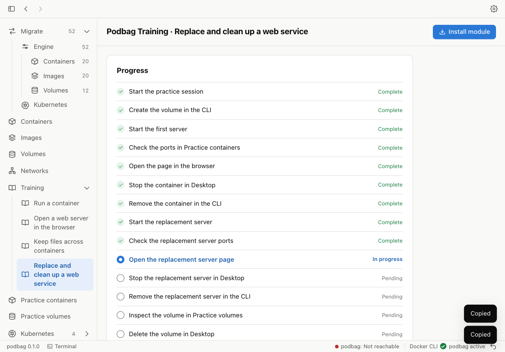
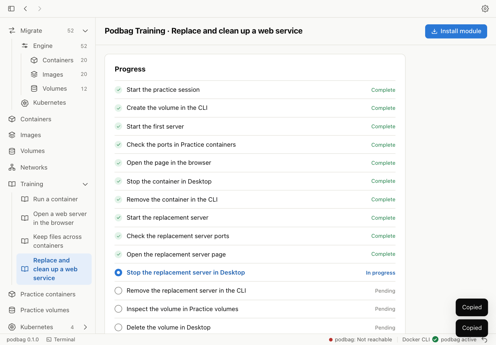

Sustituye un servicio web en ejecución sin perder su contenido. Usa el mismo volumen y la misma dirección local antes y después del cambio.

**Tiempo** 15 minutos



## Curso de iniciación

[Ejecuta tu primer contenedor](../container-basics/) → [Abre un servidor web en el navegador](../web-basics/) → [Conserva archivos entre contenedores](../volume-persistence/) → **Sustituye y limpia un servicio web**

## Instala el módulo

[Descargar web-service-lifecycle.podbag](web-service-lifecycle.podbag). En Desktop, selecciona **Instalar módulo** en la parte superior de **Training**. Elige el archivo descargado y confirma.

```sh
podbag lab install web-service-lifecycle.podbag
```


## Inicia la sesión de práctica

Despliega **Training** en la barra lateral y selecciona el módulo. Copia el comando de inicio en tu terminal. Continúa cuando aparezca el prompt `training $`.

```sh
podbag lab start web-service-lifecycle
```


Si el puerto predeterminado ya está en uso, usa el puerto que indica Training. El comando y la dirección del navegador muestran el mismo puerto.

## Crea el volumen del sitio

Crea `site-data` para guardar la página web.

```sh
podbag volume create site-data
```


## Inicia el primer servidor

Inicia `site-v1`. Escribe `index.html` en el volumen y lo sirve en el puerto publicado. El puerto predeterminado en tu computadora es `18081`.

```sh
podbag run -d --name site-v1 -p 127.0.0.1:18081:8080 -v site-data:/site docker.io/library/busybox:1.37.0 sh -c 'printf "%s\n" "My Podbag site" > /site/index.html && exec httpd -f -p 8080 -h /site'
```


## Comprueba los puertos del primer servidor

Selecciona **Contenedores de práctica → site-v1 → Ver puertos**. Comprueba la dirección en el panel de detalles.


## Abre la página del primer servidor

Selecciona **Abrir en el navegador**. Comprueba que la página muestra **My Podbag site**.


## Detén el primer servidor

Selecciona **Contenedores de práctica → site-v1 → Detener**.





## Elimina el primer servidor

Ejecuta el comando de eliminación. El contenedor desaparece y `site-data` sigue en la sesión de práctica.

```sh
podbag rm site-v1
```


## Inicia el servidor de sustitución

Inicia `site-v2` en el mismo puerto. Monta `site-data` en modo de solo lectura. El servidor usa la página que ya está guardada en el volumen.

```sh
podbag run -d --name site-v2 -p 127.0.0.1:18081:8080 -v site-data:/site:ro docker.io/library/busybox:1.37.0 httpd -f -p 8080 -h /site
```


## Comprueba los puertos del servidor de sustitución

Selecciona **Contenedores de práctica → site-v2 → Ver puertos**. Comprueba que la dirección es la misma que la del primer servidor.




## Abre la página del servidor de sustitución

Selecciona de nuevo **Abrir en el navegador**. La página sigue mostrando **My Podbag site**. Desktop comprueba la respuesta con una solicitud nueva.




## Detén el servidor de sustitución

Selecciona **Contenedores de práctica → site-v2 → Detener**.




## Elimina el servidor de sustitución

Elimina el contenedor detenido en la misma terminal.

```sh
podbag rm site-v2
```


## Abre los detalles del volumen del sitio

Selecciona **Volúmenes de práctica → site-data** para ver el volumen que queda.


## Elimina el volumen del sitio

Selecciona **Eliminar** y confirma el nombre del volumen.


## Comprueba la lista de contenedores

Lista todos los contenedores de la sesión de práctica. La lista está vacía.

```sh
podbag ps -a
```


## Comprueba la lista de volúmenes

Lista los volúmenes de práctica. La lista está vacía.

```sh
podbag volume ls
```


## Termina la sesión de práctica

Ejecuta el comando del último paso. Training registra la finalización cuando se ha eliminado el entorno de práctica.

```sh
exit
```


[Siguiente módulo de Training · Recupera un servidor web con los registros](../web-service-recovery/)
