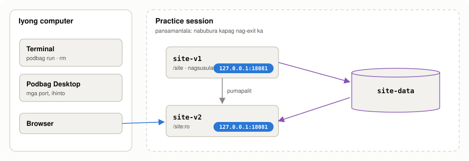
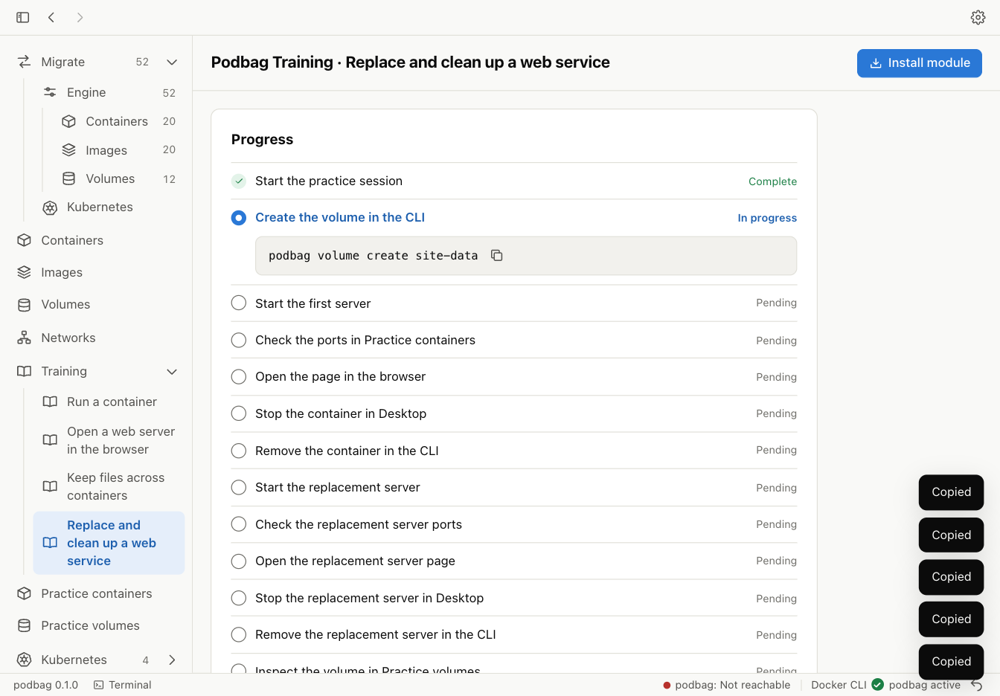
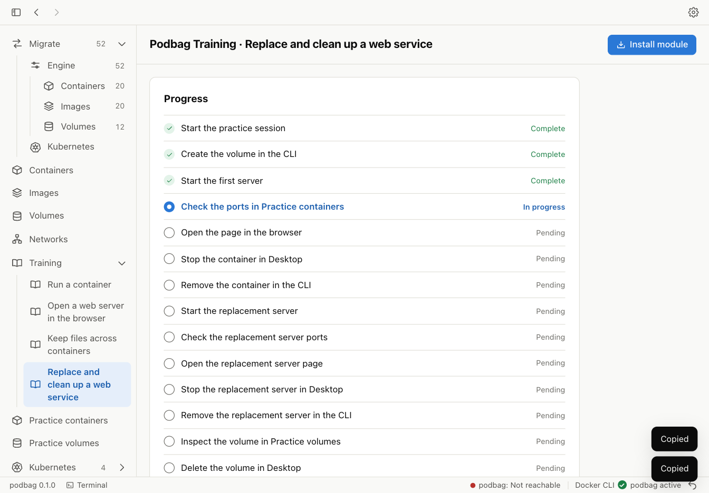
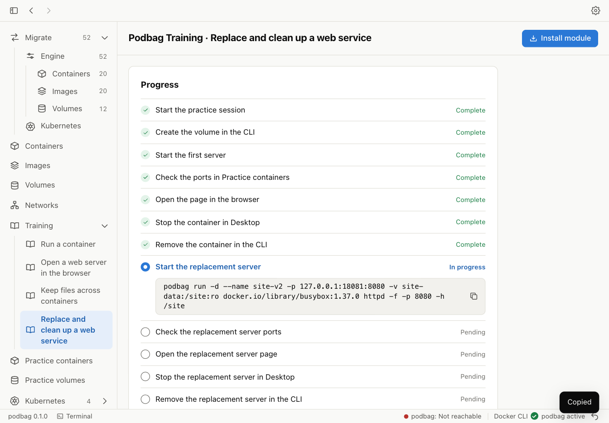
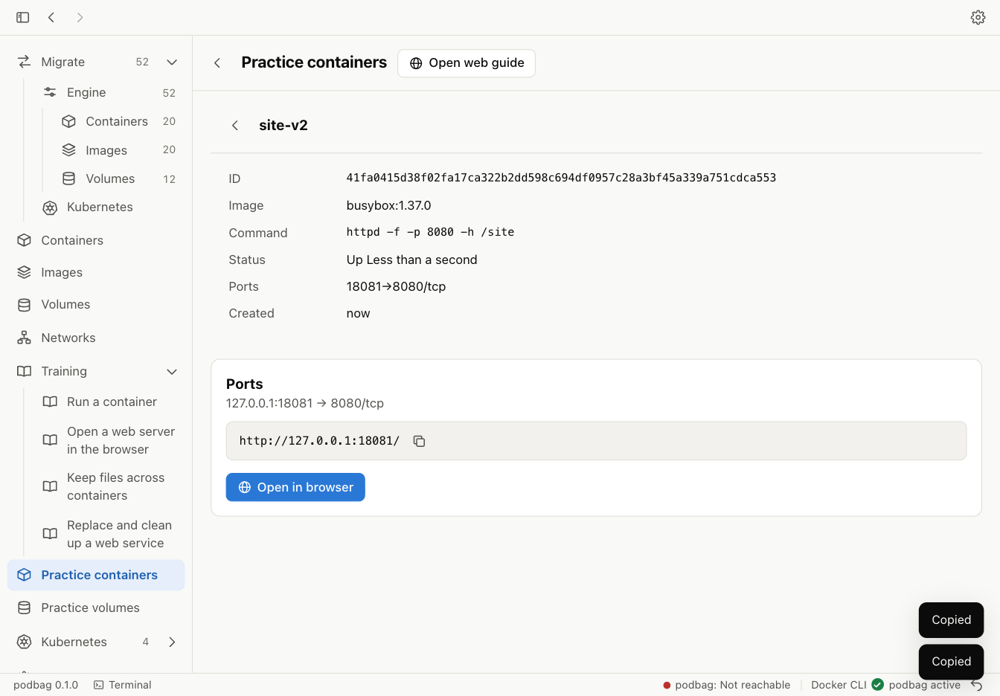
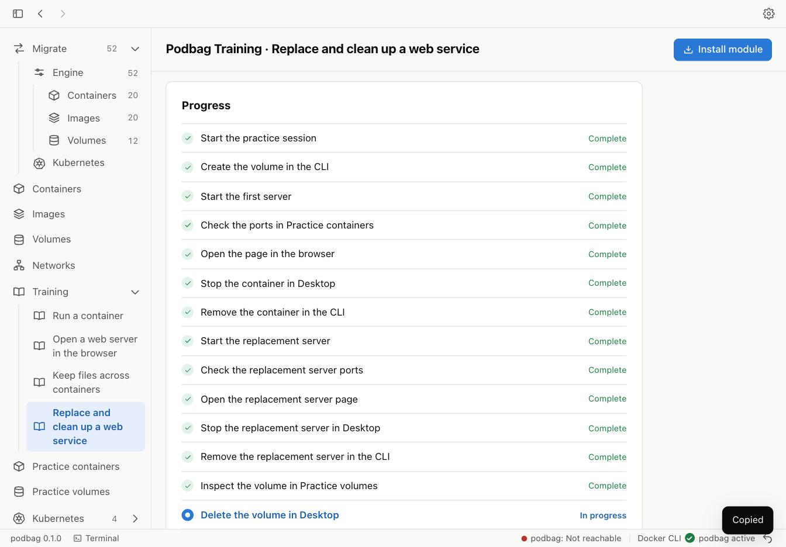
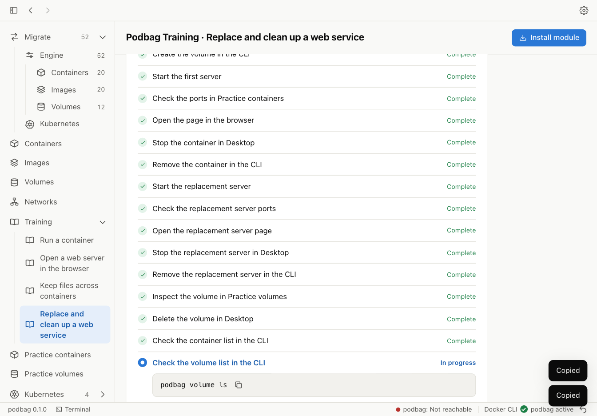

Palitan ang tumatakbong web service nang hindi nawawala ang laman nito. Gamitin ang parehong volume at lokal na address bago at pagkatapos ng pagpapalit.

**Oras** 15 minuto



## Kurso para sa baguhan

[Patakbuhin ang iyong unang container](../container-basics/) → [Buksan ang web server sa browser](../web-basics/) → [Panatilihin ang mga file sa pagitan ng mga container](../volume-persistence/) → **Palitan at linisin ang web service**

## I-install ang module

[I-download ang web-service-lifecycle.podbag](web-service-lifecycle.podbag). Sa Desktop, piliin ang **I-install ang module** sa itaas ng **Training**. Piliin ang na-download na file at kumpirmahin.

```sh
podbag lab install web-service-lifecycle.podbag
```


## Simulan ang practice session

Palawakin ang **Training** sa sidebar at piliin ang module. Kopyahin ang command sa pagsisimula sa terminal mo. Magpatuloy kapag lumabas ang prompt na `training $`.

```sh
podbag lab start web-service-lifecycle
```


Para gawin ang mga hakbang sa TUI sa halip na sa Podbag Desktop, idagdag ang `--tui`.

```sh
podbag lab start web-service-lifecycle --tui
```

Sa TUI, pindutin ang `:` para buksan ang training shell sa isang hakbang na command. I-type ang `exit` para bumalik sa TUI. Pindutin ang `q` para tapusin ang practice session.

Kung gamit na ang default na port, gamitin ang port na nasa Training. Pareho ang port sa command at sa address ng browser.

## Gumawa ng volume ng site

Gumawa ng `site-data` para paglagyan ng web page.

```sh
podbag volume create site-data
```

- **Sa Podbag Desktop:** Piliin ang **Mga practice volume → Gumawa ng volume na site-data**.
- **Sa TUI:** Buksan ang **Mga volume**, pindutin ang `v`, i-type ang `site-data` at pindutin ang `Enter`.



## Simulan ang unang server

Simulan ang `site-v1`. Isinusulat nito ang `index.html` sa volume at inihahain ito sa na-publish na port. Ang default ay `18081` sa computer mo.

```sh
podbag run -d --name site-v1 -p 127.0.0.1:18081:8080 -v site-data:/site docker.io/library/busybox:1.37.0 sh -c 'printf "%s\n" "My Podbag site" > /site/index.html && exec httpd -f -p 8080 -h /site'
```


## Tingnan ang mga port ng unang server

Piliin ang **Mga practice container → site-v1 → Tingnan ang mga port**. Tingnan ang address sa panel ng detalye.

- **Sa Podbag Desktop:** Piliin ang **Mga practice container → site-v1 → Tingnan ang mga port**.
- **Sa TUI:** Piliin ang `site-v1` sa **Mga container** at pindutin ang `Enter`.




## Buksan ang page ng unang server

Piliin ang **Buksan sa browser**. Tiyaking ipinapakita ng page ang **My Podbag site**.

- **Sa Podbag Desktop:** Piliin ang **Buksan sa browser**.
- **Sa TUI:** Buksan ang `http://127.0.0.1:18081/` sa browser. Kapag lumabas ang page, pindutin ang `o`.


## Ihinto ang unang server

Piliin ang **Mga practice container → site-v1 → Ihinto**.

- **Sa Podbag Desktop:** Piliin ang **Mga practice container → site-v1 → Ihinto**.
- **Sa TUI:** Piliin ang `site-v1` sa **Mga container** at pindutin ang `x`.


## Alisin ang unang server

Patakbuhin ang command sa pag-alis. Mawawala ang container at mananatili ang `site-data` sa practice session.

```sh
podbag rm site-v1
```

- **Sa Podbag Desktop:** Piliin ang **Mga practice container → site-v1 → Alisin** at kumpirmahin.
- **Sa TUI:** Piliin ang `site-v1` sa **Mga container**, pindutin ang `d`, saka ang `y`.


## Simulan ang pamalit na server

Simulan ang `site-v2` sa parehong port. I-mount ang `site-data` bilang read-only. Ginagamit ng server ang page na nasa volume na.

```sh
podbag run -d --name site-v2 -p 127.0.0.1:18081:8080 -v site-data:/site:ro docker.io/library/busybox:1.37.0 httpd -f -p 8080 -h /site
```



## Tingnan ang mga port ng pamalit na server

Piliin ang **Mga practice container → site-v2 → Tingnan ang mga port**. Tiyaking pareho ang address sa unang server.

- **Sa Podbag Desktop:** Piliin ang **Mga practice container → site-v2 → Tingnan ang mga port**.
- **Sa TUI:** Piliin ang `site-v2` sa **Mga container** at pindutin ang `Enter`.




## Buksan ang page ng pamalit na server

Piliin ulit ang **Buksan sa browser**. Ipinapakita pa rin ng page ang **My Podbag site**. Sinusuri ng Desktop ang tugon gamit ang bagong request.

- **Sa Podbag Desktop:** Piliin ang **Buksan sa browser**.
- **Sa TUI:** Buksan ang `http://127.0.0.1:18081/` sa browser. Kapag lumabas ang page, pindutin ang `o`.


## Ihinto ang pamalit na server

Piliin ang **Mga practice container → site-v2 → Ihinto**.

- **Sa Podbag Desktop:** Piliin ang **Mga practice container → site-v2 → Ihinto**.
- **Sa TUI:** Piliin ang `site-v2` sa **Mga container** at pindutin ang `x`.


## Alisin ang pamalit na server

Alisin ang nakahintong container sa parehong terminal.

```sh
podbag rm site-v2
```

- **Sa Podbag Desktop:** Piliin ang **Mga practice container → site-v2 → Alisin** at kumpirmahin.
- **Sa TUI:** Piliin ang `site-v2` sa **Mga container**, pindutin ang `d`, saka ang `y`.


## Buksan ang detalye ng volume ng site

Piliin ang **Mga practice volume → site-data** para makita ang natitirang volume.

- **Sa Podbag Desktop:** Piliin ang **Mga practice volume → site-data**.
- **Sa TUI:** Piliin ang `site-data` sa **Mga volume** at pindutin ang `Enter`.


## Burahin ang volume ng site

Piliin ang **Alisin** at tiyakin ang pangalan ng volume.

- **Sa Podbag Desktop:** Piliin ang **Mga practice volume → site-data → Alisin** at kumpirmahin.
- **Sa TUI:** Piliin ang `site-data` sa **Mga volume**, pindutin ang `d`, saka ang `y`.




## Tingnan ang listahan ng container

Ilista ang lahat ng container sa practice session. Walang laman ang listahan.

```sh
podbag ps -a
```


## Tingnan ang listahan ng volume

Ilista ang mga practice volume. Walang laman ang listahan.

```sh
podbag volume ls
```



## Tapusin ang practice session

Patakbuhin ang command sa huling hakbang. Itatala ng Training ang pagkumpleto pagkatapos maalis ang practice environment.

```sh
exit
```


[Susunod na Training module · Ayusin ang web server gamit ang mga log](../web-service-recovery/)
