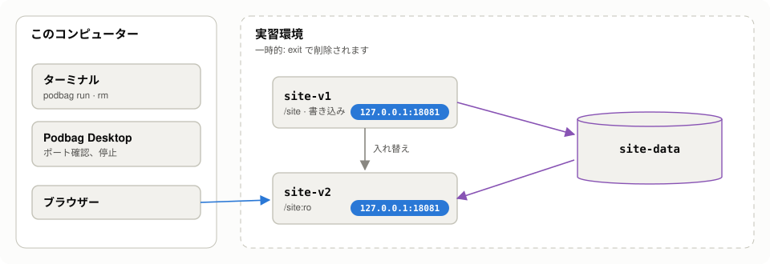
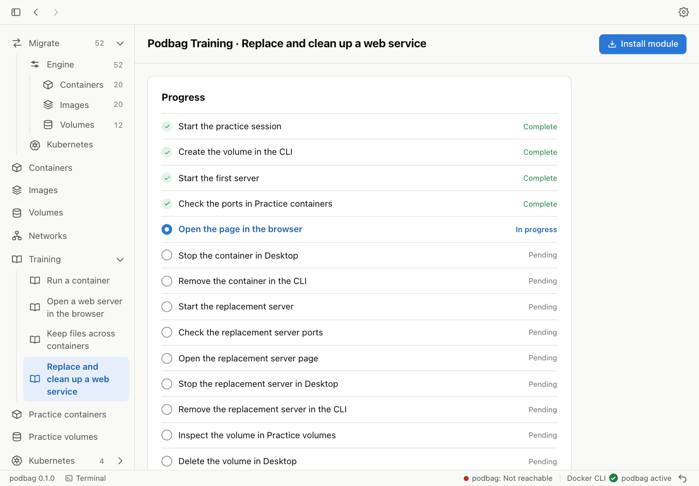
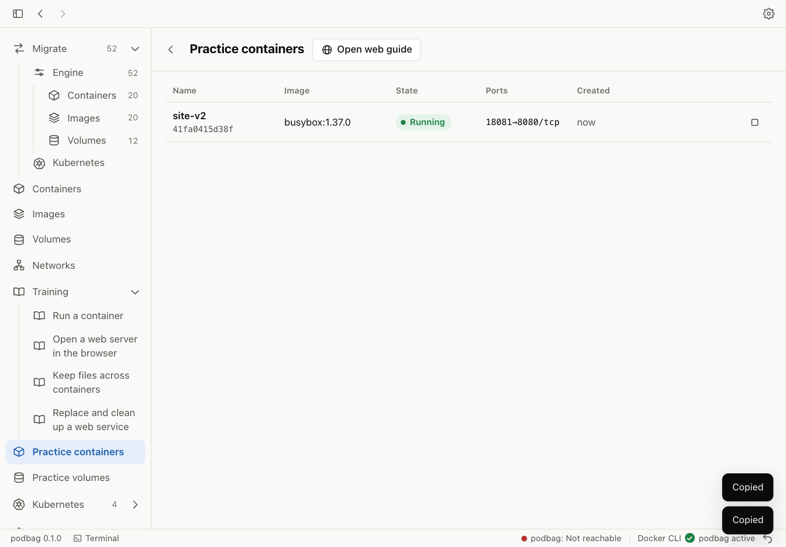
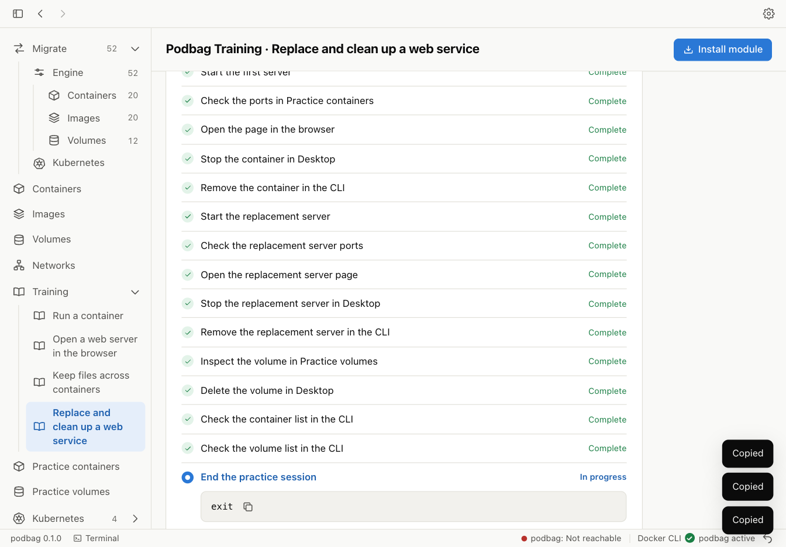

内容を残したまま、実行中の Web サービスを入れ替えます。入れ替えの前と後で、同じボリュームと同じローカルアドレスを使います。

**所要時間** 15 分



## 初心者コース

[最初のコンテナを実行する](../container-basics/) → [ブラウザーで Web サーバーを開く](../web-basics/) → [コンテナが変わってもファイルを残す](../volume-persistence/) → **Web サービスを入れ替えて片付ける**

## モジュールをインストールする

[web-service-lifecycle.podbag をダウンロード](web-service-lifecycle.podbag)します。Desktop で **Training** の上部にある**モジュールをインストール**を選びます。ダウンロードしたファイルを指定して確認します。

```sh
podbag lab install web-service-lifecycle.podbag
```


## 実習を開始する

サイドバーの **Training** を展開し、モジュールを選びます。開始コマンドをコピーし、ターミナルで実行します。`training $` プロンプトが表示されたら続けます。

```sh
podbag lab start web-service-lifecycle
```


Podbag Desktop の代わりに TUI で手順を進めるには、`--tui` を付けます。

```sh
podbag lab start web-service-lifecycle --tui
```

TUI では、コマンドの手順で `:` を押すと Training シェルが開きます。`exit` と入力すると TUI に戻ります。`q` を押すと実習を終了します。

既定のポートがすでに使われている場合は、Training に表示されるポートを使います。コマンドとブラウザーのアドレスには同じポートが表示されます。

## サイト用のボリュームを作成する

Web ページを保存する `site-data` を作成します。

```sh
podbag volume create site-data
```

- **Podbag Desktop で:** **実習ボリューム → ボリューム site-data を作成**を選びます。
- **TUI で:** **ボリューム**を開き、`v` を押して `site-data` と入力し、`Enter` を押します。


## 1 つ目のサーバーを起動する

`site-v1` を起動します。`site-v1` はボリュームに `index.html` を書き、公開したポートで配信します。既定のポートは、このコンピューターの `18081` です。

```sh
podbag run -d --name site-v1 -p 127.0.0.1:18081:8080 -v site-data:/site docker.io/library/busybox:1.37.0 sh -c 'printf "%s\n" "My Podbag site" > /site/index.html && exec httpd -f -p 8080 -h /site'
```


## 1 つ目のサーバーのポートを確認する

**実習コンテナ → site-v1 → ポートを表示**を選びます。詳細パネルでアドレスを確認します。

- **Podbag Desktop で:** **実習コンテナ → site-v1 → ポートを表示**を選びます。
- **TUI で:** **コンテナ**で `site-v1` を選び、`Enter` を押します。


## 1 つ目のサーバーのページを開く

**ブラウザーで開く**を選びます。ページに **My Podbag site** と表示されることを確認します。

- **Podbag Desktop で:** **ブラウザーで開く**を選びます。
- **TUI で:** ブラウザーで `http://127.0.0.1:18081/` を開きます。ページが表示されたら `o` を押します。




## 1 つ目のサーバーを停止する

**実習コンテナ → site-v1 → 停止**を選びます。

- **Podbag Desktop で:** **実習コンテナ → site-v1 → 停止**を選びます。
- **TUI で:** **コンテナ**で `site-v1` を選び、`x` を押します。


## 1 つ目のサーバーを削除する

削除のコマンドを実行します。コンテナはなくなり、`site-data` は実習環境に残ります。

```sh
podbag rm site-v1
```

- **Podbag Desktop で:** **実習コンテナ → site-v1 → 削除**を選び、確認します。
- **TUI で:** **コンテナ**で `site-v1` を選び、`d` を押してから `y` を押します。


## 入れ替え用のサーバーを起動する

同じポートで `site-v2` を起動します。`site-data` を読み取り専用でマウントします。サーバーは、ボリュームにすでに保存されたページを使います。

```sh
podbag run -d --name site-v2 -p 127.0.0.1:18081:8080 -v site-data:/site:ro docker.io/library/busybox:1.37.0 httpd -f -p 8080 -h /site
```


## 入れ替え用のサーバーのポートを確認する

**実習コンテナ → site-v2 → ポートを表示**を選びます。アドレスが 1 つ目のサーバーと同じであることを確認します。

- **Podbag Desktop で:** **実習コンテナ → site-v2 → ポートを表示**を選びます。
- **TUI で:** **コンテナ**で `site-v2` を選び、`Enter` を押します。


## 入れ替え用のサーバーのページを開く

もう一度**ブラウザーで開く**を選びます。ページには引き続き **My Podbag site** と表示されます。Desktop は新しいリクエストで応答を確認します。

- **Podbag Desktop で:** **ブラウザーで開く**を選びます。
- **TUI で:** ブラウザーで `http://127.0.0.1:18081/` を開きます。ページが表示されたら `o` を押します。


## 入れ替え用のサーバーを停止する

**実習コンテナ → site-v2 → 停止**を選びます。

- **Podbag Desktop で:** **実習コンテナ → site-v2 → 停止**を選びます。
- **TUI で:** **コンテナ**で `site-v2` を選び、`x` を押します。




## 入れ替え用のサーバーを削除する

同じターミナルで、停止したコンテナを削除します。

```sh
podbag rm site-v2
```

- **Podbag Desktop で:** **実習コンテナ → site-v2 → 削除**を選び、確認します。
- **TUI で:** **コンテナ**で `site-v2` を選び、`d` を押してから `y` を押します。


## サイト用のボリュームの詳細を開く

**実習ボリューム → site-data** を選び、残っているボリュームを確認します。

- **Podbag Desktop で:** **実習ボリューム → site-data**を選びます。
- **TUI で:** **ボリューム**で `site-data` を選び、`Enter` を押します。


## サイト用のボリュームを削除する

**削除**を選び、ボリューム名を確認します。

- **Podbag Desktop で:** **実習ボリューム → site-data → 削除**を選び、確認します。
- **TUI で:** **ボリューム**で `site-data` を選び、`d` を押してから `y` を押します。


## コンテナの一覧を確認する

実習環境のすべてのコンテナを一覧表示します。一覧は空です。

```sh
podbag ps -a
```


## ボリュームの一覧を確認する

実習用のボリュームを一覧表示します。一覧は空です。

```sh
podbag volume ls
```


## 実習を終了する

最後の手順に表示されるコマンドを実行します。実習環境が削除された後、Training に完了が記録されます。

```sh
exit
```




[次の Training モジュール · ログを使って Web サーバーを復旧する](../web-service-recovery/)
