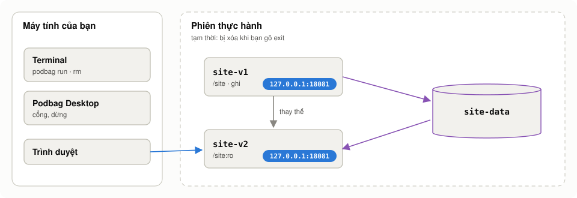
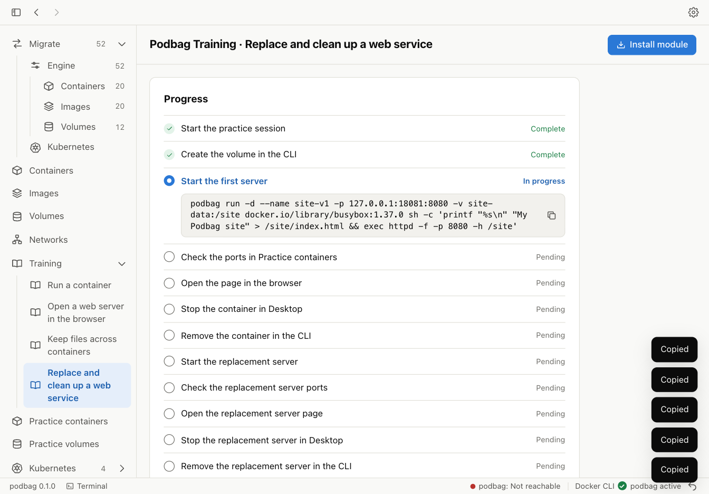
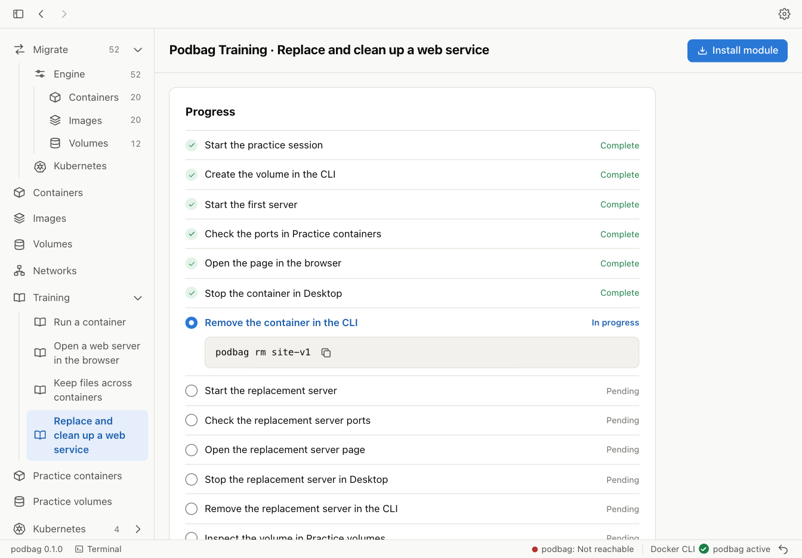
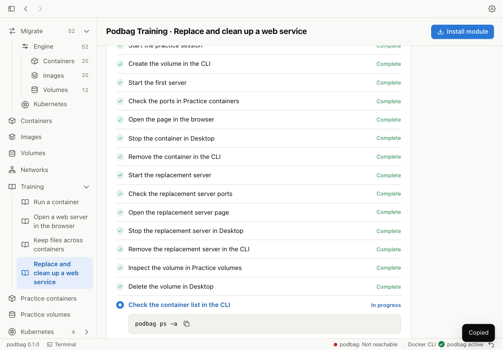
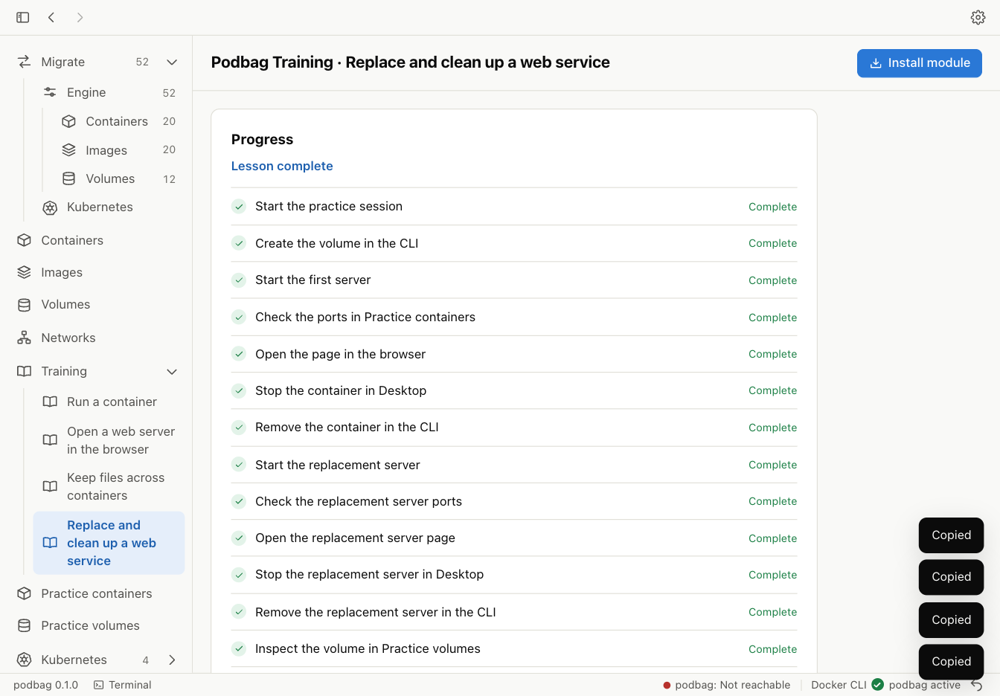

Thay thế một dịch vụ web đang chạy mà vẫn giữ nội dung của nó. Dùng cùng volume và cùng địa chỉ cục bộ trước và sau khi thay thế.

**Thời gian** 15 phút



## Lộ trình cho người mới

[Chạy container đầu tiên](../container-basics/) → [Mở máy chủ web trong trình duyệt](../web-basics/) → [Giữ tệp khi thay container](../volume-persistence/) → **Thay thế và dọn dẹp dịch vụ web**

## Cài mô-đun

[Tải web-service-lifecycle.podbag](web-service-lifecycle.podbag). Trong Desktop, chọn **Cài mô-đun** ở đầu mục **Training**. Chọn tệp đã tải và xác nhận.

```sh
podbag lab install web-service-lifecycle.podbag
```


## Bắt đầu phiên thực hành

Mở rộng **Training** ở thanh bên và chọn mô-đun. Sao chép lệnh bắt đầu vào terminal của bạn. Tiếp tục khi thấy dấu nhắc `training $`.

```sh
podbag lab start web-service-lifecycle
```


Nếu cổng mặc định đang được dùng, hãy dùng cổng hiển thị trong Training. Lệnh và địa chỉ trình duyệt hiển thị cùng một cổng.

## Tạo volume cho trang web

Tạo `site-data` để chứa trang web.

```sh
podbag volume create site-data
```


## Chạy máy chủ đầu tiên

Chạy `site-v1`. Nó ghi `index.html` vào volume và phục vụ tệp đó ở cổng đã công bố. Cổng mặc định trên máy tính của bạn là `18081`.

```sh
podbag run -d --name site-v1 -p 127.0.0.1:18081:8080 -v site-data:/site docker.io/library/busybox:1.37.0 sh -c 'printf "%s\n" "My Podbag site" > /site/index.html && exec httpd -f -p 8080 -h /site'
```



## Kiểm tra cổng của máy chủ đầu tiên

Chọn **Container thực hành → site-v1 → Xem cổng**. Kiểm tra địa chỉ trong bảng chi tiết.


## Mở trang của máy chủ đầu tiên

Chọn **Mở trong trình duyệt**. Kiểm tra rằng trang hiển thị **My Podbag site**.


## Dừng máy chủ đầu tiên

Chọn **Container thực hành → site-v1 → Dừng**.


## Xóa máy chủ đầu tiên

Chạy lệnh xóa. Container biến mất, còn `site-data` vẫn ở trong phiên thực hành.

```sh
podbag rm site-v1
```



## Chạy máy chủ thay thế

Chạy `site-v2` trên cùng cổng. Gắn `site-data` ở chế độ chỉ đọc. Máy chủ dùng trang đã có sẵn trong volume.

```sh
podbag run -d --name site-v2 -p 127.0.0.1:18081:8080 -v site-data:/site:ro docker.io/library/busybox:1.37.0 httpd -f -p 8080 -h /site
```


## Kiểm tra cổng của máy chủ thay thế

Chọn **Container thực hành → site-v2 → Xem cổng**. Kiểm tra rằng địa chỉ giống với máy chủ đầu tiên.


## Mở trang của máy chủ thay thế

Chọn lại **Mở trong trình duyệt**. Trang vẫn hiển thị **My Podbag site**. Desktop kiểm tra phản hồi bằng một yêu cầu mới.


## Dừng máy chủ thay thế

Chọn **Container thực hành → site-v2 → Dừng**.


## Xóa máy chủ thay thế

Xóa container đã dừng trong cùng terminal.

```sh
podbag rm site-v2
```


## Mở chi tiết volume của trang web

Chọn **Volume thực hành → site-data** để xem volume còn lại.


## Xóa volume của trang web

Chọn **Xóa** và xác nhận tên volume.


## Kiểm tra danh sách container

Liệt kê tất cả container trong phiên thực hành. Danh sách trống.

```sh
podbag ps -a
```



## Kiểm tra danh sách volume

Liệt kê các volume thực hành. Danh sách trống.

```sh
podbag volume ls
```


## Kết thúc phiên thực hành

Chạy lệnh ở bước cuối cùng. Training ghi nhận hoàn thành sau khi môi trường thực hành đã được xóa.

```sh
exit
```




[Mô-đun Training tiếp theo · Khôi phục máy chủ web bằng nhật ký](../web-service-recovery/)
