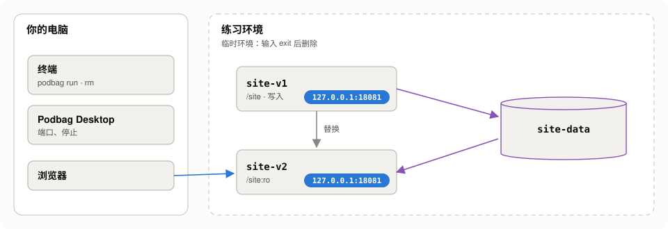
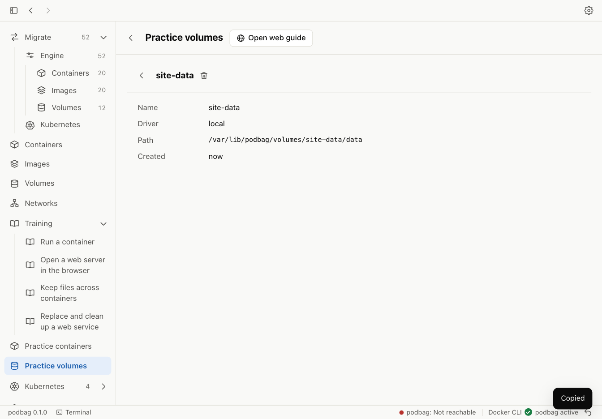

替换正在运行的 Web 服务，同时保留其内容。替换前后使用同一个卷和同一个本地地址。

**预计用时** 15 分钟



## 入门课程

[运行第一个容器](../container-basics/) → [在浏览器中打开 Web 服务器](../web-basics/) → [在不同容器之间保留文件](../volume-persistence/) → **替换并清理 Web 服务**

## 安装模块

[下载 web-service-lifecycle.podbag](web-service-lifecycle.podbag)。在 Desktop 中，点击 **Training** 顶部的**安装模块**。选择下载的文件并确认。

```sh
podbag lab install web-service-lifecycle.podbag
```


## 开始实验

在侧栏中展开 **Training**，选择该模块。将启动命令复制到终端中运行。终端显示 `training $` 提示符后继续。

```sh
podbag lab start web-service-lifecycle
```


如果默认端口已被占用，请使用 Training 中显示的端口。命令和浏览器地址会显示同一个端口。

## 创建网站卷

创建 `site-data`，用来保存网页。

```sh
podbag volume create site-data
```


## 启动第一个服务器

启动 `site-v1`。它将 `index.html` 写入卷，并在发布的端口上提供该页面。你电脑上的默认端口是 `18081`。

```sh
podbag run -d --name site-v1 -p 127.0.0.1:18081:8080 -v site-data:/site docker.io/library/busybox:1.37.0 sh -c 'printf "%s\n" "My Podbag site" > /site/index.html && exec httpd -f -p 8080 -h /site'
```


## 查看第一个服务器的端口

选择**实验容器 → site-v1 → 查看端口**。在详情面板中查看地址。


## 打开第一个服务器的页面

点击**在浏览器中打开**。确认页面显示 **My Podbag site**。


## 停止第一个服务器

选择**实验容器 → site-v1 → 停止**。


## 删除第一个服务器

运行删除命令。容器被删除，`site-data` 仍保留在练习环境中。

```sh
podbag rm site-v1
```


## 启动替换服务器

在同一个端口上启动 `site-v2`。以只读方式挂载 `site-data`。服务器使用卷中已有的页面。

```sh
podbag run -d --name site-v2 -p 127.0.0.1:18081:8080 -v site-data:/site:ro docker.io/library/busybox:1.37.0 httpd -f -p 8080 -h /site
```


## 查看替换服务器的端口

选择**实验容器 → site-v2 → 查看端口**。确认地址与第一个服务器相同。


## 打开替换服务器的页面

再次点击**在浏览器中打开**。页面仍然显示 **My Podbag site**。Desktop 会用新的请求检查响应。


## 停止替换服务器

选择**实验容器 → site-v2 → 停止**。


## 删除替换服务器

在同一个终端中删除已停止的容器。

```sh
podbag rm site-v2
```


## 打开网站卷详情

选择**实验卷 → site-data**，查看保留下来的卷。




## 删除网站卷

点击**删除**，确认卷名。


## 检查容器列表

列出练习环境中的所有容器。列表为空。

```sh
podbag ps -a
```


## 检查卷列表

列出实验卷。列表为空。

```sh
podbag volume ls
```


## 结束实验

运行最后一步中显示的命令。练习环境删除后，Training 会记录完成。

```sh
exit
```


[下一个 Training 模块 · 用日志恢复 Web 服务器](../web-service-recovery/)
