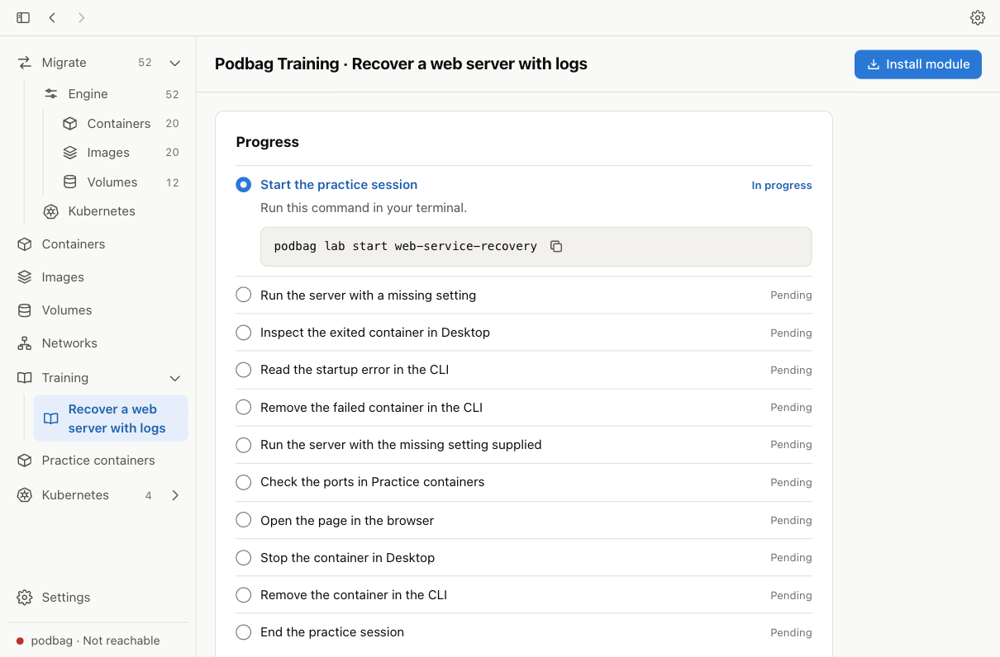
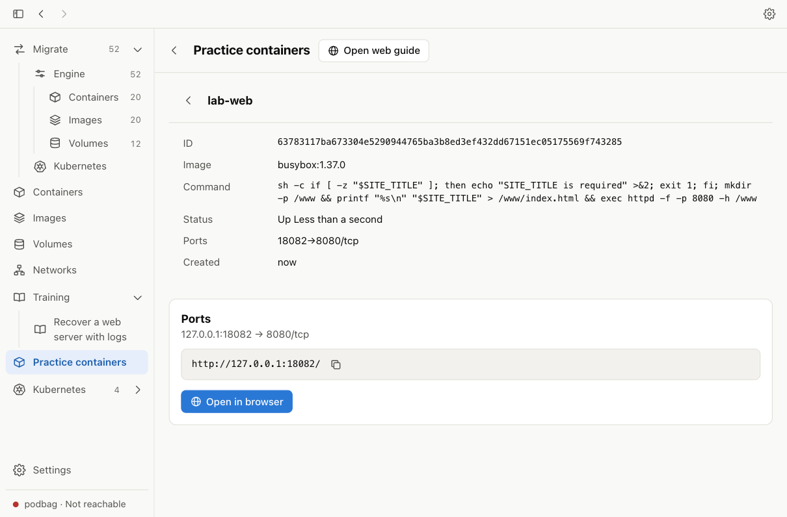

A web server can exit as soon as its startup script checks a required setting. In this module, you find the missing setting in the container logs and verify the repair in your browser.

**Time** 10–15 minutes. This module follows [Replace and clean up a web service](../web-service-lifecycle/).

## Install and start the module

This module requires a build of Podbag Desktop and the CLI that supports `web-service-recovery`. It was added after v0.3.2.

[Download web-service-recovery.podbag](web-service-recovery.podbag). In Desktop, open **Training → Install module**, choose the file, and confirm. You can also install it from the download folder.

```sh
podbag lab install web-service-recovery.podbag
```

Select **Recover a web server with logs** under **Training**. Run the start command in your existing terminal. Continue at the `training $` prompt.

```sh
podbag lab start web-service-recovery
```



## Run the server and inspect the failure

Copy the command from Training. The server starts in the background and checks for the `SITE_TITLE` environment variable. The startup script exits with code `1` because this command leaves the setting unset.

```sh
podbag run -d --name lab-web --network none docker.io/library/busybox:1.37.0 sh -c 'if [ -z "$SITE_TITLE" ]; then echo "SITE_TITLE is required" >&2; exit 1; fi; mkdir -p /www && printf "%s\n" "$SITE_TITLE" > /www/index.html && exec httpd -f -p 8080 -h /www'
```

Open **Practice containers → lab-web**. Look for `Exited (1)` in the container details. Training advances to the log step when you open this container.


## Read the startup log

Return to the same terminal. The log tells you which setting the process needs.

```sh
podbag logs lab-web
```


## Supply the missing setting

Remove the failed container to reuse its name. Then run the command shown in Training. The `-e` option sets `SITE_TITLE` inside the new container. Use the port shown in Training if the default `18082` is already in use.

```sh
podbag rm lab-web
```

```sh
podbag run -d --name lab-web -p 127.0.0.1:18082:8080 -e 'SITE_TITLE=Recovered Podbag site' docker.io/library/busybox:1.37.0 sh -c 'if [ -z "$SITE_TITLE" ]; then echo "SITE_TITLE is required" >&2; exit 1; fi; mkdir -p /www && printf "%s\n" "$SITE_TITLE" > /www/index.html && exec httpd -f -p 8080 -h /www'
```

## Verify the repaired server

Go to **Practice containers → lab-web → View ports**. Select **Open in browser**. The page displays **Recovered Podbag site**. Podbag checks for an HTTP 200 response and the expected title.




## Clean up and finish

In Desktop, select **Practice containers → lab-web → Stop**. Remove the container in the same terminal and end the session.

```sh
podbag rm lab-web
exit
```

The temporary practice resources are removed. Training shows the module as complete.


