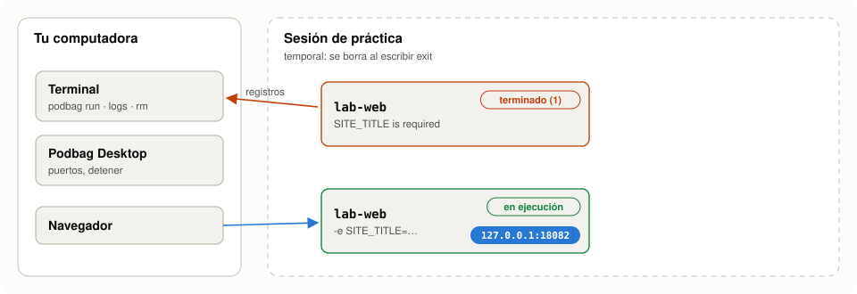

Un servidor web puede terminar en cuanto su script de inicio comprueba un ajuste obligatorio. En este módulo, encuentras el ajuste que falta en los registros del contenedor y compruebas la reparación en tu navegador.

**Tiempo** 10–15 minutos. Este módulo va después de [Sustituye y limpia un servicio web](../web-service-lifecycle/).



## Instala e inicia el módulo

Este módulo necesita una versión de Podbag Desktop y de la CLI compatible con `web-service-recovery`. Se añadió después de v0.3.2.

[Descargar web-service-recovery.podbag](web-service-recovery.podbag). En Desktop, abre **Training → Instalar módulo**, elige el archivo y confirma. También puedes instalarlo desde la carpeta de descargas.

```sh
podbag lab install web-service-recovery.podbag
```

Selecciona **Recupera un servidor web con los registros** en **Training**. Ejecuta el comando de inicio en la terminal que ya tienes abierta. Continúa en el prompt `training $`.

```sh
podbag lab start web-service-recovery
```


Para hacer los pasos en la TUI en lugar de Podbag Desktop, añade `--tui`.

```sh
podbag lab start web-service-recovery --tui
```

En la TUI, pulsa `:` para abrir la shell de Training cuando un paso pida un comando, escribe `exit` para volver a la TUI y pulsa `q` para terminar la sesión.

## Ejecuta el servidor e investiga el fallo

Copia el comando de Training. El servidor se inicia en segundo plano y busca la variable de entorno `SITE_TITLE`. Este comando no define el ajuste. Por eso el script de inicio termina con el código `1`.

```sh
podbag run -d --name lab-web --network none docker.io/library/busybox:1.37.0 sh -c 'if [ -z "$SITE_TITLE" ]; then echo "SITE_TITLE is required" >&2; exit 1; fi; mkdir -p /www && printf "%s\n" "$SITE_TITLE" > /www/index.html && exec httpd -f -p 8080 -h /www'
```

Abre **Contenedores de práctica → lab-web**. Busca `Exited (1)` en los detalles del contenedor. Training pasa al paso de los registros cuando abres este contenedor.

- **En Podbag Desktop:** Selecciona **Contenedores de práctica → lab-web**.
- **En la TUI:** Selecciona `lab-web` en **Contenedores** y pulsa `Enter`.


## Lee el registro de inicio

Vuelve a la misma terminal. El registro te dice qué ajuste necesita el proceso.

```sh
podbag logs lab-web
```

- **En Podbag Desktop:** Selecciona **Contenedores de práctica → lab-web → Registros**.
- **En la TUI:** Selecciona `lab-web` en **Contenedores** y pulsa `l`.


## Añade el ajuste que falta

Elimina el contenedor que falló para volver a usar su nombre. Luego ejecuta el comando que muestra Training. La opción `-e` define `SITE_TITLE` dentro del nuevo contenedor. Si el puerto predeterminado `18082` ya está en uso, usa el puerto que indica Training.

```sh
podbag rm lab-web
```

- **En Podbag Desktop:** Selecciona **Contenedores de práctica → lab-web → Eliminar** y confirma.
- **En la TUI:** Selecciona `lab-web` en **Contenedores**, pulsa `d` y luego `y`.

```sh
podbag run -d --name lab-web -p 127.0.0.1:18082:8080 -e 'SITE_TITLE=Recovered Podbag site' docker.io/library/busybox:1.37.0 sh -c 'if [ -z "$SITE_TITLE" ]; then echo "SITE_TITLE is required" >&2; exit 1; fi; mkdir -p /www && printf "%s\n" "$SITE_TITLE" > /www/index.html && exec httpd -f -p 8080 -h /www'
```

## Comprueba el servidor reparado

Ve a **Contenedores de práctica → lab-web → Ver puertos**. Selecciona **Abrir en el navegador**. La página muestra **Recovered Podbag site**. Podbag comprueba que hay una respuesta HTTP 200 y el título esperado.

- **En Podbag Desktop:** Selecciona **Contenedores de práctica → lab-web → Ver puertos**.
- **En la TUI:** Selecciona `lab-web` en **Contenedores** y pulsa `Enter`.
- **En Podbag Desktop:** Selecciona **Abrir en el navegador**.
- **En la TUI:** Abre `http://127.0.0.1:18082/` en un navegador. Cuando se vea la página, pulsa `o`.


## Limpia y termina

En Desktop, selecciona **Contenedores de práctica → lab-web → Detener**. Elimina el contenedor en la misma terminal y termina la sesión.

- **En Podbag Desktop:** Selecciona **Contenedores de práctica → lab-web → Detener**.
- **En la TUI:** Selecciona `lab-web` en **Contenedores** y pulsa `x`.
- **En Podbag Desktop:** Selecciona **Contenedores de práctica → lab-web → Eliminar** y confirma.
- **En la TUI:** Selecciona `lab-web` en **Contenedores**, pulsa `d` y luego `y`.

```sh
podbag rm lab-web
exit
```

Se eliminan los recursos temporales de la práctica. Training muestra el módulo como completado.


[Siguiente módulo de Training · Conecta dos contenedores por su nombre](../container-network/)
