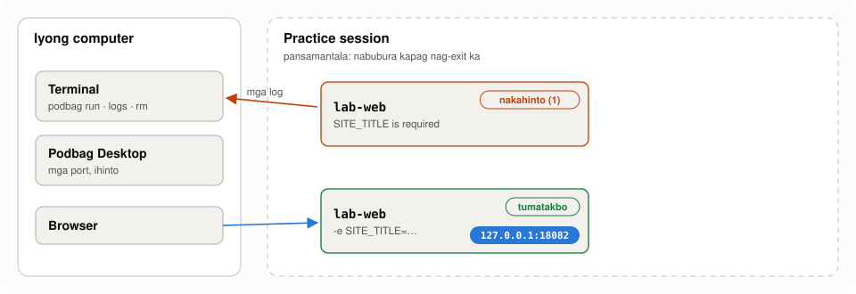

Maaaring lumabas agad ang web server kapag sinuri ng startup script nito ang kinakailangang setting. Sa module na ito, hahanapin mo ang nawawalang setting sa mga log ng container. Pagkatapos, titiyakin mo sa browser na naayos na ito.

**Oras** 10–15 minuto. Sumusunod ang module na ito sa [Palitan at linisin ang web service](../web-service-lifecycle/).



## I-install at simulan ang module

Kailangan ng module na ito ng build ng Podbag Desktop at ng CLI na sumusuporta sa `web-service-recovery`. Idinagdag ito pagkatapos ng v0.3.2.

[I-download ang web-service-recovery.podbag](web-service-recovery.podbag). Sa Desktop, buksan ang **Training → I-install ang module**, piliin ang file, at kumpirmahin. Maaari mo rin itong i-install mula sa folder ng download.

```sh
podbag lab install web-service-recovery.podbag
```

Piliin ang **Ayusin ang web server gamit ang mga log** sa ilalim ng **Training**. Patakbuhin ang command sa pagsisimula sa terminal na bukas na. Magpatuloy sa prompt na `training $`.

```sh
podbag lab start web-service-recovery
```


## Patakbuhin ang server at siyasatin ang pagkabigo

Kopyahin ang command mula sa Training. Nagsisimula ang server sa background at hinahanap nito ang environment variable na `SITE_TITLE`. Hindi itinatakda ng command na ito ang setting. Kaya lumalabas ang startup script na may code na `1`.

```sh
podbag run -d --name lab-web --network none docker.io/library/busybox:1.37.0 sh -c 'if [ -z "$SITE_TITLE" ]; then echo "SITE_TITLE is required" >&2; exit 1; fi; mkdir -p /www && printf "%s\n" "$SITE_TITLE" > /www/index.html && exec httpd -f -p 8080 -h /www'
```

Buksan ang **Mga practice container → lab-web**. Hanapin ang `Exited (1)` sa detalye ng container. Lilipat ang Training sa hakbang ng log kapag binuksan mo ang container na ito.


## Basahin ang startup log

Bumalik sa parehong terminal. Sinasabi ng log kung aling setting ang kailangan ng proseso.

```sh
podbag logs lab-web
```


## Ibigay ang nawawalang setting

Alisin ang nabigong container para magamit ulit ang pangalan nito. Pagkatapos, patakbuhin ang command na nasa Training. Itinatakda ng option na `-e` ang `SITE_TITLE` sa loob ng bagong container. Gamitin ang port na nasa Training kung gamit na ang default na `18082`.

```sh
podbag rm lab-web
```

```sh
podbag run -d --name lab-web -p 127.0.0.1:18082:8080 -e 'SITE_TITLE=Recovered Podbag site' docker.io/library/busybox:1.37.0 sh -c 'if [ -z "$SITE_TITLE" ]; then echo "SITE_TITLE is required" >&2; exit 1; fi; mkdir -p /www && printf "%s\n" "$SITE_TITLE" > /www/index.html && exec httpd -f -p 8080 -h /www'
```

## Tiyakin ang naayos na server

Pumunta sa **Mga practice container → lab-web → Tingnan ang mga port**. Piliin ang **Buksan sa browser**. Ipinapakita ng page ang **Recovered Podbag site**. Sinusuri ng Podbag kung may tugon na HTTP 200 at ang inaasahang title.


## Maglinis at tapusin

Sa Desktop, piliin ang **Mga practice container → lab-web → Ihinto**. Alisin ang container sa parehong terminal at tapusin ang session.

```sh
podbag rm lab-web
exit
```

Naaalis ang mga pansamantalang resource ng practice. Ipinapakita ng Training na tapos na ang module.


[Susunod na Training module · Ikonekta ang dalawang container gamit ang pangalan](../container-network/)
