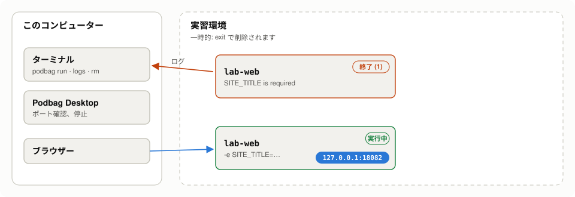

Web サーバーは、起動スクリプトが必須の設定を確認した時点で終了することがあります。このモジュールでは、コンテナのログで足りない設定を見つけます。修正の結果はブラウザーで確認します。

**所要時間** 10〜15 分。このモジュールは [Web サービスを入れ替えて片付ける](../web-service-lifecycle/)の続きです。



## モジュールをインストールして開始する

このモジュールには、`web-service-recovery` に対応した Podbag Desktop と CLI のビルドが必要です。このモジュールは v0.3.2 より後に追加されました。

[web-service-recovery.podbag をダウンロード](web-service-recovery.podbag)します。Desktop で **Training → モジュールをインストール**を開き、ファイルを指定して確認します。ダウンロード先のフォルダーからインストールすることもできます。

```sh
podbag lab install web-service-recovery.podbag
```

**Training** で**ログを使って Web サーバーを復旧する**を選びます。使っているターミナルで開始コマンドを実行します。`training $` プロンプトが表示されたら続けます。

```sh
podbag lab start web-service-recovery
```


Podbag Desktop の代わりに TUI で手順を進めるには、`--tui` を付けます。

```sh
podbag lab start web-service-recovery --tui
```

TUI では、コマンドの手順で `:` を押すと Training シェルが開きます。`exit` と入力すると TUI に戻ります。`q` を押すと実習を終了します。

## サーバーを実行して失敗を調べる

Training からコマンドをコピーします。サーバーはバックグラウンドで起動し、環境変数 `SITE_TITLE` を確認します。このコマンドではこの設定がないので、起動スクリプトはコード `1` で終了します。

```sh
podbag run -d --name lab-web --network none docker.io/library/busybox:1.37.0 sh -c 'if [ -z "$SITE_TITLE" ]; then echo "SITE_TITLE is required" >&2; exit 1; fi; mkdir -p /www && printf "%s\n" "$SITE_TITLE" > /www/index.html && exec httpd -f -p 8080 -h /www'
```

**実習コンテナ → lab-web** を開きます。コンテナの詳細で `Exited (1)` を探します。このコンテナを開くと、Training はログの手順に進みます。

- **Podbag Desktop で:** **実習コンテナ → lab-web**を選びます。
- **TUI で:** **コンテナ**で `lab-web` を選び、`Enter` を押します。


## 起動ログを読む

同じターミナルに戻ります。プロセスに必要な設定がログでわかります。

```sh
podbag logs lab-web
```

- **Podbag Desktop で:** **実習コンテナ → lab-web → ログ**を選びます。
- **TUI で:** **コンテナ**で `lab-web` を選び、`l` を押します。


## 足りない設定を渡す

同じ名前をもう一度使うため、失敗したコンテナを削除します。次に、Training に表示されるコマンドを実行します。`-e` オプションは、新しいコンテナの中に `SITE_TITLE` を設定します。既定の `18082` がすでに使われている場合は、Training に表示されるポートを使います。

```sh
podbag rm lab-web
```

- **Podbag Desktop で:** **実習コンテナ → lab-web → 削除**を選び、確認します。
- **TUI で:** **コンテナ**で `lab-web` を選び、`d` を押してから `y` を押します。

```sh
podbag run -d --name lab-web -p 127.0.0.1:18082:8080 -e 'SITE_TITLE=Recovered Podbag site' docker.io/library/busybox:1.37.0 sh -c 'if [ -z "$SITE_TITLE" ]; then echo "SITE_TITLE is required" >&2; exit 1; fi; mkdir -p /www && printf "%s\n" "$SITE_TITLE" > /www/index.html && exec httpd -f -p 8080 -h /www'
```

## 修正したサーバーを確認する

**実習コンテナ → lab-web → ポートを表示**に移動します。**ブラウザーで開く**を選びます。ページに **Recovered Podbag site** と表示されます。Podbag は、HTTP 200 の応答と期待どおりのタイトルを確認します。

- **Podbag Desktop で:** **実習コンテナ → lab-web → ポートを表示**を選びます。
- **TUI で:** **コンテナ**で `lab-web` を選び、`Enter` を押します。
- **Podbag Desktop で:** **ブラウザーで開く**を選びます。
- **TUI で:** ブラウザーで `http://127.0.0.1:18082/` を開きます。ページが表示されたら `o` を押します。


## 片付けて終了する

Desktop で**実習コンテナ → lab-web → 停止**を選びます。同じターミナルでコンテナを削除し、実習を終了します。

- **Podbag Desktop で:** **実習コンテナ → lab-web → 停止**を選びます。
- **TUI で:** **コンテナ**で `lab-web` を選び、`x` を押します。
- **Podbag Desktop で:** **実習コンテナ → lab-web → 削除**を選び、確認します。
- **TUI で:** **コンテナ**で `lab-web` を選び、`d` を押してから `y` を押します。

```sh
podbag rm lab-web
exit
```

一時的な実習用のリソースが削除されます。Training にモジュールの完了が表示されます。


[次の Training モジュール · 2 つのコンテナを名前でつなぐ](../container-network/)
