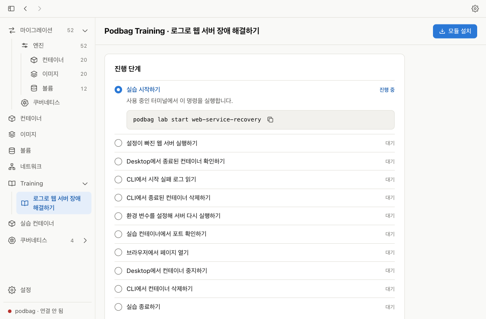
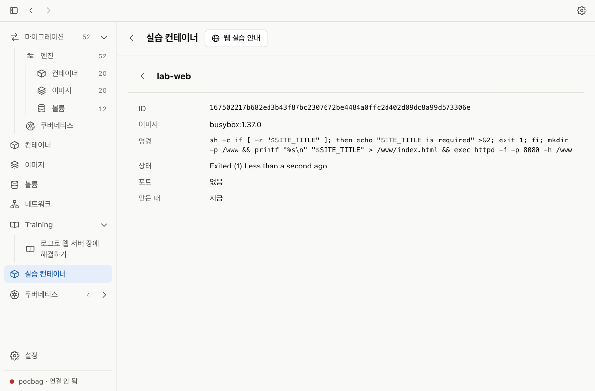
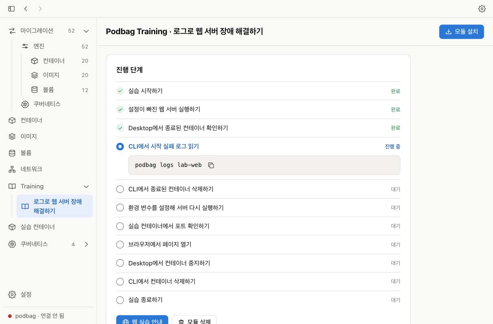
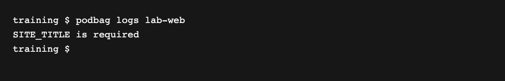
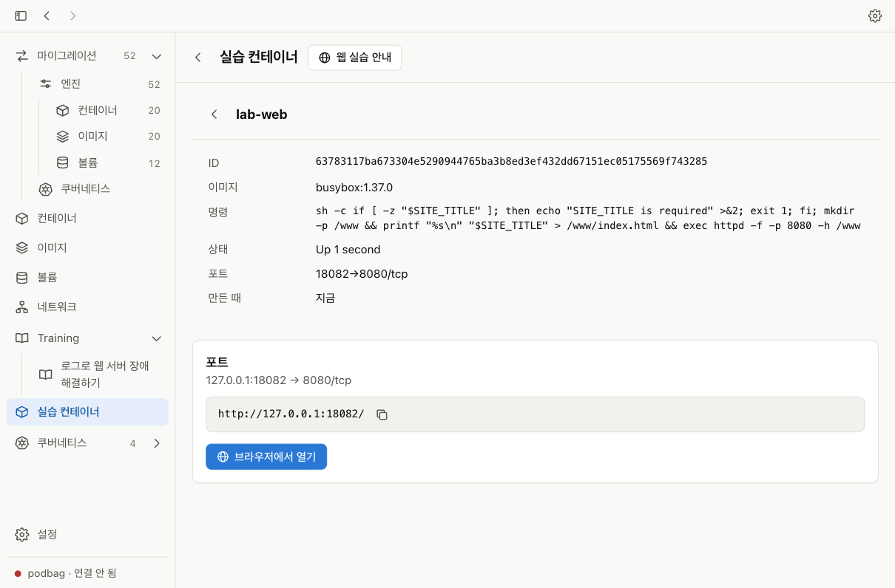
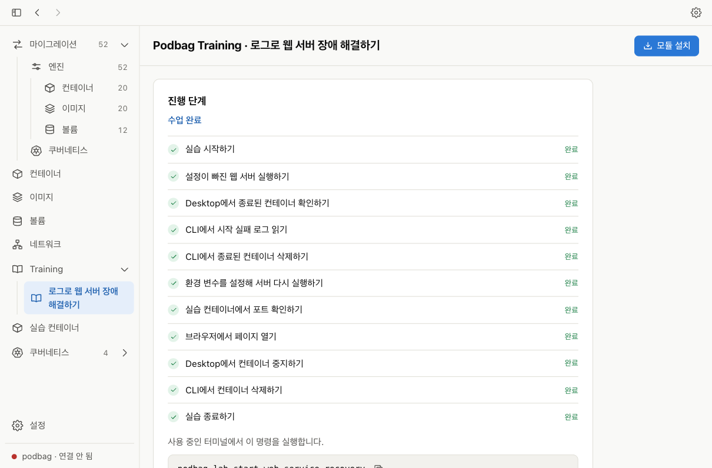

웹 서버는 필수 설정을 확인하는 도중에 종료될 수 있습니다. 이번 트레이닝에서는 로그로 빠진 설정을 찾습니다. 설정을 추가한 뒤 브라우저에서 복구를 확인합니다.

**예상 시간** 10~15분. [웹 서비스 교체하고 정리하기](/ko/blog/web-service-lifecycle/)를 마친 뒤 진행합니다.

## 모듈 설치 및 실습 시작

`web-service-recovery`를 지원하는 Podbag Desktop과 CLI가 필요합니다. 이 모듈은 v0.3.0 이후에 추가됐습니다.

[web-service-recovery.podbag 다운로드](web-service-recovery.podbag). Desktop에서 **Training → 모듈 설치**를 누릅니다. 내려받은 파일을 선택한 뒤 확인합니다. 다운로드 폴더에서 다음 명령으로 설치할 수도 있습니다.

```sh
podbag lab install web-service-recovery.podbag
```

**Training**에서 **로그로 웹 서버 장애 해결하기**를 선택합니다. 사용 중인 터미널에서 시작 명령을 실행합니다. `training $` 프롬프트가 나오면 다음 단계로 진행합니다.

```sh
podbag lab start web-service-recovery
```



## 설정 없이 실행하고 종료 상태 확인

Training에서 명령을 복사합니다. 서버가 백그라운드에서 시작해 `SITE_TITLE` 환경 변수를 확인합니다. 이 명령에는 해당 설정이 빠져 있어 시작 스크립트가 종료 코드 `1`을 반환합니다.

```sh
podbag run -d --name lab-web --network none docker.io/library/busybox:1.37.0 sh -c 'if [ -z "$SITE_TITLE" ]; then echo "SITE_TITLE is required" >&2; exit 1; fi; mkdir -p /www && printf "%s\n" "$SITE_TITLE" > /www/index.html && exec httpd -f -p 8080 -h /www'
```

Desktop에서 **실습 컨테이너 → lab-web**을 엽니다. 상세 화면에서 `Exited (1)`을 확인합니다. 컨테이너 상세를 열면 Training에서 로그 읽기 단계가 진행 중으로 표시됩니다.



## 시작 실패 로그 읽기

같은 터미널로 돌아가 로그를 읽습니다. `SITE_TITLE is required`는 서버에 필요한 설정이 무엇인지 알려 줍니다.

```sh
podbag logs lab-web
```





## 환경 변수를 추가해 서버 다시 실행

종료된 컨테이너를 삭제해 같은 이름을 다시 사용합니다. Training의 다음 명령으로 서버를 실행합니다. `-e`는 새 컨테이너 안에 `SITE_TITLE`을 설정합니다. 기본 포트 `18082`가 사용 중이면 Training에 표시된 포트로 실행합니다.

```sh
podbag rm lab-web
```

```sh
podbag run -d --name lab-web -p 127.0.0.1:18082:8080 -e 'SITE_TITLE=Recovered Podbag site' docker.io/library/busybox:1.37.0 sh -c 'if [ -z "$SITE_TITLE" ]; then echo "SITE_TITLE is required" >&2; exit 1; fi; mkdir -p /www && printf "%s\n" "$SITE_TITLE" > /www/index.html && exec httpd -f -p 8080 -h /www'
```

## 브라우저에서 복구 확인

**실습 컨테이너 → lab-web → 포트 보기**로 이동합니다. **브라우저에서 열기**를 누르면 **Recovered Podbag site**가 표시됩니다. Podbag은 HTTP 200과 설정한 제목을 확인합니다.




## 실습 리소스 정리

Desktop에서 **실습 컨테이너 → lab-web → 중지**를 누릅니다. 같은 터미널에서 컨테이너를 삭제하고 실습을 종료합니다.

```sh
podbag rm lab-web
exit
```

임시 실습 환경이 정리되면 Training에서 **수업 완료**를 확인합니다.


