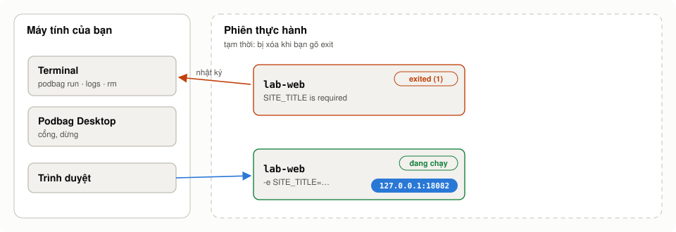
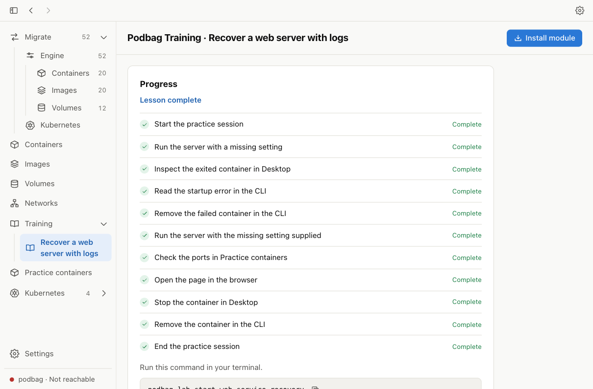

Máy chủ web có thể thoát ngay khi script khởi động kiểm tra một cài đặt bắt buộc. Trong mô-đun này, bạn tìm cài đặt bị thiếu trong nhật ký của container và kiểm tra bản sửa trong trình duyệt.

**Thời gian** 10–15 phút. Mô-đun này nối tiếp [Thay thế và dọn dẹp dịch vụ web](../web-service-lifecycle/).



## Cài và bắt đầu mô-đun

Mô-đun này cần bản Podbag Desktop và CLI có hỗ trợ `web-service-recovery`. Mô-đun được thêm sau v0.3.2.

[Tải web-service-recovery.podbag](web-service-recovery.podbag). Trong Desktop, mở **Training → Cài mô-đun**, chọn tệp và xác nhận. Bạn cũng có thể cài từ thư mục tải xuống.

```sh
podbag lab install web-service-recovery.podbag
```

Chọn **Khôi phục máy chủ web bằng nhật ký** trong **Training**. Chạy lệnh bắt đầu trong terminal bạn đang dùng. Tiếp tục tại dấu nhắc `training $`.

```sh
podbag lab start web-service-recovery
```


## Chạy máy chủ và xem lỗi

Sao chép lệnh từ Training. Máy chủ chạy ở chế độ nền và kiểm tra biến môi trường `SITE_TITLE`. Lệnh này không đặt biến đó. Vì vậy, script khởi động thoát với mã `1`.

```sh
podbag run -d --name lab-web --network none docker.io/library/busybox:1.37.0 sh -c 'if [ -z "$SITE_TITLE" ]; then echo "SITE_TITLE is required" >&2; exit 1; fi; mkdir -p /www && printf "%s\n" "$SITE_TITLE" > /www/index.html && exec httpd -f -p 8080 -h /www'
```

Mở **Container thực hành → lab-web**. Tìm `Exited (1)` trong chi tiết container. Khi bạn mở container này, Training chuyển sang bước đọc nhật ký.


## Đọc nhật ký khởi động

Quay lại cùng terminal. Nhật ký cho biết tiến trình cần cài đặt nào.

```sh
podbag logs lab-web
```


## Thêm cài đặt bị thiếu

Xóa container bị lỗi để dùng lại tên của nó. Sau đó chạy lệnh hiển thị trong Training. Tùy chọn `-e` đặt `SITE_TITLE` bên trong container mới. Nếu cổng mặc định `18082` đang được dùng, hãy dùng cổng hiển thị trong Training.

```sh
podbag rm lab-web
```

```sh
podbag run -d --name lab-web -p 127.0.0.1:18082:8080 -e 'SITE_TITLE=Recovered Podbag site' docker.io/library/busybox:1.37.0 sh -c 'if [ -z "$SITE_TITLE" ]; then echo "SITE_TITLE is required" >&2; exit 1; fi; mkdir -p /www && printf "%s\n" "$SITE_TITLE" > /www/index.html && exec httpd -f -p 8080 -h /www'
```

## Kiểm tra máy chủ đã sửa

Đi tới **Container thực hành → lab-web → Xem cổng**. Chọn **Mở trong trình duyệt**. Trang hiển thị **Recovered Podbag site**. Podbag kiểm tra phản hồi HTTP 200 và tiêu đề mong đợi.


## Dọn dẹp và kết thúc

Trong Desktop, chọn **Container thực hành → lab-web → Dừng**. Xóa container trong cùng terminal và kết thúc phiên.

```sh
podbag rm lab-web
exit
```

Các tài nguyên thực hành tạm thời đã được xóa. Training hiển thị mô-đun đã hoàn thành.



[Mô-đun Training tiếp theo · Kết nối hai container bằng tên](../container-network/)
