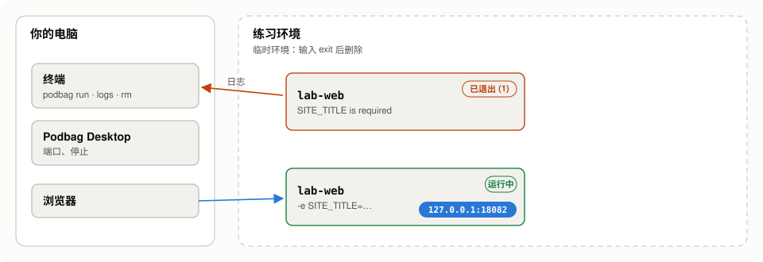
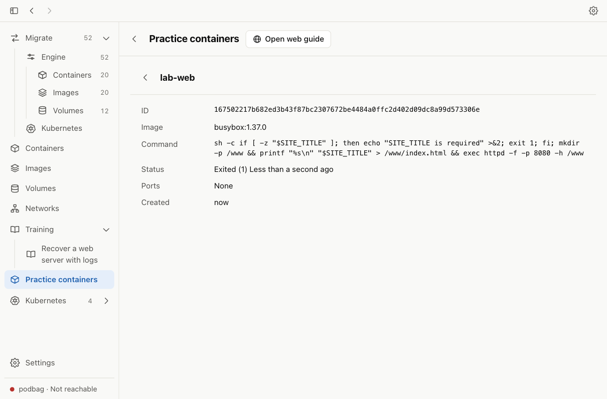
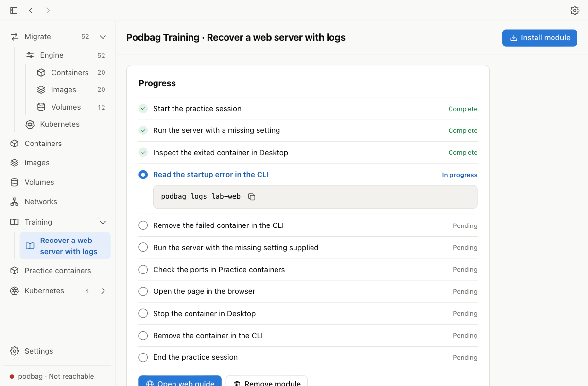

Web 服务器的启动脚本会检查必需的设置，缺少设置时会立即退出。在本模块中，你将在容器日志中找到缺少的设置，并在浏览器中确认修复结果。

**预计用时** 10–15 分钟。请在完成[替换并清理 Web 服务](../web-service-lifecycle/)后学习本模块。



## 安装并开始模块

本模块需要支持 `web-service-recovery` 的 Podbag Desktop 和 CLI 版本。该模块在 v0.3.2 之后加入。

[下载 web-service-recovery.podbag](web-service-recovery.podbag)。在 Desktop 中打开 **Training → 安装模块**，选择文件并确认。也可以在下载目录中运行以下命令安装。

```sh
podbag lab install web-service-recovery.podbag
```

在 **Training** 下选择**用日志恢复 Web 服务器**。在你当前的终端中运行启动命令。出现 `training $` 提示符后继续。

```sh
podbag lab start web-service-recovery
```


要在 TUI 而不是 Podbag Desktop 中完成这些步骤，请加上 `--tui`。

```sh
podbag lab start web-service-recovery --tui
```

在 TUI 中，按 `:` 打开 Training 终端来执行命令步骤，输入 `exit` 返回 TUI，按 `q` 结束实验。

## 运行服务器并查看故障

从 Training 复制命令。服务器在后台启动，并检查环境变量 `SITE_TITLE`。这条命令没有设置该变量，所以启动脚本以退出码 `1` 退出。

```sh
podbag run -d --name lab-web --network none docker.io/library/busybox:1.37.0 sh -c 'if [ -z "$SITE_TITLE" ]; then echo "SITE_TITLE is required" >&2; exit 1; fi; mkdir -p /www && printf "%s\n" "$SITE_TITLE" > /www/index.html && exec httpd -f -p 8080 -h /www'
```

打开**实验容器 → lab-web**。在容器详情中找到 `Exited (1)`。打开这个容器后，Training 会进入查看日志的步骤。

- **在 Podbag Desktop 中：** 选择**实验容器 → lab-web**。
- **在 TUI 中：** 在**容器**中选择 `lab-web`，然后按 `Enter`。



## 读取启动日志

回到同一个终端。日志会告诉你进程需要哪个设置。

```sh
podbag logs lab-web
```

- **在 Podbag Desktop 中：** 选择**实验容器 → lab-web → 日志**。
- **在 TUI 中：** 在**容器**中选择 `lab-web`，然后按 `l`。




## 补上缺少的设置

删除失败的容器，以便重新使用它的名称。然后运行 Training 中显示的命令。`-e` 选项在新容器中设置 `SITE_TITLE`。如果默认端口 `18082` 已被占用，请使用 Training 中显示的端口。

```sh
podbag rm lab-web
```

- **在 Podbag Desktop 中：** 选择**实验容器 → lab-web → 删除**并确认。
- **在 TUI 中：** 在**容器**中选择 `lab-web`，按 `d`，再按 `y`。

```sh
podbag run -d --name lab-web -p 127.0.0.1:18082:8080 -e 'SITE_TITLE=Recovered Podbag site' docker.io/library/busybox:1.37.0 sh -c 'if [ -z "$SITE_TITLE" ]; then echo "SITE_TITLE is required" >&2; exit 1; fi; mkdir -p /www && printf "%s\n" "$SITE_TITLE" > /www/index.html && exec httpd -f -p 8080 -h /www'
```

## 验证修复后的服务器

前往**实验容器 → lab-web → 查看端口**。点击**在浏览器中打开**。页面显示 **Recovered Podbag site**。Podbag 会检查 HTTP 200 响应和预期的标题。

- **在 Podbag Desktop 中：** 选择**实验容器 → lab-web → 查看端口**。
- **在 TUI 中：** 在**容器**中选择 `lab-web`，然后按 `Enter`。
- **在 Podbag Desktop 中：** 选择**在浏览器中打开**。
- **在 TUI 中：** 在浏览器中打开 `http://127.0.0.1:18082/`。页面显示后按 `o`。


## 清理并结束

在 Desktop 中选择**实验容器 → lab-web → 停止**。在同一个终端中删除容器，然后结束实验。

- **在 Podbag Desktop 中：** 选择**实验容器 → lab-web → 停止**。
- **在 TUI 中：** 在**容器**中选择 `lab-web`，然后按 `x`。
- **在 Podbag Desktop 中：** 选择**实验容器 → lab-web → 删除**并确认。
- **在 TUI 中：** 在**容器**中选择 `lab-web`，按 `d`，再按 `y`。

```sh
podbag rm lab-web
exit
```

临时实验资源会被删除。Training 会显示该模块已完成。


[下一个 Training 模块 · 通过名称连接两个容器](../container-network/)
